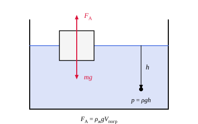
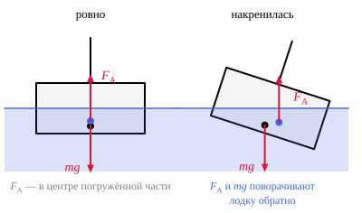

Брось в воду железный гвоздь — он сразу пойдёт ко дну. А огромный корабль из железа плавает и везёт тысячи тонн груза. Кусок льда плавает, но почти весь под водой. Сырое яйцо в пресной воде тонет, а в очень солёной — всплывает. В этом уроке поймём, от чего это зависит.

## Тонет или всплывает

На тело в жидкости действуют две силы: сила тяжести $mg$ вниз и архимедова сила $F_{\text{А}}$ вверх (урок 9.5). Куда тело пойдёт, решает их сравнение — как в уроке 5.2: тело движется в сторону большей силы.

Погрузим тело целиком. Его масса $m = \rho_{\text{т}} V$, поэтому

$$
mg = \rho_{\text{т}} g V, \qquad F_{\text{А}} = \rho_{\text{ж}} g V.
$$

Объём и $g$ в обеих формулах одинаковые. Всё решают плотности.

- $\rho_{\text{т}} > \rho_{\text{ж}}$ — сила тяжести больше, тело **тонет**. Гвоздь, камень, монета.
- $\rho_{\text{т}} = \rho_{\text{ж}}$ — силы равны, тело **висит** в жидкости на любой глубине. Так держится рыба.
- $\rho_{\text{т}} < \rho_{\text{ж}}$ — архимедова сила больше, тело **всплывает**. Дерево, лёд, пенопласт.

Поэтому яйцо всплывает в солёной воде: соль увеличивает плотность воды, и она становится больше плотности яйца.

Проверь себя: утонет ли кусок парафина плотностью 900 кг/м³ в воде? А в керосине плотностью 800 кг/м³?

В воде всплывёт: $900 < 1000$. В керосине утонет: $900 > 800$.

## Сколько тела под водой

Всплывающее тело поднимается к поверхности и выходит из воды. Чем больше тела над водой, тем меньше погружённый объём — и тем меньше архимедова сила. Тело остановится, когда она уменьшится ровно до силы тяжести.

**Плавающее тело:** $F_{\text{А}} = mg$. Это первый закон Ньютона (урок 5.3): тело покоится, силы уравновешены. Подставим:

$$
\rho_{\text{ж}} g V_{\text{погр}} = \rho_{\text{т}} g V
\quad\Rightarrow\quad
\frac{V_{\text{погр}}}{V} = \frac{\rho_{\text{т}}}{\rho_{\text{ж}}}.
$$

Доля объёма под водой равна отношению плотностей.

**Пример.** Лёд плотностью $900\ \text{кг/м}^3$ в воде погружён на $900/1000 = 0{,}9$, то есть на $90\,\%$. Над водой только $10\,\%$. Поэтому опасны айсберги: «верхушка айсберга» — малая часть, остальное скрыто под водой.

**Пример.** Брусок плавает в воде, погрузившись на $60\,\%$ своего объёма. Значит, $\rho_{\text{т}}/\rho_{\text{в}} = 0{,}6$, и плотность бруска $0{,}6 \cdot 1000 = 600\ \text{кг/м}^3$.

<pp-task id="ks-hydro-07"></pp-task>

## В разных жидкостях

Пока тело плавает, $F_{\text{А}} = mg$ — **в любой жидкости**. Меняется только глубина погружения. В более плотной жидкости тело погружается меньше: чтобы получить ту же силу, нужно вытеснить меньший объём.

Так устроен **ареометр** — прибор для измерения плотности жидкости. Это стеклянная трубка с грузиком внизу. Она плавает стоймя, и по тому, насколько она погрузилась, читают плотность.

Проверь себя: корабль из реки вышел в море. Солёная морская вода плотнее речной. Корабль поднимется или опустится? Изменится ли архимедова сила?

Архимедова сила не изменится: она равна силе тяжести корабля, а масса корабля та же. Но в более плотной воде для этой силы нужен меньший погружённый объём, поэтому корабль немного поднимется.

## Почему плавает железный корабль

Плотность железа почти $8000\ \text{кг/м}^3$, в $8$ раз больше, чем у воды. Но корабль — не сплошной кусок железа. Внутри него много воздуха. Важна **средняя** плотность: масса корабля, делённая на весь его объём вместе с воздухом внутри. Она меньше плотности воды, и корабль плавает.

Чем больше груза положили, тем больше масса — и тем глубже корабль сидит в воде. Наибольший груз — когда корабль погрузился до опасной черты. Если пробить борт, внутрь хлынет вода, средняя плотность вырастет, и корабль утонет.

Подводная лодка управляет своей средней плотностью. Набирает воду в баки — становится тяжелее и погружается. Продувает баки сжатым воздухом — становится легче и всплывает.

Если тело плавает на чём-то ещё, например груз лежит на плоту, считай силу тяжести всего вместе: $F_{\text{А}} = (M + m) g$.

<pp-task id="ks-hydro-13"></pp-task>

## Почему лодка не переворачивается

Архимедова сила приложена не к центру тяжести лодки, а к центру погружённой части — туда, где был центр тяжести вытесненной воды. Центр тяжести лодки (урок 8.4) делают низким: тяжёлый киль, груз на дне.

Когда лодка ровная, $F_{\text{А}}$ и $mg$ действуют по одной вертикали и не поворачивают её. Когда лодка накренилась, погружённая часть смещается в сторону крена, и архимедова сила вместе с ней. Теперь $F_{\text{А}}$ и $mg$ не на одной вертикали — их моменты (урок 8.2) поворачивают лодку обратно. Это устойчивое равновесие из урока 8.7. Поэтому в лодке нельзя вставать во весь рост: центр тяжести поднимается, и при крене лодка может перевернуться.

## Частые ловушки

- **«В более плотной жидкости на плавающее тело действует бо́льшая сила».** Пока тело плавает, $F_{\text{А}} = mg$ в любой жидкости. Меняется глубина погружения.
- **Нашли погружённую часть, а спрашивали надводную.** Над водой — $1 - V_{\text{погр}}/V$.
- **Перепутали отношение.** Под водой доля $\rho_{\text{т}}/\rho_{\text{ж}}$ — она меньше единицы для плавающего тела.
- **Плотность материала вместо средней плотности.** Для корабля, бутылки, мяча важна средняя плотность.
- **Забыли груз.** Если на теле что-то лежит, архимедова сила держит и его.

## Коротко

- $\rho_{\text{т}} > \rho_{\text{ж}}$ — тонет; $\rho_{\text{т}} = \rho_{\text{ж}}$ — висит; $\rho_{\text{т}} < \rho_{\text{ж}}$ — всплывает.
- Плавающее тело: $F_{\text{А}} = mg$, доля под водой $V_{\text{погр}}/V = \rho_{\text{т}}/\rho_{\text{ж}}$.
- В более плотной жидкости плавающее тело погружается меньше, а сила та же.
- Корабль плавает, потому что его средняя плотность меньше плотности воды.

Дальше — урок 9.7: тело висит на нити, лежит на дне, сосуд стоит на весах. Что покажут приборы?
