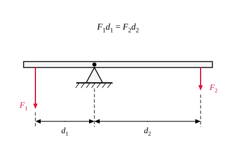

Почему дверную ручку ставят у края двери, а не у петель? Почему длинным гаечным ключом проще открутить гайку? Ответ — момент силы. Тема нужна в задаче 4, в задаче 5 и в задаче 26, где часто просят обосновать применимость условий равновесия.

Рычаг, момент и блоки проходят в 7 классе — с них и начнём. Потом дойдём до того, что нужно на ЕГЭ: плечо силы под углом и два условия равновесия твёрдого тела. Пригодятся силы из темы «Силы в механике» и первый закон Ньютона.

## Шаг 1. Рычаг и правило рычага (7 класс)

Качели-балансир во дворе, ножницы, гвоздодёр — всё это **рычаги**. Рычаг — твёрдое тело, которое может поворачиваться вокруг неподвижной оси (точки опоры).

Попробуй открыть дверь, толкая её у самых петель. Тяжело. Толкни у ручки — легко. Сила та же, а результат разный. Значит, важна не только сила, но и то, **где** она приложена.

**Плечо силы** $d$ — расстояние от оси вращения до линии, вдоль которой действует сила. Пока сила перпендикулярна рычагу, плечо — это просто расстояние от опоры до точки, где приложена сила.

Рычаг в равновесии, если силы обратно пропорциональны своим плечам. Это **правило рычага**:

$$
F_1 d_1 = F_2 d_2.
$$

Длинным плечом маленькая сила уравновешивает большую. Поэтому гвоздодёр длинный, а ручка у двери — на краю.

<pp-task id="ks-moments-01"></pp-task>

## Шаг 2. Момент силы (7 класс)

Произведение силы на её плечо называют **моментом силы**:

$$
M = F d.
$$

- $F$ — модуль силы, Н;
- $d$ — плечо, м;
- $M$ — момент силы, $\text{Н} \cdot \text{м}$.

Момент показывает, насколько сильно сила поворачивает тело. Если сила направлена прямо на ось (или от неё), плечо равно нулю и сила тело не поворачивает. Попробуй открыть дверь, толкая её в сторону петель, — не выйдет.

Правило рычага на языке моментов: момент, который крутит рычаг по часовой стрелке, равен моменту, который крутит против часовой: $M_1 = M_2$.

<pp-task id="ks-moments-02"></pp-task>

## Шаг 3. Правило моментов для нескольких сил (7 класс)

Сил может быть больше двух: на качели сели трое, на линейку повесили несколько грузиков. Тогда тело не поворачивается, если

$$
\text{сумма моментов «по часовой»} = \text{сумма моментов «против часовой»}.
$$

Удобнее считать моменты со знаком: против часовой — плюс, по часовой — минус (или наоборот, главное — одинаково для всех сил). Тогда условие короче: $\sum M_i = 0$.

Для каждой силы задай себе вопрос: «Если бы действовала только она, куда повернулось бы тело?» Так знак не перепутаешь.

<pp-task id="ks-moments-03"></pp-task>

## Шаг 4. Блоки и «золотое правило» механики (7 класс)

**Блок** — колесо с жёлобом для верёвки. Это тоже рычаг.

- **Неподвижный блок** (ось закреплена) — рычаг с равными плечами. Выигрыша в силе нет, но он меняет направление: тянешь вниз — груз едет вверх.
- **Подвижный блок** (поднимается вместе с грузом) — груз висит на двух концах верёвки. Если весом блока и трением можно пренебречь, тянуть нужно с силой вдвое меньше веса груза: $F = P/2$.

Но бесплатно ничего не бывает. Чтобы поднять груз подвижным блоком на $1\ \text{м}$, конец верёвки придётся вытянуть на $2\ \text{м}$. Это **«золотое правило» механики**: во сколько раз выигрываешь в силе, во столько раз проигрываешь в расстоянии. К нему мы вернёмся в теме «Работа и мощность».

<pp-task id="ks-moments-04"></pp-task>

## Шаг 5. Центр тяжести (7 класс)

До сих пор рычаг был невесомым. Но у настоящей доски или лома есть масса. Сила тяжести действует на каждый кусочек тела, а при расчёте моментов её можно считать приложенной в одной точке — **центре тяжести**.

- У однородного стержня или доски центр тяжести посередине.
- У однородного диска, шара, кольца — в центре.

Значит, в правиле моментов сила тяжести стержня $mg$ приложена в его середине, и её плечо считают от оси до середины.

<pp-task id="ks-moments-05"></pp-task>

## Шаг 6. Плечо силы под углом (10 класс)

В 7 классе сила почти всегда перпендикулярна рычагу. На ЕГЭ — нет. Вспомним определение: плечо — расстояние от оси до **линии действия** силы (прямой, вдоль которой она направлена), а не до точки приложения.

Пусть сила $F$ приложена на расстоянии $l$ от оси и направлена под углом $\alpha$ к рычагу. Опусти перпендикуляр из оси на линию действия силы. Из прямоугольного треугольника:

$$
d = l \sin\alpha, \qquad M = F l \sin\alpha.
$$

Проверь крайние случаи. При $\alpha = 90^\circ$ получается $d = l$ — как в 7 классе. При $\alpha = 0$ сила направлена вдоль рычага, $d = 0$ — тело не поворачивается.

<pp-task id="ks-moments-06"></pp-task>

## Шаг 7. Условия равновесия твёрдого тела (10 класс)

Рычаг закреплён на оси, поэтому он может только поворачиваться. Свободная доска на двух опорах может ещё и сдвинуться. Тело покоится, если выполнены **оба** условия:

1. Сумма сил равна нулю — тело не начинает двигаться поступательно (это первый закон Ньютона):

$$
\sum \vec F_i = 0.
$$

2. Сумма моментов относительно **любой** оси равна нулю — тело не начинает вращаться:

$$
\sum M_i = 0.
$$

Хитрость: ось для моментов можно выбрать где угодно. Выбирай её в точке, где приложена неизвестная сила, которую не нужно находить. Её момент станет нулём, и уравнение упростится. А из суммы сил потом найдётся вторая сила.

<pp-task id="ks-moments-07"></pp-task>

## Шаг 8. Устойчивость равновесия (10 класс)

Равновесие бывает разным. Отклони тело чуть-чуть и посмотри, что будет.

- **Устойчивое** — тело возвращается назад. Шарик на дне ямки, груз на нитке. Центр тяжести при отклонении поднимается.
- **Неустойчивое** — тело уходит ещё дальше. Шарик на вершине горки, карандаш на острие. Центр тяжести опускается.
- **Безразличное** — тело остаётся там, куда его сдвинули. Шар на ровном столе, колесо на оси через центр.

Тело на опоре стоит, пока вертикаль через центр тяжести проходит через площадь опоры. Поэтому стакан с низким тяжёлым дном трудно опрокинуть, а высокий шкаф лучше крепить к стене.

## Частые ловушки

- **Плечо — расстояние до точки приложения.** Нет, до линии действия силы. Если сила под углом $\alpha$ к стержню, плечо $d = l\sin\alpha$.
- **Забывают силу тяжести самого стержня.** Если масса рычага дана, она приложена в его середине.
- **Пишут только моменты и забывают про сумму сил** — а из неё часто находится сила реакции опоры.
- **Путают знаки моментов.** Определи для каждой силы, куда она крутит тело.

## Как это выглядит на ЕГЭ

*Однородная доска длиной $4\ \text{м}$ и массой $10\ \text{кг}$ лежит на двух опорах — под левым концом и под правым. На доске на расстоянии $1\ \text{м}$ от левого конца стоит ведро массой $20\ \text{кг}$. С какой силой доска давит на правую опору? $g = 10\ \text{м/с}^2$.*

Возьмём ось вращения на левой опоре — тогда её неизвестная сила реакции не войдёт в уравнение.

Силы, которые крутят доску вокруг левой опоры:

- вес ведра $200\ \text{Н}$ на плече $1\ \text{м}$ — по часовой;
- сила тяжести доски $100\ \text{Н}$ на плече $2\ \text{м}$ (середина) — по часовой;
- реакция правой опоры $N_2$ на плече $4\ \text{м}$ — против часовой.

$$
N_2 \cdot 4 = 200 \cdot 1 + 100 \cdot 2,
$$

$$
N_2 = 100\ \text{Н}.
$$

По третьему закону Ньютона доска давит на опору с той же силой, $100\ \text{Н}$. Левая опора держит остальное: $300 - 100 = 200\ \text{Н}$.

## Коротко

- Плечо — расстояние от оси до линии действия силы; под углом $d = l\sin\alpha$.
- $M = Fd$; правило рычага $F_1 d_1 = F_2 d_2$.
- Подвижный блок даёт выигрыш в силе вдвое, неподвижный — только меняет направление.
- Равновесие: $\sum \vec F = 0$ и $\sum M = 0$.
- Ось выбирай там, где неизвестная сила, которую не просят.
- Сила тяжести однородного стержня — в его середине.
- Тело устойчиво, если при отклонении его центр тяжести поднимается.
