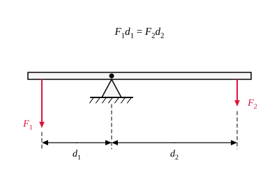

Папа и маленькая дочка садятся на качели-балансир. Если сесть на одинаковом расстоянии от оси, папа перевесит. Но если дочка сядет на самый край, а папа подвинется поближе к оси, качели можно уравновесить. Тяжёлый и лёгкий — в равновесии! В этом уроке найдём правило, по которому это получается.

## Что такое рычаг

**Рычаг** — твёрдое тело, которое может поворачиваться вокруг неподвижной оси, или **точки опоры**. Качели, ножницы, гвоздодёр, лом, весло, тачка — всё это рычаги.

Пока на рычаг действует одна сила, он поворачивается. Чтобы он остался в покое, нужна вторая сила, которая крутит его в другую сторону.

Расстояние от опоры до точки, где приложена сила, называют **плечом силы** $d$. Это пока, в 7 классе, — когда сила перпендикулярна рычагу. Точное определение плеча будет в уроке 8.5.

## Правило рычага

Опыты показывают: рычаг в равновесии, если

$$
F_1 d_1 = F_2 d_2.
$$

Можно записать по-другому: $\dfrac{F_1}{F_2} = \dfrac{d_2}{d_1}$. Силы **обратно пропорциональны** плечам. Во сколько раз плечо длиннее, во столько раз сила может быть меньше.

Так и с качелями. Папа массой $80\ \text{кг}$ сидит в $1\ \text{м}$ от оси, дочка массой $20\ \text{кг}$ вчетверо легче. Чтобы уравновесить папу, ей нужно плечо вчетверо длиннее — $4\ \text{м}$. Проверим: $800 \cdot 1 = 200 \cdot 4$.

Проверь себя: на коротком плече рычага, 0,1 м, висит груз. Чтобы удержать рычаг, на длинное плечо, 0,4 м, давят с силой 30 Н. Какой вес у груза?

$120\ \text{Н}$. Плечо груза вчетверо короче, значит, его вес вчетверо больше: $30 \cdot 0{,}4 = P \cdot 0{,}1$, $P = 120\ \text{Н}$.

<pp-task id="ks-moments-01"></pp-task>

## Выигрыш в силе

Рычаг позволяет маленькой силой уравновесить большую. Так работает гвоздодёр.

**Пример.** Рука давит на ручку гвоздодёра в $1\ \text{м}$ от точки опоры с силой $100\ \text{Н}$. Гвоздь сидит в $5\ \text{см}$ от опоры, плечо в $20$ раз короче. Значит, на гвоздь действует сила в $20$ раз больше:

$$
F_2 = \frac{F_1 d_1}{d_2} = \frac{100 \cdot 1}{0{,}05} = 2000\ \text{Н}.
$$

Руками гвоздь не вытащить, а гвоздодёром — легко. Поэтому дверную ручку ставят у края двери, а ножницами режут толстый картон у самой оси, а не кончиками.

<pp-task id="ks-moments-08"></pp-task>

## Частые ловушки

- **Перепутали плечи.** Большая сила — на коротком плече, а не на длинном. Проверь: тяжёлый груз висит ближе к опоре.
- **Плечо — расстояние между силами.** Нет: от опоры до точки приложения каждой силы.
- **Разные единицы.** Плечи можно брать в сантиметрах, но обязательно оба.

## Коротко

- Рычаг — тело, которое поворачивается вокруг опоры.
- Плечо силы $d$ — расстояние от опоры до силы (пока сила перпендикулярна рычагу).
- Правило рычага: $F_1 d_1 = F_2 d_2$.
- Силы обратно пропорциональны плечам: длинное плечо — малая сила.

Дальше — урок 8.2: что общего у рычага, двери и гаечного ключа? Величина, которая показывает, насколько сила поворачивает тело, — момент силы.
