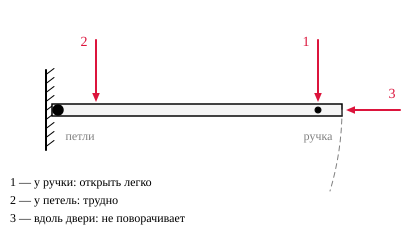
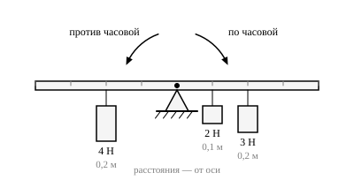

Попробуй открыть дверь, толкая её у самых петель. Тяжело. Толкни у ручки — легко. А если толкать дверь вдоль неё, прямо в петли, она не повернётся совсем, как ни дави. Сила одна и та же, а поворачивает по-разному. В этом уроке введём величину, которая это описывает.

## Сила и плечо — вместе

Поворачивающее действие силы зависит от двух вещей: от самой силы и от её плеча. Сила $1$ и сила $2$ одинаковые, но у силы $1$ плечо длинное, а у силы $2$ — короткое. У силы $3$ плеча нет совсем: она направлена прямо на ось.

Произведение силы на её плечо называют **моментом силы**:

$$
M = F d.
$$

- $F$ — модуль силы, Н;
- $d$ — плечо, м;
- $M$ — момент силы, $\text{Н} \cdot \text{м}$ (ньютон-метр).

Сила, направленная на ось или от оси, тело не поворачивает: её плечо равно нулю, и момент тоже.

**Пример.** Гайку откручивают ключом, давят на ручку с силой $150\ \text{Н}$ в $30\ \text{см}$ от оси гайки, перпендикулярно ключу:

$$
M = 150 \cdot 0{,}3 = 45\ \text{Н} \cdot \text{м}.
$$

Длинный ключ даёт тот же момент меньшей силой. Поэтому прикипевшую гайку откручивают, надев на ключ трубу.

Проверь себя: на ручку ключа давят с силой 150 Н, но вдоль ключа, к гайке. Чему равен момент?

Нулю. Сила направлена на ось гайки, плеча нет. Гайка не повернётся, как ни дави.

<pp-task id="ks-moments-02"></pp-task>

## Правило рычага — это равенство моментов

Перепишем правило рычага из урока 8.1: $F_1 d_1 = F_2 d_2$ — это $M_1 = M_2$. Одна сила крутит рычаг по часовой стрелке, другая — против, и их моменты равны.

## Если сил больше двух

На качели сели трое, на линейку повесили несколько грузиков. Тогда тело не поворачивается, если

$$
\text{сумма моментов «по часовой»} = \text{сумма моментов «против часовой»}.
$$

Это **правило моментов**. Для каждой силы спроси себя: «Если бы действовала только она, куда повернулось бы тело?» Так ты не перепутаешь, в какую сумму её записать.

**Пример.** На рисунке против часовой стрелки крутит один груз: $4 \cdot 0{,}2 = 0{,}8\ \text{Н} \cdot \text{м}$. По часовой — два: $2 \cdot 0{,}1 + 3 \cdot 0{,}2 = 0{,}2 + 0{,}6 = 0{,}8\ \text{Н} \cdot \text{м}$. Суммы равны — линейка в равновесии.

Обрати внимание: складывают **моменты**, а не силы. Справа грузы весят вместе $5\ \text{Н}$, слева — $4\ \text{Н}$, а линейка всё равно в равновесии.

Можно считать и короче, со знаками: моменты против часовой — с плюсом, по часовой — с минусом (или наоборот, главное — одинаково для всех сил). Тогда правило моментов: $\sum M = 0$.

Поиграй с моделью. Сейчас перевешивает левый груз. Повесь груз В так, чтобы линейка выровнялась. Найди несколько способов.

<pp-lever a="4,-2" b="2,1" c="0,3">Модель: линейка на оси посередине, отверстия через 10 см. На неё вешают три груза, у каждого можно выбрать вес и отверстие. Линейка в равновесии, когда сумма моментов против часовой стрелки равна сумме моментов по часовой.</pp-lever>

<pp-task id="ks-moments-03"></pp-task>

<pp-task id="ks-moments-09"></pp-task>

## Частые ловушки

- **Сложили силы вместо моментов.** Равновесие решают моменты: сила, умноженная на своё плечо.
- **Перепутали стороны.** Для каждой силы реши отдельно, куда она крутит тело.
- **Плечо в сантиметрах, а момент нужен в $\text{Н} \cdot \text{м}$.** Переведи плечо в метры.
- **Сила на ось «тоже немного крутит».** Нет: плечо ноль — момент ноль.

## Коротко

- Момент силы $M = Fd$, единица — $\text{Н} \cdot \text{м}$.
- Сила, направленная на ось, не поворачивает тело.
- Правило моментов: сумма моментов по часовой равна сумме моментов против часовой.
- Со знаками: $\sum M = 0$.
- Складывают моменты, а не силы.

Дальше — урок 8.3: колесо с верёвкой — тоже рычаг. Как блок помогает поднимать тяжёлые грузы?
