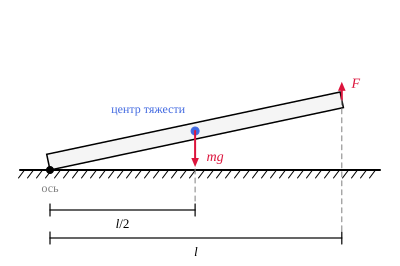

Положи линейку на палец. Если палец под серединой, линейка лежит. Сдвинь палец к краю — линейка падает в сторону длинного конца. Хотя к линейке ничего не подвешено, она ведёт себя как рычаг с грузом. Этот «груз» — её собственный вес. В этом уроке разберёмся, где он приложен.

## Одна точка вместо многих

Сила тяжести тянет вниз **каждый** кусочек тела. Складывать моменты всех кусочков неудобно. Но оказывается, их общее действие такое же, как у одной силы $mg$, приложенной в особой точке. Эту точку называют **центром тяжести**.

Где он находится:

- у однородного стержня, доски, линейки — **посередине**;
- у однородного диска, шара, кольца — **в центре**;
- у однородного прямоугольника — там, где пересекаются диагонали.

Значит, в правиле моментов сила тяжести доски $mg$ приложена в её середине. Плечо считают **от оси до середины доски**, а не до её конца.

Проверь себя: где центр тяжести у однородного кольца? Есть ли в этой точке само вещество кольца?

В центре кольца. А вещества там нет: центр тяжести может лежать и вне тела. Так же у бублика или у подковы.

## Бревно за один конец

Бревно лежит на земле, его поднимают за один конец. Ось поворота — второй конец, который остаётся на земле. Сила тяжести приложена в середине, на плече $l/2$. Сила рук — на конце, на плече $l$ (при любом наклоне бревна оба плеча меняются одинаково, и их отношение остаётся $1 : 2$).

**Пример.** Бревно массой $80\ \text{кг}$. Сила тяжести $800\ \text{Н}$. Правило моментов:

$$
F \cdot l = 800 \cdot \frac{l}{2}, \qquad F = 400\ \text{Н}.
$$

Поднять бревно за один конец вдвое легче, чем целиком. Длина бревна сократилась — она не нужна.

<pp-task id="ks-moments-05"></pp-task>

## Как найти центр тяжести опытом

Подвесь плоскую фигурку из картона за любую точку. Она повиснет так, что центр тяжести окажется точно под точкой подвеса. Проведи по нити вертикальную линию. Подвесь за другую точку и проведи вторую линию. Центр тяжести — там, где линии пересекаются.

Почему так? Пока центр тяжести не под точкой подвеса, у силы тяжести есть плечо, и она поворачивает фигурку. Остановится фигурка, только когда плечо станет нулём.

## Рычаг с массой

Теперь можно решать задачи, где у рычага есть масса. Её сила тяжести — ещё одна сила в правиле моментов из урока 8.2, приложенная в середине.

<pp-task id="ks-moments-11"></pp-task>

## Частые ловушки

- **Забыли массу рычага.** Если масса доски или стержня дана, её сила тяжести тоже даёт момент.
- **Плечо силы тяжести до конца стержня.** Нет: до середины.
- **Опора посередине — значит, вес доски не нужен.** Да: у силы тяжести, приложенной над осью, плечо ноль. Но если опора не посередине — нужен.

## Коротко

- Центр тяжести — точка, в которой можно считать приложенной силу тяжести всего тела.
- У однородного стержня — посередине, у диска и кольца — в центре.
- Центр тяжести может лежать вне тела.
- Подвешенное тело висит так, что центр тяжести под точкой подвеса.
- Бревно за один конец: $F = mg/2$.

Дальше — урок 8.5: до сих пор силы были перпендикулярны рычагу. А если тянуть под углом — какое тогда плечо?
