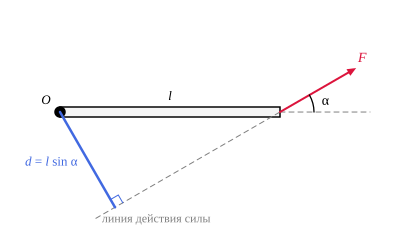

Открой дверь, потянув ручку прямо на себя, перпендикулярно двери. Легко. А теперь тяни ту же ручку почти вдоль двери, в сторону петель. Чем острее угол, тем тяжелее, а вдоль двери — не выходит совсем (урок 8.2). Точка приложения та же, расстояние до петель то же. Значит, плечо — это не просто расстояние до точки, где приложена сила. В этом уроке дадим точное определение.

## Линия действия силы

Проведём через стрелку силы прямую — **линию действия силы**. Это прямая, вдоль которой направлена сила.

**Плечо силы** — расстояние от оси вращения до линии действия силы. «Расстояние до прямой» — это длина перпендикуляра, опущенного из оси на эту прямую.

Пока сила перпендикулярна рычагу, перпендикуляр из оси попадает прямо в точку приложения, и плечо равно $l$ — так было в уроках 8.1–8.4. Под углом перпендикуляр короче.

## Плечо через синус

На рисунке ось $O$, точка приложения и основание перпендикуляра образуют прямоугольный треугольник. Его гипотенуза — $l$, а плечо $d$ — катет напротив угла $\alpha$:

$$
d = l\sin\alpha, \qquad M = Fl\sin\alpha.
$$

Здесь $\alpha$ — угол между силой и рычагом.

Проверь крайние случаи:

- $\alpha = 90^\circ$: $\sin\alpha = 1$, $d = l$ — как раньше;
- $\alpha = 0$: сила вдоль рычага, $d = 0$ — тело не поворачивается, как сила $3$ в уроке 8.2.

**Пример.** Дверную ручку в $0{,}8\ \text{м}$ от петель тянут с силой $20\ \text{Н}$. Перпендикулярно двери момент $M = 20 \cdot 0{,}8 = 16\ \text{Н} \cdot \text{м}$. Под углом $30^\circ$ к двери:

$$
M = 20 \cdot 0{,}8 \cdot \sin 30^\circ = 20 \cdot 0{,}8 \cdot 0{,}5 = 8\ \text{Н} \cdot \text{м}.
$$

Вдвое меньше — хотя сила и точка те же.

<pp-task id="ks-moments-06"></pp-task>

## Второй способ: разложить силу

Разложим силу на две составляющие, как в уроке 5.6: вдоль рычага и перпендикулярно ему.

- Составляющая **вдоль** рычага, $F\cos\alpha$, направлена на ось. Её плечо ноль, она не поворачивает.
- Составляющая **поперёк** рычага, $F\sin\alpha$, перпендикулярна ему, её плечо — $l$.

Момент $M = F\sin\alpha \cdot l$ — то же самое. Выбирай способ, который удобнее: «укоротить плечо» или «укоротить силу».

Проверь себя: ту же ручку тянут с силой 20 Н под углом 150° к двери. Каким будет момент?

$8\ \text{Н} \cdot \text{м}$, как и при $30^\circ$: $\sin 150^\circ = \sin 30^\circ = 0{,}5$. Линия действия силы та же, только стрелка смотрит в другую сторону, — и плечо то же.

<pp-task id="ks-moments-12"></pp-task>

## Частые ловушки

- **Плечо до точки приложения.** Плечо — до линии действия силы: $d = l\sin\alpha$.
- **Косинус вместо синуса.** Если $\alpha$ — угол между силой и рычагом, то $\sin$. Проверь: при $\alpha = 0$ момент должен быть нулём.
- **Взяли угол не с тем.** Если дан угол силы с вертикалью, а рычаг горизонтальный, сначала найди угол между силой и рычагом.

## Коротко

- Плечо — расстояние от оси до линии действия силы.
- $d = l\sin\alpha$, $M = Fl\sin\alpha$, $\alpha$ — угол между силой и рычагом.
- Сила вдоль рычага не поворачивает его.
- Или так: поворачивает только составляющая $F\sin\alpha$, перпендикулярная рычагу.

Дальше — урок 8.6: доска на двух опорах может не только повернуться, но и сдвинуться. Какие условия нужны, чтобы тело было в равновесии?
