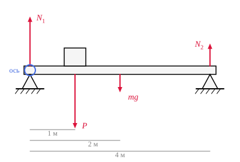

Доска лежит на двух табуретках, на доске стоит ведро. Доска не падает, не поворачивается и не съезжает. С какой силой она давит на каждую табуретку? Здесь нет закреплённой оси: доска могла бы и повернуться, и сдвинуться целиком. В этом уроке соберём оба условия, при которых твёрдое тело покоится, и научимся решать такие задачи — они есть в части 2 ЕГЭ.

## Два условия

Тело может двигаться двумя способами: **сдвигаться** целиком и **поворачиваться**. Чтобы оно покоилось, нужно запретить оба.

1. **Сумма сил равна нулю** — тело не начинает двигаться поступательно. Это первый закон Ньютона из урока 5.3:

$$
\sum \vec F = 0.
$$

2. **Сумма моментов равна нулю** — тело не начинает поворачиваться. Это правило моментов из урока 8.2:

$$
\sum M = 0.
$$

Одного условия мало. Две равные силы, приложенные к разным концам доски в противоположные стороны, дают в сумме ноль — но доску крутят. А рычаг на оси может уравновесить моменты, но ось при этом на него давит — и сила оси нужна в сумме сил.

## Ось можно выбрать где угодно

У доски на табуретках нет закреплённой оси. Относительно какой точки считать моменты? Оказывается, если тело покоится, сумма моментов равна нулю **относительно любой точки**. Выбирай самую удобную.

Удобнее всего ось там, где приложена неизвестная сила, которую **не спрашивают**. У этой силы плечо ноль, она выпадает из уравнения моментов. В уравнении останется одна неизвестная.

## Балка на двух опорах

**Пример.** Однородная доска длиной $4\ \text{м}$ и массой $10\ \text{кг}$ лежит на опорах под концами. На доске в $1\ \text{м}$ от левого конца стоит ведро массой $30\ \text{кг}$. С какой силой доска давит на правую опору?

Решаем по шагам.

1. **Все силы.** Вниз: вес ведра $P = 300\ \text{Н}$ и сила тяжести доски $mg = 100\ \text{Н}$ в её середине (урок 8.4). Вверх: реакции опор $N_1$ и $N_2$.
2. **Ось.** Нужна $N_2$, а $N_1$ не нужна. Ось — на левой опоре.
3. **Моменты относительно левой опоры.** По часовой крутят $P$ (плечо $1\ \text{м}$) и $mg$ (плечо $2\ \text{м}$), против часовой — $N_2$ (плечо $4\ \text{м}$):

$$
N_2 \cdot 4 = 300 \cdot 1 + 100 \cdot 2 = 500, \qquad N_2 = 125\ \text{Н}.
$$

4. **Сумма сил** даёт вторую реакцию: $N_1 = 400 - 125 = 275\ \text{Н}$.
5. **Ответ на вопрос.** По третьему закону (урок 5.5) доска давит на правую опору с той же силой, что опора на доску: $125\ \text{Н}$.

Проверь здравым смыслом: ведро ближе к левой опоре, и левая держит больше. Сходится.

Проверь себя: как найти N₁ сразу, одним уравнением, не находя N₂?

Взять ось на правой опоре. Тогда $N_2$ выпадет: $N_1 \cdot 4 = 300 \cdot 3 + 100 \cdot 2 = 1100$, $N_1 = 275\ \text{Н}$ — то же, что из суммы сил.

<pp-task id="ks-moments-07"></pp-task>

<pp-task id="ks-moments-13"></pp-task>

## Частые ловушки

- **Только моменты, без суммы сил.** Из суммы сил часто находится вторая реакция опоры.
- **Забыли силу тяжести балки.** Если масса дана, это ещё одна сила в середине.
- **Плечи от конца, а не от оси.** Каждое плечо — от выбранной оси.
- **Нашли силу реакции, а спрашивали давление на опору.** Это равные силы по третьему закону, но их полезно назвать в ответе.

## Коротко

- Равновесие твёрдого тела: $\sum \vec F = 0$ и $\sum M = 0$.
- Моменты можно считать относительно любой точки.
- Ось — там, где неизвестная сила, которую не спрашивают.
- План: все силы → ось → моменты → сумма сил → проверка.

Дальше — урок 8.7: тело в равновесии, но если его чуть-чуть толкнуть — вернётся оно или упадёт?
