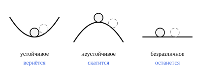
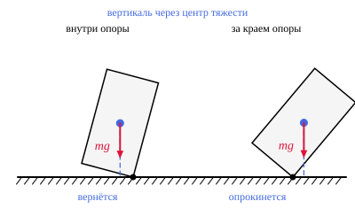

Карандаш можно поставить на тупой конец — он постоит. На острие — тоже, если очень постараться, но от малейшего дуновения он упадёт. А карандаш, лежащий на столе, никуда не денется. Во всех трёх случаях карандаш в равновесии: силы и моменты уравновешены (урок 8.6). Но равновесие разное. В этом уроке разберёмся, какое и почему.

## Три вида равновесия

Отклони тело чуть-чуть и отпусти.

- **Устойчивое** — тело возвращается. Шарик в ямке, груз на нитке, маятник. При отклонении центр тяжести **поднимается**, и сила тяжести тянет его назад.
- **Неустойчивое** — тело уходит ещё дальше. Шарик на вершине горки, карандаш на острие. При отклонении центр тяжести **опускается**.
- **Безразличное** — тело остаётся там, куда его сдвинули. Шар на ровном столе, колесо на оси через его центр. Центр тяжести остаётся на той же высоте.

Короче: тело «стремится» опустить свой центр тяжести как можно ниже.

Проверь себя: линейку подвесили на гвоздь за отверстие у одного конца. Какое это равновесие? А если подвесить за отверстие точно в середине?

За конец — устойчивое: центр тяжести под гвоздём, при отклонении он поднимается, и линейка возвращается. За середину — безразличное: центр тяжести на оси, при повороте он не поднимается и не опускается, и линейка остаётся в любом положении.

## Тело на опоре

Ящик стоит на полу. Наклоним его на ребро и отпустим. Вернётся он или упадёт?

Ось поворота — ребро, на котором стоит ящик. Сила тяжести приложена в центре тяжести и направлена вниз. Смотри, по какую сторону от ребра проходит её вертикаль:

- **внутри опоры** — момент силы тяжести возвращает ящик назад;
- **за краем опоры** — момент силы тяжести опрокидывает ящик.

Правило: **тело стоит, пока вертикаль через центр тяжести проходит через площадь опоры.**

Поэтому устойчивы тела с широким основанием и низким центром тяжести: их приходится сильно наклонить, прежде чем вертикаль выйдет за край. Стакан с тяжёлым дном трудно опрокинуть. Высокий узкий шкаф опрокидывается легко, и его крепят к стене. Канатоходец держит длинный шест, чтобы точнее держать центр тяжести над канатом.

## Доска на краю стола

**Пример.** Однородную доску длиной $2\ \text{м}$ выдвигают за край стола. На сколько её можно выдвинуть, пока она не опрокинулась?

Опора доски — стол, край стола — ось опрокидывания. Центр тяжести доски — в её середине (урок 8.4). Пока середина над столом, доска лежит. Когда середина выходит за край, момент силы тяжести опрокидывает доску. Значит, выдвинуть можно половину доски, $1\ \text{м}$.

Если на выступающий конец что-то положить, его момент тоже крутит доску вниз — и выдвинуть получится меньше. Это уже правило моментов относительно края стола.

<pp-task id="ks-moments-14"></pp-task>

## Как опрокинуть ящик

Ящик можно опрокинуть и толчком. Толкнём его горизонтально у верхнего края. Ящик начнёт поворачиваться вокруг нижнего ребра на той стороне, куда толкаем. Относительно этого ребра:

- сила толчка крутит ящик «на опрокидывание», её плечо — высота ящика;
- сила тяжести крутит назад, её плечо — половина ширины ящика;
- сила реакции пола и трение приложены на самом ребре, их плечо ноль.

Ящик начнёт опрокидываться, когда момент толчка сравняется с моментом силы тяжести. Чем выше точка толчка, тем меньше нужна сила. Если трения не хватит, ящик не опрокинется, а поедет (урок 6.4).

<pp-task id="ks-moments-15"></pp-task>

## Частые ловушки

- **«В равновесии — значит, устойчиво».** Нет: равновесие бывает и неустойчивым, как карандаш на острие.
- **Плечо силы тяжести до края тела.** Плечо — от оси (ребра) до вертикали через центр тяжести.
- **Забыли, вокруг чего опрокидывается тело.** Ось — ребро или край опоры, к которому тело наклоняется.
- **«Доска упадёт, когда за край выйдет её конец».** Нет: когда за край выйдет её центр тяжести.

## Коротко

- Устойчивое равновесие: при отклонении центр тяжести поднимается — тело возвращается.
- Неустойчивое: центр тяжести опускается — тело уходит дальше. Безразличное: высота не меняется.
- Тело стоит, пока вертикаль через центр тяжести проходит через площадь опоры.
- Широкое основание и низкий центр тяжести — устойчивость.
- Опрокидывание считают правилом моментов относительно ребра.

Это последний урок темы. Ты знаешь, когда твёрдое тело покоится. А почему лодка не тонет, а камень идёт ко дну? Почему в воде легко поднять товарища, которого на берегу не оторвёшь от земли? Об этом следующая тема, «Давление жидкости и закон Архимеда».
