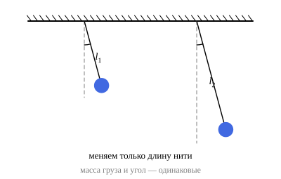

В задаче 20 нужно выбрать установки, с помощью которых можно проверить гипотезу или исследовать зависимость. Здесь не нужно ничего считать — нужно понимать логику эксперимента. Освоив одно правило, ты будешь решать эту задачу почти без ошибок.

Логике опыта учатся с 7 класса, на первых лабораторных работах. Пригодится тема «Измерения и погрешности». После шагов есть задачи на то, что уже прочитано; в задачах на выбор установок номера записывают подряд в порядке возрастания, например $13$.

## Шаг 1. Главное правило: меняем одно (7 класс)

Представь, что ты хочешь узнать, от чего зависит время закипания чайника — от объёма воды или от мощности. Если ты возьмёшь два чайника, в которых разное **и** количество воды, **и** мощность, ты ничего не поймёшь: непонятно, что повлияло.

Правило: **чтобы исследовать зависимость величины от одного параметра, нужно менять только этот параметр, а все остальные оставить одинаковыми.**

Это называют контролем переменных.

- **Исследуемая (независимая) величина** — та, влияние которой проверяем. Она **различается** в опытах.
- **Остальные величины**, которые могут влиять на результат, **одинаковы** в опытах.

<pp-task id="ks-exp-01"></pp-task>

## Шаг 2. Как решать задачу 20 (7 класс)

Обычно дана таблица или список установок: номер, а дальше параметры (масса, длина, материал, угол...). Нужно выбрать **две** установки.

1. Пойми, какую зависимость исследуют. Например, «зависимость периода колебаний маятника от длины нити».
2. Найди все параметры, которые могут повлиять на результат (масса груза, длина нити, амплитуда, место опыта...).
3. Выбери пару установок, в которой **отличается только** исследуемый параметр (длина), а все остальные **совпадают**.
4. Проверь каждую пару из таблицы. Обычно подходит ровно одна.

Пример. Исследуют, зависит ли сила Архимеда от плотности жидкости. Установки:

| № | Объём тела | Материал тела | Жидкость |
|---|---|---|---|
| 1 | $100\ \text{см}^3$ | сталь | вода |
| 2 | $100\ \text{см}^3$ | алюминий | масло |
| 3 | $100\ \text{см}^3$ | сталь | масло |
| 4 | $200\ \text{см}^3$ | сталь | вода |

Нужно, чтобы различалась только жидкость, а объём и материал совпадали. Подходит пара **1 и 3**: одинаковые объём и материал, разные жидкости.

Пара 1 и 2 не подходит: кроме жидкости, отличается материал. Хотя мы знаем, что сила Архимеда от материала не зависит, в эксперименте это не очевидно — проверяемый опыт должен быть «чистым».

<pp-task id="ks-exp-02"></pp-task>

## Шаг 3. Ловушки в таблице (7 класс)

Перед ответом проверь выбранную пару ещё раз по **всем** столбцам. Чаще всего ошибаются так:

- в паре совпадает всё, кроме исследуемого параметра, **и ещё одного**, который легко не заметить — начальная температура, материал сосуда, место опыта;
- в паре различается что-то, но **не** исследуемый параметр.

<pp-task id="ks-exp-03"></pp-task>

## Шаг 4. Повторение опыта (7 класс)

**Чтобы уменьшить случайную погрешность**, опыт повторяют несколько раз и берут среднее: сложи все результаты и раздели на их число. Случайные отклонения в одну и в другую сторону при этом частично гасят друг друга.

<pp-task id="ks-exp-04"></pp-task>

## Шаг 5. Много одинаковых сразу (7 класс)

**Чтобы измерить малую величину точнее**, измеряют сразу много одинаковых: время 20 колебаний вместо одного, толщину стопки листов вместо одного листа. Потом результат делят на их число.

<pp-task id="ks-exp-05"></pp-task>

## Шаг 6. Что показывает график (7 класс)

**Если точки на графике** ложатся на прямую через начало координат, величины прямо пропорциональны: во сколько раз увеличилась одна, во столько же раз увеличилась другая.

<pp-task id="ks-exp-06"></pp-task>

## Частые ловушки

- **Выбирают установки, где различаются два параметра.** Даже если один из них «не влияет» по твоему знанию — опыт должен это проверить.
- **Выбирают установки, где исследуемый параметр одинаков.** Тогда зависимость не увидеть.
- **Не замечают скрытый параметр**, например, разные места опыта (разное $g$) или разные начальные температуры.
- **Записывают номера не в том порядке.** Обычно порядок не важен, но лучше проверить условие.

## Коротко

- Меняй только исследуемый параметр, остальные — одинаковые.
- Перебери все пары установок и отбрось те, где отличается что-то ещё.
- Повторение опыта уменьшает случайную погрешность.
- Измеряй много одинаковых величин сразу, чтобы найти одну точнее.
