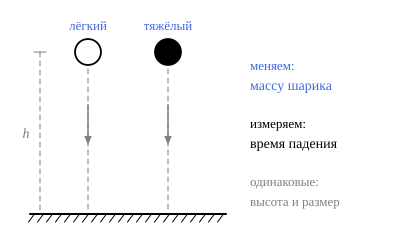

Больше двух тысяч лет люди были уверены, что тяжёлое тело падает быстрее лёгкого. Это казалось очевидным: камень падает быстро, а пёрышко — медленно. Галилей не стал спорить словами, а проверил опытом — и оказалось, что очевидное было неправдой (урок 3.1 из механики). С такого вопроса — «а правда ли?» — начинается любой опыт.

## Наблюдение и опыт

Камень и пёрышко — это **наблюдение**: мы смотрим, как всё происходит само. Но камень и пёрышко различаются сразу многим — массой, размером, формой. Из наблюдения не понять, что именно мешает пёрышку падать: его малая масса или воздух, который тормозит лёгкое и широкое пёрышко.

**Опыт** (эксперимент) отличается тем, что условия задаём мы сами. Возьмём два шарика **одного размера** — пустой и сплошной, лёгкий и тяжёлый — и уроним их с одной высоты. Теперь шарики различаются только массой:

Если шарики упадут за одно время, масса на время падения не влияет. Если тяжёлый упадёт заметно быстрее — влияет.

## Гипотеза

Утверждение «тяжёлое падает быстрее» — **гипотеза**: предположение, которое можно проверить опытом. Гипотезу обычно формулируют так:

- «величина ${A}$ зависит от величины ${B}$»;
- или точнее: «если увеличить ${B},$ то ${A}$ увеличится».

Важно слово «проверить». «Тела падают, потому что хотят на землю» — не гипотеза: такой опыт не придумать.

## Что меняем и что измеряем

В каждом опыте есть три группы величин:

- **независимая величина** — её меняем сами: масса шарика;
- **зависимая величина** — её измеряем как результат: время падения;
- **остальные условия** — их держим одинаковыми: высоту и размер шарика.

Слова «зависимая» и «независимая» подсказывают, кто от кого зависит: результат **зависит** от того, что мы выбрали.

**Пример.** Гипотеза: «чем выше горка, тем дальше уезжают санки». Независимая величина — высота горки: её выбираем, катаясь с разных горок. Зависимая — расстояние, на которое уехали санки: его измеряем. Одинаковыми держим санки, седока и снег на склоне.

Проверь себя: гипотеза — «чем толще лёд, тем больший груз он выдержит». Какая величина здесь независимая, а какая зависимая?

Толщину льда выбирают сами — это независимая величина. Наибольший груз, который лёд выдержал, измеряют — это зависимая величина.

<pp-task id="ks-exp-07"></pp-task>

## Что опыт может показать, а что нет

Опыт может **подтвердить** гипотезу или **опровергнуть** её. Но подтверждает он её только для тех условий, в которых его провели.

Галилей брал тяжёлые шарики одного размера, и сопротивление воздуха почти не мешало им падать. Поэтому вывод «время падения не зависит от массы» верен, когда сопротивление воздуха мало. Пёрышко в воздухе этот вывод не нарушает: у него другие условия. Без воздуха, в трубке с откачанным воздухом, пёрышко и камень падают вместе.

Отсюда два правила:

- один надёжный опыт, который противоречит гипотезе, её опровергает;
- согласие с гипотезой в нескольких опытах её подтверждает, но не доказывает «навсегда»: в других условиях результат может быть другим. Вывод не должен говорить больше, чем проверили.

## Частые ловушки

- **Путают зависимую и независимую величины.** Независимую меняют сами, зависимую получают в ответ и измеряют.
- **Считают наблюдение опытом.** Если сравниваемые случаи различаются многим, нельзя сказать, что повлияло.
- **Делают вывод шире опыта.** Проверили массу шарика — не пишут, что время падения «ни от чего не зависит».

## Коротко

- Гипотеза — предположение, которое можно проверить опытом.
- Независимую величину меняем сами, зависимую измеряем, остальные условия держим одинаковыми.
- Опыт подтверждает или опровергает гипотезу только для своих условий.
