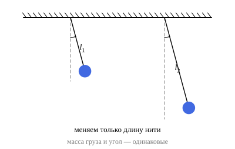

Ты хочешь узнать, от чего зависит время закипания воды в чайнике. Берёшь два чайника: в одном мало воды и мощный нагреватель, в другом много воды и слабый нагреватель. Первый закипел быстрее. Почему — из-за воды или из-за нагревателя? Сказать нельзя: поменялось сразу два, и оба могли повлиять.

## Главное правило

**Чтобы исследовать, зависит ли результат от одной величины, меняют только эту величину. Всё остальное, что может повлиять на результат, оставляют одинаковым.**

Это правило называют **контролем переменных**. Тогда, если результат изменился, причина одна — та величина, которую поменяли.

На рисунке исследуют, зависит ли время скатывания шарика от высоты желоба. Высота различается, а шарик и длина желоба — те же. Если второй шарик скатится быстрее, причина — высота: больше ничего не поменялось.

## Что держать одинаковым

Чтобы ничего не упустить, перед опытом выпиши **всё**, что может повлиять на результат. Для шарика на желобе это:

- высота желоба — её меняем;
- длина желоба;
- шарик: его размер и материал;
- поверхность желоба: гладкая или шероховатая.

Всё, кроме высоты, должно быть одинаковым в обоих опытах.

Держать одинаковым нужно и то, что кажется неважным. Может быть, материал шарика и правда не влияет на время скатывания. Но если в двух опытах взять разные шарики и разную высоту, опыт этого не покажет — придётся верить на слово. Как проверить, что величина не влияет, — в уроке 2.4.

<pp-task id="ks-exp-01"></pp-task>

## Сколько опытов нужно

Чтобы узнать, **есть ли** зависимость, достаточно двух опытов, которые различаются только исследуемой величиной. Чтобы узнать, **какая** это зависимость — например, растёт ли время вдвое, если высоту уменьшить вдвое, — нужна серия опытов при нескольких значениях. Об этом — в уроках 2.5 и 2.6.

Проверь себя: исследуют, зависит ли громкость звука барабана от силы удара. Что меняем, а что оставляем одинаковым?

Меняем силу удара. Одинаковыми оставляем барабан, палочку, место удара на барабане и расстояние до того, кто слушает или до прибора.

<pp-task id="ks-exp-08"></pp-task>

## Частые ловушки

- **Меняют сразу две величины.** Тогда результат не показывает, какая из них повлияла.
- **Не держат одинаковым «неважное».** Что не влияет, должен показать опыт, а не уверенность.
- **Забывают про условия опыта** — начальную температуру, поверхность, место. Их тоже держат одинаковыми.

## Коротко

- Меняем только исследуемую величину, всё остальное — одинаковое.
- Перед опытом выпиши всё, что может повлиять на результат.
- Два опыта показывают, есть ли зависимость; серия опытов — какая.
