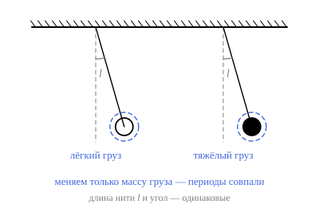

В учебнике написано: период маятника не зависит от массы груза (урок 13.6 из механики). А откуда это известно? Кто-то когда-то проверил. Отсутствие зависимости — тоже результат опыта, и получают его по тем же правилам, что и саму зависимость.

## Опыт, где результат не меняется

Чтобы проверить, влияет ли масса груза на период, берут два маятника, которые различаются **только массой** груза: нити одинаковой длины, грузы одного размера, отклоняют их на одинаковый угол.

Периоды совпали. Раз ничего, кроме массы, не меняли, а результат не изменился, масса на период **не влияет**. Это такой же полноценный вывод, как «влияет».

Совпадение проверяют **в пределах погрешности**: два измерения почти никогда не дают одно и то же число до последней цифры. Если периоды ${(1{,}41 \pm 0{,}02)\ \text{с}}$ и ${(1{,}42 \pm 0{,}02)\ \text{с},}$ их отрезки на числовой прямой перекрываются — разницы опыт не обнаружил (урок 1.3).

## Почему «и так ясно» — не оправдание

В задаче 20 часто есть пара, где различается исследуемая величина и ещё одна, про которую ты знаешь, что она не влияет. Например, исследуют, зависит ли период маятника от длины нити, а в паре различаются длина и масса груза. Кажется: «масса же не влияет — значит, пара подходит». Нет.

- Опыт должен **сам** показать результат, а не опираться на то, что мы хотим проверить. Иначе мы проверяем не природу, а свои ожидания.
- То, что «известно», известно для определённых условий. Масса не влияет на период маятника, пока груз маленький, а нить лёгкая. Лёгкий большой шар качается иначе: ему мешает воздух.
- Правило задачи 20 простое и не знает исключений: подходит только пара, где различается одна исследуемая величина.

Ещё примеры того, что опыт показывает «не влияет»: сила трения скольжения почти не зависит от площади соприкосновения (урок 6.3 из механики), выталкивающая сила не зависит от того, из какого вещества сделано тело, если объём тот же (урок 9.5 из механики). В опыте, где исследуют что-то другое, эти величины всё равно держат одинаковыми.

Проверь себя: брусок тянут по столу один раз на широкой грани, другой — на узкой. Сила трения одинаковая. Что показал опыт и что должно было остаться одинаковым?

Опыт показал, что сила трения скольжения не зависит от площади грани. Одинаковыми должны были остаться брусок (его масса), стол и то, как его тянут — равномерно.

<pp-task id="ks-exp-09"></pp-task>

## Каким бывает вывод

Опыт, где результат не изменился, разрешает только такой вывод: «от этой величины результат не зависит — в этих условиях и с этой точностью». Нельзя сказать «не зависит ни от чего»: проверяли одну величину. И нельзя сказать «опыт ничего не показал»: совпадение — тоже результат.

<pp-task id="ks-exp-10"></pp-task>

## Частые ловушки

- **Выбирают пару, где кроме исследуемой величины различается «неважная».** Неважность должен доказать отдельный опыт.
- **Требуют точного совпадения чисел.** Результаты сравнивают в пределах погрешности.
- **Считают совпадение пустым опытом.** «Не влияет» — такой же вывод, как «влияет».
- **Расширяют вывод.** Проверили одну величину — говорят только о ней.

## Коротко

- Что величина не влияет, проверяют тем же правилом: меняют только её.
- Совпадение в пределах погрешности — вывод «не влияет» для этих условий.
- «И так знаем» не оправдывает пару, где различаются две величины.
