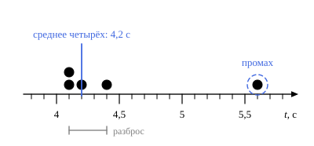

Одно измерение может обмануть: секундомер включили с опозданием, шарик задел край желоба. В уроке 1.5 мы уже повторяли опыт и брали среднее, чтобы уменьшить случайные ошибки. Повторение даёт и больше: оно показывает, каким результатам можно верить, а каким нет.

## Зачем повторять

Повторяя опыт несколько раз, мы:

- **усредняем случайные ошибки** — отклонения в разные стороны частично гасят друг друга (урок 1.5);
- **замечаем промахи** — результаты, испорченные ошибкой;
- **видим разброс** — насколько результаты отличаются друг от друга. Разброс показывает, насколько можно доверять среднему.

## Промах

Время скатывания шарика измерили пять раз:

Четыре результата лежат рядом, а ${5{,}6\ \text{с}}$ — далеко от них. Скорее всего, секундомер остановили поздно или шарик зацепился. Такой результат называют **промахом** и отбрасывают. Среднее считают по остальным:

$$
t = \frac{4{,}1 + 4{,}4 + 4{,}2 + 4{,}1}{4}\ \text{с} = 4{,}2\ \text{с}.
$$

Если бы промах оставили, среднее сдвинулось бы к ${4{,}5\ \text{с}}$ — и оказалось бы больше всех четырёх нормальных результатов.

Отбрасывать можно только результат, который **резко** отличается от остальных, — лучше, если ты знаешь причину. Нельзя выкидывать результаты только потому, что они не совпадают с гипотезой: так опыт перестаёт что-то проверять.

<pp-task id="ks-exp-04"></pp-task>

## Разброс и сравнение двух установок

**Разброс** — насколько отличаются результаты повторных опытов: на рисунке они лежат от ${4{,}1}$ до ${4{,}4\ \text{с}.}$

Разброс нужен, чтобы сравнивать. Пусть шарик с одного желоба скатывается в среднем за ${3{,}2\ \text{с},}$ а с другого — за ${3{,}8\ \text{с},}$ и в каждой серии результаты отличаются от среднего не больше чем на ${0{,}1\ \text{с}.}$ Разница средних — ${0{,}6\ \text{с}}$ — намного больше разброса: она настоящая.

А если бы средние были ${3{,}2}$ и ${3{,}3\ \text{с}}$ при том же разбросе? Разница ${0{,}1\ \text{с}}$ не больше случайных отклонений. Такой опыт **не обнаружил** разницы: чтобы её увидеть, нужно больше повторений или точнее прибор.

Проверь себя: результаты четырёх повторных опытов — 12,4; 12,6; 12,5 и 12,5 с. Есть ли среди них промах? Каково среднее?

Промаха нет: все четыре результата близки, разброс — от 12,4 до 12,6 с. Среднее: (12,4 + 12,6 + 12,5 + 12,5) : 4 = 50 : 4 = 12,5 с.

<pp-task id="ks-exp-05"></pp-task>

## Серия опытов

Два опыта показывают, **есть ли** зависимость. Чтобы узнать, **какая** она, ставят **серию**: берут несколько значений независимой величины — обычно пять-шесть, в широких пределах — и при каждом повторяют опыт. Результаты записывают в таблицу.

**Пример.** К резиновому шнуру подвешивают грузы весом от ${1}$ до ${4\ \text{Н}}$ и измеряют удлинение, при каждом грузе — три раза:

| Груз | Опыт 1 | Опыт 2 | Опыт 3 | Среднее |
|---|---|---|---|---|
| $1\ \text{Н}$ | $2{,}0\ \text{см}$ | $2{,}1\ \text{см}$ | $1{,}9\ \text{см}$ | $2{,}0\ \text{см}$ |
| $2\ \text{Н}$ | $3{,}9\ \text{см}$ | $4{,}1\ \text{см}$ | $4{,}0\ \text{см}$ | $4{,}0\ \text{см}$ |
| $3\ \text{Н}$ | $6{,}1\ \text{см}$ | $5{,}9\ \text{см}$ | $6{,}0\ \text{см}$ | $6{,}0\ \text{см}$ |
| $4\ \text{Н}$ | $8{,}2\ \text{см}$ | $7{,}8\ \text{см}$ | $8{,}0\ \text{см}$ | $8{,}0\ \text{см}$ |

Уже по таблице видно: груз вдвое больше — удлинение вдвое больше. Но удобнее всего зависимость видна на графике — об этом следующий урок.

Ещё одно правило серии: измеряй то, что можно измерить точно. Время одного качания маятника слишком короткое для секундомера в руке — поэтому засекают время многих качаний (урок 1.5).

## Частые ловушки

- **Усредняют вместе с промахом.** Среднее уезжает от всех нормальных результатов.
- **Выкидывают «неудобные» результаты**, которые не похожи на гипотезу, а не на остальные результаты.
- **Видят разницу там, где её нет.** Если разница средних меньше разброса, опыт её не обнаружил.
- **Делают вывод о виде зависимости по двум точкам.** Для этого нужна серия.

## Коротко

- Повторение усредняет случайные ошибки, показывает промахи и разброс.
- Промах — резко отличающийся результат; его отбрасывают и усредняют остальные.
- Разница между установками настоящая, только если она больше разброса.
- Вид зависимости дают серия опытов, таблица и график.
