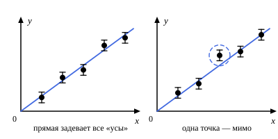

В прошлом уроке мы записали в таблицу, как растягивается резиновый шнур под разными грузами. Четыре строки чисел — уже немало, но зависимость в них приходится искать глазами. На графике она видна сразу.

## Строим график

По горизонтальной оси откладывают **независимую** величину — ту, что меняли (вес груза). По вертикальной — **зависимую**, которую измеряли (удлинение). Каждый опыт — одна точка. Потом через точки проводят **плавную линию**: прямую или кривую, около которой точки лежат. Точки не соединяют ломаной: каждая из них немного сдвинута случайными ошибками, а зависимость в природе плавная.

## Три вида зависимости

**Прямая через начало координат** — прямая пропорциональность: во сколько раз увеличилась одна величина, во столько же раз увеличилась другая. Так ведёт себя удлинение шнура: ${2{,}0\ \text{см}}$ на каждый ньютон. При грузе ${2{,}5\ \text{Н}}$ удлинение ${2{,}5 \cdot 2{,}0\ \text{см} = 5{,}0\ \text{см}.}$ Так же растягивается пружина (закон Гука, урок 6.1 из механики) и растёт ток в резисторе с напряжением (урок 5.3 из электродинамики).

<pp-task id="ks-exp-06"></pp-task>

**Прямая не через начало координат** — линейная зависимость, но **не** пропорциональная. Измерим не удлинение шнура, а всю его длину. Без груза шнур длиной ${20\ \text{см},}$ под грузом ${1\ \text{Н}}$ — ${22\ \text{см},}$ под грузом ${3\ \text{Н}}$ — ${26\ \text{см}.}$ Точки лежат на прямой, но груз втрое больше, а длина вовсе не втрое больше. На каждый ньютон длина прибавляет одно и то же — ${2\ \text{см},}$ — грузу пропорционален только **прирост** длины. Начало прямой на вертикальной оси показывает длину без груза.

<pp-task id="ks-exp-11"></pp-task>

**Кривая** — нелинейная зависимость. Например, период маятника растёт с длиной нити всё медленнее: чтобы период стал вдвое больше, нить нужно удлинить вчетверо (урок 13.6 из механики). Здесь «во сколько раз» не работает ни для самих величин, ни для их приростов.

Проверь себя: точки легли на прямую, которая пересекает вертикальную ось на высоте 5 см. Пропорциональна ли зависимость?

Нет. Прямая не проходит через начало координат, значит, зависимость линейная, но не пропорциональная: при нулевой независимой величине зависимая уже равна 5 см.

## Точки с погрешностью

Каждое измерение известно с погрешностью (урок 1.3). На графике её показывают «усами»: отрезком от ${x - \Delta x}$ до ${x + \Delta x}$ вокруг точки. Настоящее значение лежит где-то на этом отрезке, поэтому линия зависимости **не обязана** проходить через сами точки — она должна пройти через их «усы».

Так проверяют гипотезу по графику:

- прямая (или кривая) гипотезы проходит через «усы» всех точек — опыт с гипотезой **согласуется**;
- у одной точки «усы» далеко от линии — сначала проверь это измерение: может быть, это промах (урок 2.5);
- если мимо линии проходят многие точки, гипотеза **не подтвердилась**.

<pp-task id="ks-exp-12"></pp-task>

## Частые ловушки

- **Любую прямую считают пропорциональностью.** Пропорциональность — только прямая через начало координат.
- **Соединяют точки ломаной.** Через точки проводят плавную линию.
- **Требуют, чтобы линия прошла через каждую точку.** Достаточно, чтобы она прошла через «усы» погрешностей.
- **Путают оси.** По горизонтали — что меняли, по вертикали — что измеряли.

## Коротко

- По горизонтали — независимая величина, по вертикали — зависимая; через точки — плавная линия.
- Прямая через начало — пропорциональная зависимость; прямая не через начало — линейная; кривая — нелинейная.
- Линия должна проходить через «усы» погрешностей всех точек.

Это последний урок темы и всей дорожной карты: от первого урока кинематики до планирования опыта пройдены все темы ЕГЭ по физике. Вернись к дорожной карте, чтобы повторить темы, где было трудно, а задачу 20 потренируй в разделе «Практика».
