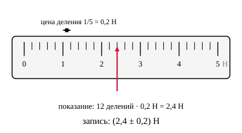

Задача 19 — самая короткая на ЕГЭ: нужно правильно снять показание прибора и записать его с погрешностью. Это лёгкий балл, но его часто теряют из-за невнимательности. Здесь разберём, как не ошибиться.

## Цена деления

Посмотри на линейку. Между цифрами $1$ и $2\ \text{см}$ десять маленьких штрихов. Одно маленькое деление — $1\ \text{мм}$. Это **цена деления** — значение самого маленького деления шкалы.

Как её найти на любом приборе:

1. Возьми два соседних подписанных штриха (например, $20$ и $40$).
2. Вычти меньшее из большего: $40 - 20 = 20$.
3. Посчитай число **промежутков** (не штрихов!) между ними, например, $10$.
4. Раздели: цена деления $20/10 = 2$ единицы.

Частая ошибка — считать штрихи вместо промежутков. Между подписанными значениями с девятью штрихами внутри — десять промежутков.

## Снятие показания

Найди, у какого штриха стоит стрелка или граница жидкости. Отсчитай деления от ближайшего подписанного значения и умножь на цену деления.

У мензурки (мерного цилиндра) показание снимают по **нижнему краю мениска** воды, глядя на шкалу на уровне глаз.

## Погрешность

Никакое измерение не бывает абсолютно точным. Результат записывают так:

$$
x = x_{\text{изм}} \pm \Delta x.
$$

- $x_{\text{изм}}$ — измеренное значение;
- $\Delta x$ — абсолютная погрешность.

В задачах ЕГЭ погрешность обычно **указана в условии**: «погрешность равна цене деления» или «половине цены деления». Читай условие внимательно — это главное место для ошибки.

Важное правило записи: **показание и погрешность записывают с одинаковым числом знаков после запятой**. Если погрешность $0{,}2$, то показание $2{,}4$, а не $2{,}40$ и не $2$.

Пример: цена деления $0{,}2\ \text{Н}$, погрешность равна цене деления, стрелка на $12$-м делении. Показание $12 \cdot 0{,}2 = 2{,}4\ \text{Н}$, запись $(2{,}4 \pm 0{,}2)\ \text{Н}$.

## Несколько измерений

Иногда в задаче несколько приборов или несколько одинаковых тел. Например, высота стопки из $10$ одинаковых монет измерена линейкой с погрешностью $1\ \text{мм}$. Толщина одной монеты — показание, делённое на $10$, и погрешность тоже делится на $10$. Так измерение многих одинаковых предметов сразу повышает точность.

## Относительная погрешность

Иногда нужна **относительная погрешность** — какую долю от измеренного значения составляет погрешность:

$$
\varepsilon = \frac{\Delta x}{x_{\text{изм}}} \cdot 100\,\%.
$$

Измерить длину $1\ \text{м}$ с погрешностью $1\ \text{мм}$ — точно ($0{,}1\,\%$). Измерить $1\ \text{см}$ с той же погрешностью — грубо ($10\,\%$).

## Частые ловушки

- **Считают штрихи вместо промежутков** при поиске цены деления.
- **Берут погрешность, равную цене деления, когда в условии сказано «половине цены деления»** (и наоборот).
- **Записывают показание и погрешность с разным числом знаков** после запятой.
- **Забывают единицы шкалы.** Если шкала в мА, а ответ просят в А — переведи и показание, и погрешность.

## Как это выглядит на ЕГЭ

*Шкала амперметра проградуирована в амперах. Между отметками $0$ и $1$ — $5$ промежутков. Стрелка стоит на третьем делении после отметки $1$. Погрешность равна половине цены деления. Запиши показание.*

Цена деления: $1/5 = 0{,}2\ \text{А}$. Показание: $1 + 3 \cdot 0{,}2 = 1{,}6\ \text{А}$. Погрешность: $0{,}2/2 = 0{,}1\ \text{А}$.

Ответ: $(1{,}6 \pm 0{,}1)\ \text{А}$. Как именно записать его в бланк, сказано в инструкции к заданию — прочитай её на экзамене.

## Коротко

- Цена деления = разность подписанных значений / число промежутков.
- Показание = начальная отметка + число делений × цена деления.
- Погрешность — по условию (цена деления или её половина).
- Запись $x \pm \Delta x$ с одинаковым числом знаков после запятой.
- Измерение $N$ одинаковых тел: и значение, и погрешность делятся на $N$.
