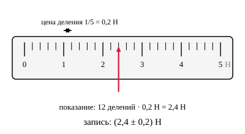

Два ученика смотрят на одну мензурку с водой. Один говорит «$26\ \text{мл}$», другой — «$28\ \text{мл}$». Прибор один, вода одна — откуда разные ответы? Оказывается, мало знать цену деления: важно ещё, от какой отметки считать и откуда смотреть.

## От ближайшей подписанной отметки

Цену деления ты уже умеешь находить (урок 1.1). Дальше всё просто:

1. Найди подписанную отметку, **ближайшую** к стрелке (столбику, краю предмета).
2. Посчитай, на сколько делений стрелка от неё отстоит.
3. Умножь число делений на цену деления и прибавь к отметке, если стрелка дальше по шкале, или вычти, если ближе к началу.

$$
\text{показание} = \text{отметка} \pm \text{число делений} \cdot \text{цена деления}.
$$

На рисунке цена деления ${\dfrac{1\ \text{Н}}{5} = 0{,}2\ \text{Н}.}$ Стрелка на четвёртом штрихе после отметки ${3\ \text{Н}\text{:}}$ показание ${3 + 4 \cdot 0{,}2 = 3{,}8\ \text{Н}.}$ Но до отметки $4\ \text{Н}$ стрелке не хватает всего одного деления, поэтому быстрее и надёжнее так: ${4 - 1 \cdot 0{,}2 = 3{,}8\ \text{Н}.}$ Чем меньше делений считаешь, тем меньше шанс сбиться.

**Пример.** На шкале термометра подписаны ${10\ ^\circ\text{C}}$ и ${20\ ^\circ\text{C},}$ между ними $5$ промежутков, цена деления ${2\ ^\circ\text{C}.}$ Верхний край столбика — на втором штрихе ниже отметки ${20\ ^\circ\text{C}.}$ Показание: ${20 - 2 \cdot 2 = 16\ ^\circ\text{C}.}$ Проверим от другой отметки: от $10\ ^\circ\text{C}$ вверх три деления, ${10 + 3 \cdot 2 = 16\ ^\circ\text{C}.}$ Совпало.

<pp-task id="ks-meas-02"></pp-task>

<pp-task id="ks-meas-08"></pp-task>

## Если стрелка между штрихами

Бывает, что стрелка остановилась не на штрихе, а между двумя. Тогда берут **ближайший** штрих. Ошибка при этом не больше половины деления — вот почему погрешность часто считают равной половине цены деления (урок 1.3). В задачах ЕГЭ стрелка обычно стоит точно на штрихе, а про погрешность сказано в условии.

## Смотри прямо: параллакс

Стрелка прибора находится не на самой шкале, а чуть перед ней. Если смотреть сбоку, стрелка проецируется на соседний штрих — показание выходит неверным. Это явление называют **параллаксом**. Его легко увидеть самому: поставь палец перед линейкой и посмотри на него то одним, то другим глазом — палец «прыгает» по шкале.

Правило простое: **смотри на шкалу прямо, перпендикулярно ей.** У точных стрелочных приборов под стрелкой даже делают зеркальную полоску: если отражение стрелки спряталось за самой стрелкой, ты смотришь правильно.

## Мензурка и мениск

В узкой мензурке вода у стенок немного поднимается, и её поверхность получается изогнутой — это **мениск**. По какому краю снимать показание? У воды — по **нижнему** краю мениска, в середине сосуда. И глаз нужно держать **на уровне** этого края: сверху показание кажется одним, снизу — другим.

Вот откуда два ответа в начале урока: правильно ${26\ \text{мл},}$ а $28\ \text{мл}$ получилось у того, кто смотрел сверху и взял край воды у стенки.

У термометра показание снимают по **верхнему краю столбика** жидкости, тоже глядя прямо.

<pp-task id="ks-meas-09"></pp-task>

## Модель: снимаем показания

Выбери прибор, двигай ползунок «Показание» или нажимай «Новое показание» и проверяй себя по таблице. Акцентом выделены деления, отсчитанные от ближайшей подписанной отметки. Попробуй сначала снять показание сам, а потом посмотреть в таблицу. Про погрешность и запись — следующий урок.

<pp-gauge instrument="cylinder" value="38">Здесь интерактивная модель для тренировки в снятии показаний приборов — для неё нужен JavaScript.</pp-gauge>

Проверь себя: стрелка динамометра на рисунке выше сдвинулась на два деления дальше по шкале. Каким стало показание?

Было ${3{,}8\ \text{Н},}$ цена деления ${0{,}2\ \text{Н}.}$ Два деления — это ${0{,}4\ \text{Н},}$ показание ${3{,}8 + 0{,}4 = 4{,}2\ \text{Н}.}$ Или от ближайшей отметки: ${4 + 1 \cdot 0{,}2 = 4{,}2\ \text{Н}.}$

## Частые ловушки

- **Считают деления от нуля шкалы.** Долго и легко сбиться — считай от ближайшей подписанной отметки.
- **Путают «после отметки» и «до отметки».** Проверь себя от второй соседней отметки: ответ должен совпасть.
- **Смотрят на шкалу сбоку или сверху.** Глаз — напротив стрелки или на уровне жидкости.
- **Снимают показание мензурки по краю у стенок.** У воды — по нижнему краю мениска.

## Коротко

- Показание = ближайшая подписанная отметка ± число делений × цена деления.
- Стрелка между штрихами — бери ближайший штрих.
- Смотри на шкалу прямо, иначе ошибёшься из-за параллакса.
- Мензурка — по нижнему краю мениска, глаз на его уровне; термометр — по верхнему краю столбика.
