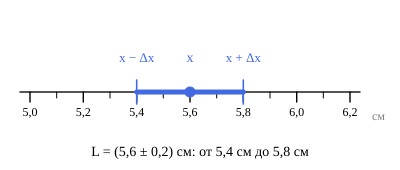

Линейка показала, что длина бруска ${5{,}6\ \text{см}.}$ Ровно ${5{,}6?}$ Мы уже знаем, что точных измерений не бывает (урок 1.1). Честный ответ звучит так: «длина ${5{,}6\ \text{см},}$ но, может быть, на $0{,}2\ \text{см}$ больше или меньше». Как записать это коротко?

## Абсолютная погрешность

**Абсолютная погрешность** $\Delta x$ («дельта икс») — на сколько измеренное значение может отличаться от истинного в ту или другую сторону. Она измеряется в тех же единицах, что и сама величина.

Результат измерения записывают так:

$$
x = (x_{\text{изм}} \pm \Delta x)\ \text{единица}.
$$

- $x_{\text{изм}}$ — измеренное значение, показание прибора;
- $\Delta x$ — абсолютная погрешность;
- знак $\pm$ читается «плюс-минус».

Запись ${L = (5{,}6 \pm 0{,}2)\ \text{см}}$ значит: истинная длина лежит где-то между ${5{,}6 - 0{,}2 = 5{,}4\ \text{см}}$ и ${5{,}6 + 0{,}2 = 5{,}8\ \text{см}.}$ На числовой прямой это отрезок:

Измерить точнее — значит сузить этот отрезок.

<pp-task id="ks-meas-10"></pp-task>

## Откуда берут погрешность

У погрешности много причин: неточная шкала, параллакс, стрелка между штрихами, дрожащая рука. Самую понятную часть задаёт сам прибор — его цена деления. В школе и на ЕГЭ погрешность прибора считают равной:

- **цене деления** — если так сказано в условии;
- **половине цены деления** — если так сказано в условии. Логика такая: стрелку относят к ближайшему штриху (урок 1.2), а ошибиться при этом можно не больше чем на полделения.

Какой вариант взять, решаешь не ты: **это всегда написано в условии задачи.** Внимательно дочитай фразу про погрешность — здесь теряют больше всего баллов.

<pp-task id="ks-meas-03"></pp-task>

## Одинаковое число знаков после запятой

Главное правило записи: **показание записывают с тем же числом знаков после запятой, что и погрешность.**

| Показание | Погрешность | Запись |
|---|---|---|
| $12\ \text{Н}$ | $0{,}5\ \text{Н}$ | ${(12{,}0 \pm 0{,}5)\ \text{Н}}$ |
| $4{,}6\ \text{В}$ | $0{,}1\ \text{В}$ | ${(4{,}6 \pm 0{,}1)\ \text{В}}$ |
| $8\ \text{мл}$ | $1\ \text{мл}$ | ${(8 \pm 1)\ \text{мл}}$ |
| $6{,}3\ \text{см}$ | $0{,}05\ \text{см}$ | ${(6{,}30 \pm 0{,}05)\ \text{см}}$ |

Почему так? Погрешность $0{,}5\ \text{Н}$ говорит, что десятые доли ньютона мы знаем. Тогда и в показании нужно указать десятые: $12{,}0,$ а не $12.$ А писать ${(6{,}3 \pm 0{,}05)}$ — значит сказать, что сотые известны в погрешности, но неизвестны в самом значении; так не бывает. Ноль в конце здесь не лишний: ${6{,}30}$ значит «сотых нет», а ${6{,}3}$ — «про сотые ничего не известно».

И ещё: единицу пишут **после скобки**, она относится к обоим числам.

<pp-task id="ks-meas-11"></pp-task>

## Модель: показание и погрешность

В модели переключай правило: погрешность равна цене деления или её половине — и смотри, как меняется запись. У вольтметра цена деления ${0{,}2\ \text{В}}$ и половина ${0{,}1\ \text{В}}$ — знаков столько же. А у линейки или динамометра половина цены деления ${0{,}1}$ — это ${0{,}05,}$ и в записи появляется второй знак после запятой.

<pp-gauge instrument="volt" value="4,6" rule="half">Здесь интерактивная модель для тренировки в снятии показаний и записи погрешности — для неё нужен JavaScript.</pp-gauge>

Проверь себя: вольтметр показал 7 В, погрешность 0,5 В. Как записать результат?

У погрешности один знак после запятой, значит, и у показания тоже: ${(7{,}0 \pm 0{,}5)\ \text{В}.}$

## Как это выглядит на ЕГЭ

*Шкала амперметра проградуирована в амперах. Между отметками $0$ и $1$ — $5$ промежутков. Стрелка стоит на третьем делении после отметки ${1.}$ Погрешность равна половине цены деления. Запиши показание с учётом погрешности.*

Цена деления: ${1 / 5 = 0{,}2\ \text{А}.}$ Показание: ${1 + 3 \cdot 0{,}2 = 1{,}6\ \text{А}.}$ Погрешность: ${0{,}2 / 2 = 0{,}1\ \text{А}.}$

Ответ: ${(1{,}6 \pm 0{,}1)\ \text{А}.}$ Как именно записать его в бланк, сказано в инструкции к заданию — прочитай её на экзамене.

## Частые ловушки

- **Берут цену деления, когда в условии сказано «половине цены деления»** — и наоборот.
- **Пишут показание и погрешность с разным числом знаков.** Ноль в конце ${(2{,}0 \pm 0{,}5)}$ нужен.
- **Отбрасывают погрешность.** В задаче 19 ответ — пара чисел: показание и погрешность.
- **Ставят единицу только после погрешности** и забывают скобки: правильно ${(12{,}0 \pm 0{,}5)\ \text{Н}.}$

## Коротко

- Абсолютная погрешность $\Delta x$ — на сколько измеренное значение может отличаться от истинного.
- Запись ${(x \pm \Delta x)}$ значит: истинное значение — от ${x - \Delta x}$ до ${x + \Delta x.}$
- Погрешность берут как сказано в условии: цена деления или её половина.
- Показание пишут с тем же числом знаков после запятой, что и погрешность; единица — после скобки.
