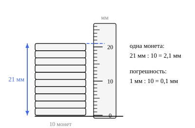

Как измерить толщину монеты обычной линейкой? Монета тоньше трёх миллиметров, а погрешность линейки — целый миллиметр: ошибка сравнима с самой величиной. Есть простой приём, который превращает грубую линейку в точный прибор.

## Измеряем сразу много

Сложим $10$ одинаковых монет в стопку и измерим высоту всей стопки:

Высота стопки ${(21 \pm 1)\ \text{мм}.}$ Толщина одной монеты — в $10$ раз меньше, и **погрешность тоже делится на** ${10\text{:}}$

$$
d = \frac{21\ \text{мм}}{10} = 2{,}1\ \text{мм}, \qquad \Delta d = \frac{1\ \text{мм}}{10} = 0{,}1\ \text{мм}.
$$

Результат: ${d = (2{,}1 \pm 0{,}1)\ \text{мм}.}$ Линейка ошибается на миллиметр при измерении всей стопки, а эта ошибка «делится» между десятью монетами. Возьмём $100$ монет — погрешность одной станет ещё в $10$ раз меньше.

Почему погрешность делится? Высота $H$ известна с точностью до ${\Delta H\text{:}}$ она лежит между ${H - \Delta H}$ и ${H + \Delta H.}$ Поделим оба конца на ${N}$ — толщина одной монеты лежит между ${\dfrac{H - \Delta H}{N}}$ и ${\dfrac{H + \Delta H}{N},}$ то есть её погрешность ${\dfrac{\Delta H}{N}.}$

Так же измеряют толщину листа бумаги (по пачке листов) и диаметр тонкой проволоки: её наматывают на карандаш виток к витку и меряют длину намотки.

<pp-task id="ks-meas-05"></pp-task>

<pp-task id="ks-meas-13"></pp-task>

## Время многих колебаний

Тот же приём работает со временем. Одно колебание маятника длится секунду-две, а человек включает и выключает секундомер с опозданием в доли секунды — ошибка сравнима с самим периодом. Поэтому засекают время многих колебаний и делят (урок 13.1 из механики).

**Пример.** Время $20$ колебаний ${(26{,}0 \pm 0{,}2)\ \text{с}.}$ Период и его погрешность:

$$
T = \frac{26{,}0\ \text{с}}{20} = 1{,}30\ \text{с}, \qquad \Delta T = \frac{0{,}2\ \text{с}}{20} = 0{,}01\ \text{с}.
$$

Результат: ${T = (1{,}30 \pm 0{,}01)\ \text{с}.}$ Заметь: у погрешности два знака после запятой — и у периода два.

## Повторяем и усредняем

Бывают ошибки, которые каждый раз разные: то секундомер включили чуть раньше, то чуть позже, то шарик скатился чуть иначе. Это **случайные погрешности**. Их уменьшают, повторяя опыт несколько раз и беря **среднее** — сумму результатов, делённую на их число. Отклонения в одну и в другую сторону при этом частично гасят друг друга.

**Пример.** Время скатывания шарика измерили пять раз: ${3{,}1}$; ${3{,}3}$; ${3{,}0}$; ${3{,}2}$ и ${2{,}9\ \text{с}.}$ Среднее:

$$
t = \frac{3{,}1 + 3{,}3 + 3{,}0 + 3{,}2 + 2{,}9}{5}\ \text{с} = \frac{15{,}5}{5}\ \text{с} = 3{,}1\ \text{с}.
$$

А вот **погрешность прибора** повторением не уменьшить: если линейка размечена в миллиметрах, сколько ни меряй одну монету, десятые доли миллиметра она не покажет. Если же сама линейка неточная (например, растянулась), она даёт ошибку в одну сторону каждый раз, и среднее её тоже не исправит. Против этого помогает только другой, точный прибор.

Как правильно повторять опыты и сравнивать их результаты — в следующей теме, «Планирование опыта».

Проверь себя: высота пачки из 100 листов бумаги (9 ± 1) мм. Какова толщина одного листа с погрешностью?

Делим на $100$ и значение, и погрешность: ${(0{,}09 \pm 0{,}01)\ \text{мм}.}$

## Частые ловушки

- **Делят на число предметов только значение**, а погрешность оставляют прежней.
- **Отвечают высотой стопки** или временем всех колебаний, а спрашивают про одну монету или один период.
- **Путают число колебаний** с числом прохождений через середину: за одно колебание маятник проходит её дважды.
- **Думают, что усреднение исправит любую ошибку.** Неточный прибор ошибается в одну сторону — среднее это не уберёт.

## Коротко

- Малое измеряют у многих одинаковых сразу, потом делят на их число.
- Делится и значение, и погрешность: погрешность одного в $N$ раз меньше.
- Период маятника — время многих колебаний, делённое на их число.
- Случайные погрешности уменьшают повторением и усреднением; погрешность прибора — нет.
