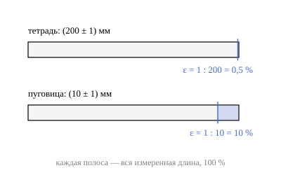

Длину тетради и диаметр пуговицы измерили одной линейкой, с погрешностью $1\ \text{мм}$ в обоих случаях. Одинаково ли точны эти измерения? Абсолютная погрешность одна и та же, но чувствуется, что для пуговицы миллиметр — это много, а для тетради — почти ничего.

## Доля погрешности

**Относительная погрешность** $\varepsilon$ («эпсилон») — какую долю измеренного значения составляет абсолютная погрешность:

$$
\varepsilon = \frac{\Delta x}{x_{\text{изм}}} \cdot 100\,\%.
$$

Это отношение двух величин в одних единицах, поэтому у $\varepsilon$ единиц нет — её выражают в долях или в процентах.

Для тетради ${\varepsilon = \dfrac{1}{200} \cdot 100\,\% = 0{,}5\,\%,}$ для пуговицы ${\varepsilon = \dfrac{1}{10} \cdot 100\,\% = 10\,\%.}$ Измерение тетради в $20$ раз точнее, хотя абсолютные погрешности равны.

**Пример.** Масса груза ${(40 \pm 1)\ \text{г}.}$ Относительная погрешность ${\varepsilon = \dfrac{1}{40} \cdot 100\,\% = 2{,}5\,\%.}$

Подставляй в формулу абсолютную погрешность и значение **в одних единицах** и не забудь умножить на ${100\,\%,}$ если ответ нужен в процентах.

<pp-task id="ks-meas-06"></pp-task>

## Какое измерение точнее

Сравнивать точность разных измерений можно только по относительной погрешности. Абсолютная погрешность ничего не говорит, пока не знаешь, какую величину мерили: ошибка в $1\ \text{км}$ для расстояния до Луны — невероятная точность, а для длины комнаты — нелепость.

Отсюда и приём из урока 1.5: стопка из многих монет высокая, а погрешность линейки та же — значит, относительная погрешность меньше. Измерение становится точнее.

<pp-task id="ks-meas-14"></pp-task>

## Когда величин несколько

Иногда нужную величину не измеряют прямо, а вычисляют из нескольких измеренных. Как тогда найти погрешность? В задачах ЕГЭ это встречается редко, поэтому запомни лишь два простых правила (подробно их разбирают в старших классах).

- **Сумма и разность:** абсолютные погрешности **складываются.** Взвесили два груза: ${(40 \pm 1)\ \text{г}}$ и ${(16 \pm 2)\ \text{г}.}$ Вместе ${(56 \pm 3)\ \text{г}.}$ Для разности погрешности тоже складываются, а не вычитаются: ошибки могут сложиться в худшую сторону.
- **Произведение и частное:** складываются **относительные** погрешности. Стороны прямоугольника ${(40 \pm 1)\ \text{см}}$ и ${(25 \pm 1)\ \text{см}\text{:}}$ их относительные погрешности ${2{,}5\,\%}$ и ${4\,\%,}$ значит, у площади ${S = 1000\ \text{см}^2}$ относительная погрешность ${2{,}5\,\% + 4\,\% = 6{,}5\,\%,}$ то есть ${\Delta S = 65\ \text{см}^2.}$

Проверь себя: что измерено точнее — время (10,0 ± 0,1) с или время (100 ± 1) с?

Одинаково: в обоих случаях ${\varepsilon = 1\,\%.}$ Абсолютная погрешность второго в $10$ раз больше, но и само время в $10$ раз больше.

## Частые ловушки

- **Делят наоборот:** $x / \Delta x$ вместо ${\Delta x / x.}$ Относительная погрешность почти всегда меньше ${100\,\%.}$
- **Забывают умножить на ${100\,\%,}$** когда ответ просят в процентах.
- **Подставляют разные единицы:** погрешность в миллиметрах, значение в сантиметрах.
- **Сравнивают точность по абсолютной погрешности.** Точнее то измерение, у которого меньше $\varepsilon.$

## Коротко

- ${\varepsilon = \dfrac{\Delta x}{x} \cdot 100\,\%}$ — доля погрешности от измеренного значения.
- Точность разных измерений сравнивают по относительной погрешности.
- При сложении и вычитании складываются абсолютные погрешности, при умножении и делении — относительные.

Это последний урок темы. Следующая тема — «Планирование опыта»: как выбрать установки, чтобы проверить зависимость одной величины от другой, — задача 20 ЕГЭ.
