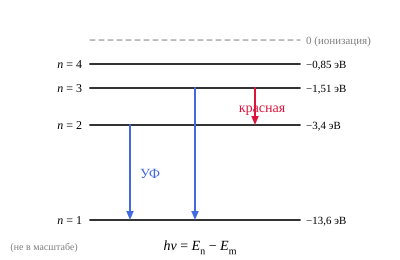

Неоновая вывеска светится красным, натриевый фонарь — жёлто-оранжевым. Каждый газ светится своими цветами, как будто у него есть «отпечаток пальца». Объяснение дала модель атома Бора. Тема встречается в задачах 16, 17 и 18.

Опыт Резерфорда, планетарную модель и линейчатые спектры проходят в 9 классе. Постулаты Бора и расчёт уровней энергии — в 11. Пригодятся темы «Фотоны» (энергия фотона $h\nu$) и «Закон Кулона».

## Шаг 1. Опыт Резерфорда (9 класс)

Резерфорд обстреливал тонкую золотую фольгу альфа-частицами. Почти все они пролетали насквозь, но некоторые отскакивали назад — как будто снаряд отразился от листа бумаги.

Вывод: почти вся масса и весь положительный заряд атома сосредоточены в крошечном **ядре** (в десятки тысяч раз меньше атома), а вокруг движутся электроны.

## Шаг 2. Планетарная модель атома (9 класс)

Атом похож на Солнечную систему: в центре — положительно заряженное ядро, вокруг движутся электроны. Заряд ядра равен $+Ze$, где $Z$ — порядковый номер элемента в таблице Менделеева. В нейтральном атоме $Z$ электронов, и их общий заряд $-Ze$ компенсирует заряд ядра.

Если атом теряет электроны, он становится положительным **ионом**; если приобретает — отрицательным.

<pp-task id="ks-atom-01"></pp-task>

## Шаг 3. Линейчатые спектры (9 класс)

Разреженный газ из возбуждённых атомов излучает свет только определённых частот — **линейчатый спектр испускания**. Набор линий у каждого элемента свой, как отпечаток пальца.

Если белый свет пропустить через холодный газ, атомы поглотят те же частоты, которые сами излучают: получится **спектр поглощения** — радуга с тёмными линиями.

На этом основан **спектральный анализ**: по спектру определяют химический состав вещества, даже звёзд. Сравни: раскалённое твёрдое тело или плотный газ дают **сплошной** спектр.

## Шаг 4. Постулаты Бора (11 класс)

Классическая физика говорит: электрон, движущийся по окружности, имеет ускорение, а значит, должен излучать и терять энергию, падая на ядро. Атомы же устойчивы. Противоречие разрешил Бор.

1. **Стационарные состояния.** Атом может находиться только в особых состояниях с определёнными энергиями $E_1, E_2, E_3, \dots$ В этих состояниях атом не излучает.

2. **Правило частот.** При переходе атома из состояния с энергией $E_n$ в состояние с меньшей энергией $E_m$ излучается фотон:

$$
h\nu = E_n - E_m.
$$

Так объясняется шаг 3: каждая линия спектра — переход между двумя уровнями.

<pp-task id="ks-atom-02"></pp-task>

## Шаг 5. Поглощение и ионизация (11 класс)

При поглощении фотона атом переходит на более высокий уровень. Поглощён может быть только фотон, энергия которого **точно** равна разности энергий уровней (если энергии фотона хватает на ионизацию, условие снимается).

Состояние с наименьшей энергией $E_1$ — **основное**. Остальные — **возбуждённые**. Энергии уровней отрицательны: чтобы оторвать электрон от атома (ионизовать атом), нужно сообщить энергию. Энергия ионизации из основного состояния равна $|E_1|$.

<pp-task id="ks-atom-03"></pp-task>

## Шаг 6. Уровни атома водорода (11 класс)

Для атома водорода:

$$
E_n = -\frac{13{,}6\ \text{эВ}}{n^2}.
$$

$E_1 = -13{,}6\ \text{эВ}$, $E_2 = -3{,}4\ \text{эВ}$, $E_3 \approx -1{,}51\ \text{эВ}$. Уровни сгущаются к нулю.

<pp-task id="ks-atom-04"></pp-task>

## Шаг 7. Длина волны излучённого фотона (11 класс)

Энергия фотона — разность уровней: чем больше «прыжок», тем больше частота и меньше длина волны. Из темы «Фотоны»:

$$
\lambda = \frac{hc}{E_n - E_m}.
$$

Не забудь перевести энергию в джоули, если $h$ дана в Дж·с.

<pp-task id="ks-atom-05"></pp-task>

## Шаг 8. Сколько линий в спектре (11 класс)

Атом в состоянии $n$ может спускаться вниз разными путями: сразу на нижний уровень или по ступенькам. Каждая пара уровней даёт свою линию. Из состояния $n$ при переходах вниз возможно

$$
\frac{n(n-1)}{2}
$$

разных линий — число пар из $n$ уровней.

<pp-task id="ks-atom-06"></pp-task>

## Частые ловушки

- **Путают знак.** Излучение — переход **вниз**, энергия атома уменьшается.
- **Думают, что атом поглотит любой фотон.** Только с энергией, равной разности уровней (или достаточной для ионизации).
- **Считают, что большой «прыжок» даёт длинную волну.** Наоборот: больше энергия — короче волна.
- **Забывают, что энергии уровней отрицательны** при вычитании.

## Как это выглядит на ЕГЭ

*Атом водорода переходит из состояния с $n = 3$ в состояние с $n = 2$. Найди энергию излучённого фотона.*

$$
E_3 = -\frac{13{,}6}{9} \approx -1{,}51\ \text{эВ}, \qquad E_2 = -\frac{13{,}6}{4} = -3{,}4\ \text{эВ}.
$$

$$
h\nu = E_3 - E_2 = -1{,}51 - (-3{,}4) \approx 1{,}89\ \text{эВ}.
$$

Это красная линия в спектре водорода, около $656\ \text{нм}$.

## Коротко

- Планетарная модель: маленькое массивное ядро с зарядом $+Ze$, вокруг электроны.
- Газ даёт линейчатый спектр; спектр — «отпечаток» элемента.
- Бор: стационарные состояния не излучают; $h\nu = E_n - E_m$.
- Водород: $E_n = -13{,}6/n^2\ \text{эВ}$.
- Из уровня $n$ — до $n(n-1)/2$ линий.
