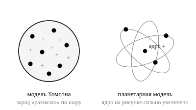
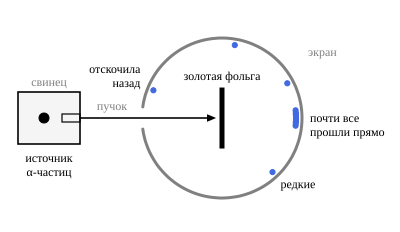

Атом очень мал, увидеть его в обычный микроскоп нельзя. Как тогда узнать, что у него внутри? Эрнест Резерфорд придумал способ: обстрелять атомы очень быстрыми частицами и посмотреть, как они отлетают. Так в 1911 году открыли атомное ядро.

## Модель Томсона

Мы уже знаем, что в атоме есть лёгкие отрицательные электроны, а в целом атом нейтрален (урок 1.2 из электродинамики). Значит, где-то в нём есть и положительный заряд. Но где?

В 1904 году Джозеф Томсон, открывший электрон, предложил простую картину: атом — шар, по всему объёму которого равномерно «размазан» положительный заряд, а электроны вкраплены в него, как изюм в булку. Модель объясняла, почему атом нейтрален, и долго считалась верной.

## Обстрел фольги

Для опыта Резерфорду нужны были «снаряды» — **альфа-частицы**. Их испускают некоторые радиоактивные вещества, например радий. Альфа-частица заряжена положительно, её заряд ${+2e,}$ а масса примерно в семь с лишним тысяч раз больше массы электрона. Летит она со скоростью около двадцати тысяч километров в секунду.

Источник прятали в свинцовый блок с узким каналом: наружу выходил тонкий пучок частиц. Пучок направляли на золотую фольгу толщиной всего в несколько сотен атомов. Вокруг ставили экран, покрытый веществом, которое вспыхивает при ударе альфа-частицы. Помощники Резерфорда Гейгер и Марсден часами смотрели на экран в микроскоп и считали вспышки.

Результат:

- почти все альфа-частицы пролетали сквозь фольгу, как будто её нет, и лишь немного отклонялись;
- редкие частицы отклонялись на большие углы;
- примерно одна из нескольких тысяч отскакивала назад.

Резерфорд потом вспоминал: это было так же невероятно, как если бы артиллерийский снаряд отскочил от листа папиросной бумаги.

## Почему модель Томсона не годится

Развернуть тяжёлую быструю частицу назад может только очень большая сила. Электроны для этого слишком лёгкие: альфа-частица отбрасывает их, как грузовик — мошек, и почти не замечает.

Остаётся положительный заряд атома. По закону Кулона сила растёт, когда заряды сближаются: в десять раз ближе — в сто раз сильнее (урок 1.4 из электродинамики). В модели Томсона заряд размазан по всему атому, и частица не может подойти близко ко всему заряду сразу. Сила получается слабой, и большой поворот невозможен.

А вот если весь положительный заряд собран в крошечном **ядре**, частица, пролетающая рядом с ним, испытывает огромную силу. Чем ближе она пролетает к ядру, тем сильнее отклоняется. Та, что летит почти прямо на ядро, разворачивается назад.

Почему же назад отлетает так мало частиц? Потому что ядро крошечное, и попасть близко к нему очень трудно: почти все частицы пролетают через пустоту между ядрами.

## Что узнал Резерфорд

Опыт дал **ядерную модель атома**:

- в центре атома — положительно заряженное **ядро**, в нём почти вся масса атома;
- ядро крошечное: его размер около ${10^{-15}\text{–}10^{-14}\ \text{м},}$ а размер атома — около ${10^{-10}\ \text{м};}$ ядро меньше атома в десятки тысяч раз;
- вокруг ядра движутся электроны, а всё остальное в атоме — пустота.

**Пример.** Если бы ядро увеличили до шарика размером ${1\ \text{см},}$ атом стал бы размером с большой стадион, около километра. И почти весь этот стадион пуст.

<pp-task id="ks-atom-07"></pp-task>

<pp-task id="ks-atom-08"></pp-task>

Проверь себя: почему почти все альфа-частицы пролетали сквозь фольгу, хотя в ней сотни слоёв атомов?

Почти весь объём атома пуст: ядро в десятки тысяч раз меньше атома. Частица пролетает между ядрами, далеко от них, и сила Кулона там слабая. А электроны слишком лёгкие, чтобы заметно её отклонить.

## Частые ловушки

- **Думают, что отклонялось большинство частиц.** Наоборот: почти все пролетали прямо, сильно отклонялись лишь редкие.
- **Считают, что частицы отражали электроны.** Электрон в тысячи раз легче альфа-частицы и развернуть её не может; поворачивает ядро.
- **Путают размеры.** Атом — около ${10^{-10}\ \text{м},}$ ядро — в десятки тысяч раз меньше.
- **Забывают, где масса.** Почти вся масса атома — в ядре, электроны очень лёгкие.

## Коротко

- Модель Томсона: положительный заряд размазан по атому, электроны вкраплены в него.
- Опыт Резерфорда: почти все альфа-частицы проходят фольгу, редкие отклоняются сильно, некоторые отскакивают назад.
- Вывод: положительный заряд и почти вся масса — в крошечном ядре, ${10^{-15}\text{–}10^{-14}\ \text{м}}$ против ${10^{-10}\ \text{м}}$ у атома.
