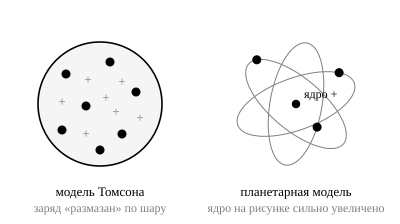
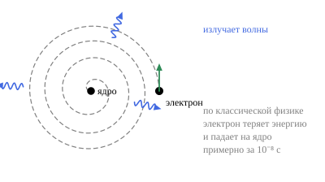

После опыта Резерфорда картина атома стала похожа на Солнечную систему: тяжёлое ядро в центре, лёгкие электроны вокруг. Модель так и назвали — **планетарной**. Она объяснила, как устроен атом, но тут же поставила вопрос, на который классическая физика ответить не смогла.

## Ядро и электроны

Заряд ядра равен ${+Ze,}$ где $Z$ — **порядковый номер** элемента в таблице Менделеева, а ${e = 1{,}6 \cdot 10^{-19}\ \text{Кл}}$ — элементарный заряд (урок 1.2 из электродинамики). У водорода ${Z = 1,}$ у гелия ${Z = 2,}$ у золота ${Z = 79.}$ Номер элемента — это и есть заряд его ядра в единицах ${e.}$

В нейтральном атоме вокруг ядра движутся $Z$ электронов. Их общий заряд ${-Ze}$ как раз компенсирует заряд ядра.

## Ионы

Внешние электроны держатся слабее всего, их можно оторвать или добавить. Ядро при этом не меняется.

- Атом **потерял** электроны — их стало меньше, чем нужно для нейтральности, и атом стал **положительным ионом**.
- Атом **получил** лишние электроны — стал **отрицательным ионом**.

Заряд иона — сумма заряда ядра и зарядов всех оставшихся электронов.

**Пример.** У хлора ${Z = 17.}$ Атом хлора захватил один лишний электрон: электронов стало ${18,}$ а заряд иона

$$
q = +17e - 18e = -e = -1{,}6 \cdot 10^{-19}\ \text{Кл}.
$$

<pp-task id="ks-atom-01"></pp-task>

## Что держит электрон

Планеты удерживает на орбитах притяжение к Солнцу (урок 7.1 из механики). Электрон удерживает притяжение к ядру — сила Кулона (урок 1.4 из электродинамики). Она и сообщает электрону центростремительное ускорение ${a = v^2/r}$ (урок 4.3 из механики).

**Пример.** В атоме водорода электрон находится примерно в ${5{,}3 \cdot 10^{-11}\ \text{м}}$ от протона. Сила их притяжения

$$
F = k\frac{e^2}{r^2} = \frac{9 \cdot 10^9 \cdot (1{,}6 \cdot 10^{-19})^2}{(5{,}3 \cdot 10^{-11})^2} \approx 8{,}2 \cdot 10^{-8}\ \text{Н}.
$$

Кажется, мало, но электрон очень лёгкий, и такая сила разгоняет его по орбите до огромной скорости. А сила тяготения между электроном и протоном слабее кулоновской примерно в ${10^{39}}$ раз — в атоме её можно не замечать.

<pp-task id="ks-atom-09"></pp-task>

## Беда планетарной модели

Электрон на круговой орбите движется с ускорением: его скорость всё время меняет направление. А заряд, движущийся с ускорением, излучает электромагнитные волны (урок 13.3 из электродинамики). Волны уносят энергию. Значит, электрон должен терять энергию, всё ближе подходить к ядру и по спирали упасть на него. Расчёт по законам классической физики даёт на это примерно ${10^{-8}\ \text{с}.}$

К тому же, сближаясь с ядром, электрон обращался бы всё быстрее, и частота излучения менялась бы плавно. Атомы светились бы сплошной радугой всех частот.

На деле всё не так:

- атомы **устойчивы**: вещество вокруг нас существует миллиарды лет и не «схлопывается»;
- светящийся газ даёт не сплошной спектр, а отдельные **линии** — об этом следующий урок.

Классическая физика, которая прекрасно описывает планеты и антенны, внутри атома не работает. Выход нашёл Нильс Бор — его постулаты в уроке 3.4.

Проверь себя: электрон в планетарной модели движется по окружности с постоянной по модулю скоростью. Почему он должен излучать?

Скорость постоянна только по модулю, а её направление всё время меняется. Значит, у электрона есть центростремительное ускорение, а любой заряд, движущийся с ускорением, излучает электромагнитные волны.

## Частые ловушки

- **Путают знак иона.** Потерял электроны — ион положительный, получил — отрицательный.
- **Считают, что ион образуется, когда меняется ядро.** Меняется только число электронов; заряд ядра и номер элемента прежние.
- **Думают, что электрон держит тяготение.** Его держит сила Кулона; тяготение в атоме ничтожно.
- **Считают планетарную модель окончательной.** По классической физике такой атом неустойчив; модель исправил Бор.

## Коротко

- Ядро с зарядом ${+Ze,}$ вокруг $Z$ электронов; $Z$ — номер элемента.
- Потерял электроны — положительный ион, получил — отрицательный.
- Электрон держит сила Кулона: она даёт центростремительное ускорение.
- По классической физике электрон излучал бы и падал на ядро — атомы же устойчивы.
