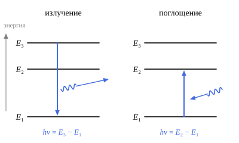

В 1913 году датский физик Нильс Бор взял планетарную модель и прямо запретил ей то, что требовала классическая физика: излучать на орбите. Звучит как уловка, но два его правила, **постулата**, сразу объяснили и устойчивость атомов, и линейчатые спектры. А числа, которые из них получились для водорода, совпали с опытом.

## Первый постулат: стационарные состояния

Атом может находиться только в особых **стационарных состояниях**. У каждого из них своя определённая энергия: ${E_1, E_2, E_3}$ и так далее. Других значений энергии у атома не бывает. Находясь в стационарном состоянии, атом **не излучает**, хотя электрон в нём движется.

Энергии удобно рисовать горизонтальными линиями — **уровнями энергии**: чем выше линия, тем больше энергия. Это и есть **энергетическая диаграмма** атома.

- Состояние с наименьшей энергией ${E_1}$ — **основное**. В нём атом может находиться сколь угодно долго.
- Остальные — **возбуждённые**. В них атом обычно живёт около ${10^{-8}\ \text{с},}$ а потом сам переходит вниз.

Энергии уровней обычно записывают отрицательными: за ноль берут энергию электрона, оторванного от атома и покоящегося вдали от ядра. Почему так — в уроке 3.6. Пока важно одно: чем ниже уровень, тем более отрицательна его энергия, и вычитать надо аккуратно.

## Второй постулат: правило частот

Атом излучает, только когда **переходит** из одного стационарного состояния в другое. При переходе с уровня ${E_n}$ на более низкий уровень ${E_m}$ рождается один фотон, и его энергия — ровно разность энергий уровней:

$$
h\nu = E_n - E_m.
$$

Это **правило частот Бора**. Энергия фотона связана с его частотой и длиной волны так же, как в уроках 1.1 и 1.2: ${h\nu = hc/\lambda.}$

Обратно тоже работает: атом может **поглотить** фотон и подняться с уровня ${E_m}$ на уровень ${E_n,}$ но только если энергия фотона точно равна ${E_n - E_m.}$ Фотон с другой энергией атом в этой паре уровней не поглощает.

**Пример.** У атома ртути энергия основного состояния ${-10{,}4\ \text{эВ},}$ одного из возбуждённых — ${-5{,}5\ \text{эВ}.}$ При переходе вниз излучается фотон

$$
\begin{aligned}
h\nu &= -5{,}5 - (-10{,}4) = 4{,}9\ \text{эВ}, \\
h\nu &= 4{,}9 \cdot 1{,}6 \cdot 10^{-19} = 7{,}84 \cdot 10^{-19}\ \text{Дж}, \\
\lambda &= \frac{hc}{h\nu} = \frac{6{,}6 \cdot 10^{-34} \cdot 3 \cdot 10^8}{7{,}84 \cdot 10^{-19}} \approx 2{,}53 \cdot 10^{-7}\ \text{м} \approx 253\ \text{нм}.
\end{aligned}
$$

Это ультрафиолет. Такую линию дают кварцевые ртутные лампы, которыми обеззараживают воздух.

<pp-task id="ks-atom-02"></pp-task>

<pp-task id="ks-atom-04"></pp-task>

## Что объясняют постулаты

- **Устойчивость.** В основном состоянии атом не излучает, а ниже ему переходить некуда. Электрон не падает на ядро.
- **Линейчатый спектр испускания.** Уровни отдельные, поэтому и разности энергий — отдельные числа. Каждая линия спектра — переход между какой-то парой уровней (урок 3.3).
- **Спектр поглощения.** Поглощается фотон той же пары уровней, что и излучается, поэтому тёмные линии стоят на месте ярких.
- **Отпечаток элемента.** Набор уровней у каждого элемента свой — значит, и набор линий свой.

Постулаты Бора противоречат классической физике: заряд, движущийся с ускорением, вдруг не излучает. Позже квантовая механика объяснила, почему это так. На ЕГЭ достаточно самих постулатов.

Проверь себя: атом находится в основном состоянии. Может ли он излучить фотон?

Нет. Излучение — переход на более низкий уровень, а ниже основного уровней нет. Сначала атом надо возбудить: например, дать ему поглотить фотон или ударить электроном.

## Частые ловушки

- **Путают направление.** Излучение — переход **вниз**, энергия атома уменьшается; поглощение — **вверх**.
- **Теряют минусы.** Энергии уровней отрицательны: ${-2 - (-7) = +5,}$ а не ${-9.}$
- **Думают, что атом поглотит любой фотон.** В паре уровней — только фотон с энергией, точно равной их разности.
- **Считают, что атом излучает, пока находится в возбуждённом состоянии.** Он излучает в момент перехода, один фотон на переход.

## Коротко

- Стационарные состояния: энергии ${E_1, E_2, \dots,}$ в них атом не излучает.
- Переход вниз — излучение фотона ${h\nu = E_n - E_m;}$ поглощение такого фотона — переход вверх.
- Основное состояние — самое низкое и устойчивое; возбуждённые — выше.
