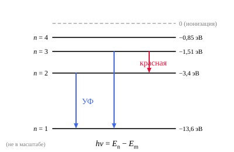

Постулаты Бора годятся для любого атома, но энергии уровней у каждого свои, и вычислить их непросто. Для самого простого атома — водорода, где вокруг протона один электрон, — Бор смог это сделать. Получилась короткая формула, и по ней линии водорода вычисляются с точностью, которой до тех пор в физике атома не видели.

## Формула уровней

Энергия атома водорода в стационарном состоянии с номером $n$:

$$
E_n = -\frac{13{,}6\ \text{эВ}}{n^2}, \qquad n = 1, 2, 3, \dots
$$

- $n$ — **номер уровня**, целое число; ${n = 1}$ — основное состояние;
- ${13{,}6\ \text{эВ}}$ — постоянное для водорода число; электронвольт мы уже знаем (урок 1.2).

| ${n}$ | ${1}$ | ${2}$ | ${3}$ | ${4}$ | ${5}$ | ${\infty}$ |
|---|---|---|---|---|---|---|
| ${E_n,}$ эВ | ${-13{,}6}$ | ${-3{,}4}$ | ${\approx -1{,}51}$ | ${-0{,}85}$ | ${\approx -0{,}54}$ | ${0}$ |

С ростом $n$ энергия растёт (становится менее отрицательной) и приближается к нулю, а уровни **сгущаются**: между первым и вторым — больше десяти электронвольт, а между четвёртым и пятым — десятые доли. Уровень ${n = \infty}$ с энергией ${0}$ — граница: выше неё электрон уже свободен (урок 3.6).

## Серии линий

Каждая линия водорода — переход с какого-то верхнего уровня на нижний. Переходы на один и тот же нижний уровень образуют **серию**:

- на ${n = 1}$ — **серия Лаймана**: прыжки большие, больше десяти электронвольт, это ультрафиолет;
- на ${n = 2}$ — **серия Бальмера**: переходы с третьего, четвёртого, пятого и шестого уровней дают четыре видимые линии из урока 3.3;
- на ${n = 3}$ — **серия Пашена**: прыжки маленькие, это инфракрасное излучение.

**Пример.** Найдём энергию фотона при переходе атома водорода с третьего уровня на второй.

$$
\begin{aligned}
E_3 &= -\frac{13{,}6}{9} \approx -1{,}51\ \text{эВ}, \\
E_2 &= -\frac{13{,}6}{4} = -3{,}4\ \text{эВ}, \\
h\nu &= E_3 - E_2 \approx -1{,}51 - (-3{,}4) \approx 1{,}89\ \text{эВ}.
\end{aligned}
$$

Видимый свет — от ${1{,}63}$ до ${3{,}26\ \text{эВ}}$ (урок 1.2), и ${1{,}89\ \text{эВ}}$ — его красный край: это красная линия водорода. Её длину волны найдём в уроке 3.7.

А переход со второго уровня на первый даёт ${-3{,}4 - (-13{,}6) = 10{,}2\ \text{эВ}}$ — далеко за фиолетовым краем, в ультрафиолете.

## Модель

Выбирай верхний и нижний уровни ползунками или щелчком по уровню. Стрелки показывают все линии, которые атом может излучить с верхнего уровня, выбранная выделена. В таблице энергия фотона, его частота и длина волны, а внизу на шкале длин волн — линия этого фотона и четыре линии Бальмера.

<pp-atom>Модель атома водорода: уровни энергии в масштабе от минус 13,6 электронвольта до нуля, выбор верхнего и нижнего уровня, режимы излучения, поглощения и фотона любой энергии. Стрелки показывают все переходы с верхнего уровня, выбранный выделен. Шкала длин волн с линиями серии Бальмера. Таблица энергии фотона, частоты, длины волны, диапазона и числа линий.</pp-atom>

Посмотри, что выходит:

- все переходы на второй уровень попадают в видимую полосу, на первый — в ультрафиолет, на третий — в инфракрасное;
- переход 6 → 2 почти на фиолетовом краю, а 3 → 2 — красный;
- чем выше начальный уровень, тем меньше прибавка энергии: верхние уровни почти слиплись.

<pp-task id="ks-atom-12"></pp-task>

Проверь себя: какой переход на второй уровень даёт фотон с наименьшей энергией? Какой это свет?

С третьего уровня: он ближе всех ко второму, разность энергий самая маленькая. Это красная линия, самая длинноволновая в серии Бальмера.

## Частые ловушки

- **Делят на ${n,}$ а не на ${n^2}.$** ${E_2 = -13{,}6/4,}$ а не ${-13{,}6/2.}$
- **Теряют минус.** Все уровни отрицательны; энергия фотона — разность, она положительна.
- **Думают, что уровни равноотстоящие.** Они сгущаются к нулю.
- **Путают серии.** На первый уровень — ультрафиолет, на второй — видимый свет, на третий — инфракрасное.

## Коротко

- Водород: ${E_n = -13{,}6/n^2\ \text{эВ},}$ основное состояние ${-13{,}6\ \text{эВ}.}$
- Уровни сгущаются к ${E = 0}$ при ${n \to \infty.}$
- Серии: Лаймана (на ${n = 1,}$ УФ), Бальмера (на ${n = 2,}$ видимый свет), Пашена (на ${n = 3,}$ ИК).
