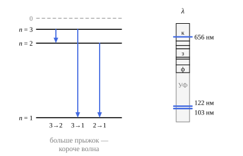

Спектроскоп измеряет длины волн линий, а постулаты Бора дают энергии фотонов. Соединим одно с другим: по уровням найдём, где в спектре встанет линия, и сколько всего линий даст газ.

## Длина волны перехода

Энергия фотона — разность уровней, а длина волны связана с энергией формулой из урока 1.2:

$$
\lambda = \frac{hc}{E_n - E_m}.
$$

Чем больше «прыжок» ${E_n - E_m,}$ тем больше энергия фотона, тем выше частота и **короче** волна.

Энергию подставляют в джоулях, если $h$ дана в ${\text{Дж} \cdot \text{с}\text{:}}$ электронвольты умножают на ${1{,}6 \cdot 10^{-19}.}$ Удобно сразу взять ${hc = 6{,}6 \cdot 10^{-34} \cdot 3 \cdot 10^8 = 1{,}98 \cdot 10^{-25}\ \text{Дж} \cdot \text{м}.}$

**Пример.** В уроке 3.5 переход водорода с третьего уровня на второй дал фотон ${\approx 1{,}89\ \text{эВ}.}$ Его длина волны:

$$
\begin{aligned}
E &\approx 1{,}89 \cdot 1{,}6 \cdot 10^{-19} \approx 3{,}02 \cdot 10^{-19}\ \text{Дж}, \\
\lambda &= \frac{hc}{E} \approx \frac{1{,}98 \cdot 10^{-25}}{3{,}02 \cdot 10^{-19}} \approx 6{,}55 \cdot 10^{-7}\ \text{м} \approx 655\ \text{нм}.
\end{aligned}
$$

Это красная линия водорода. Спектроскоп даёт ${656\ \text{нм}}$ (урок 3.3): разница — только от того, что мы округлили $h$ и ${e.}$ Теория Бора совпала с опытом — в этом и был её триумф.

Проверка «на глаз»: в нанометрах ${\lambda \approx 1240/E,}$ если $E$ в электронвольтах. Для ${1{,}89\ \text{эВ}}$ выходит около ${656\ \text{нм}.}$

<pp-task id="ks-atom-05"></pp-task>

## Сколько линий

Возьмём атомы водорода, возбуждённые до третьего уровня. Атом может спуститься сразу на первый уровень, а может по ступенькам: сначала на второй, потом на первый. Каждый переход даёт свою линию: 3 → 2, 3 → 1 и 2 → 1. В газе много атомов, и разные атомы спускаются разными путями, поэтому в спектре появляются все три линии.

Каждая линия — это пара уровней: верхний и нижний. Если атомы возбуждены до уровня ${n,}$ уровней ниже или равных ему $n$ штук, и число разных линий равно числу пар:

$$
N = \frac{n(n-1)}{2}.
$$

С третьего уровня: ${3 \cdot 2/2 = 3}$ линии. С пятого: ${5 \cdot 4/2 = 10}$ линий. Почему делим на два: пара «3 и 2» — это одна линия, а не две.

Один атом даёт не все эти линии сразу: спускаясь с уровня ${n,}$ он испускает не больше ${n - 1}$ фотонов — по одному на ступеньку.

## Модель

Модель из урока 3.5. Выбирай верхний уровень: стрелки показывают все линии, которые с него возможны, а надпись в правом верхнем углу — их число. Сравни длины волн при больших и маленьких прыжках.

<pp-atom upper="5" lower="2">Модель атома водорода: уровни энергии в масштабе от минус 13,6 электронвольта до нуля, выбор верхнего и нижнего уровня, режимы излучения, поглощения и фотона любой энергии. Стрелки показывают все переходы с верхнего уровня, выбранный выделен. Шкала длин волн с линиями серии Бальмера. Таблица энергии фотона, частоты, длины волны, диапазона и числа линий.</pp-atom>

<pp-task id="ks-atom-06"></pp-task>

<pp-task id="ks-atom-15"></pp-task>

Проверь себя: один атом водорода возбуждён до четвёртого уровня. Сколько фотонов он может испустить, спускаясь в основное состояние?

От одного до трёх. Если он спускается по ступенькам 4 → 3 → 2 → 1, то три фотона; если прыгает через уровни — меньше, например один фотон при переходе 4 → 1. Все разные линии сразу даёт только газ из многих атомов.

## Частые ловушки

- **Считают, что большой прыжок даёт длинную волну.** Наоборот: больше энергия — короче волна.
- **Подставляют электронвольты вместо джоулей.** С ${h}$ в ${\text{Дж} \cdot \text{с}}$ энергия нужна в джоулях.
- **Ответ оставляют в метрах.** ${6{,}55 \cdot 10^{-7}\ \text{м} = 655\ \text{нм}\text{:}}$ проверь, в чём просят ответ.
- **Считают только переходы с верхнего уровня.** Атом может спускаться и по ступенькам: учитывай все пары уровней.

## Коротко

- ${\lambda = hc/(E_n - E_m);}$ больше прыжок — короче волна.
- Энергию — в джоули: ${1\ \text{эВ} = 1{,}6 \cdot 10^{-19}\ \text{Дж}.}$
- Атомы на уровне $n$ дают ${n(n-1)/2}$ разных линий.

Это последний урок темы. Дальше — тема «Состав ядра и энергия связи»: из чего состоит само атомное ядро, которое открыл Резерфорд, и почему оно не разлетается.
