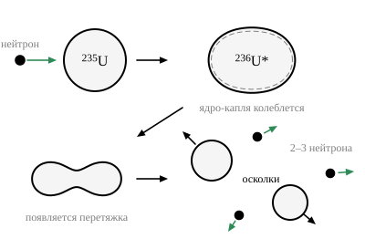

Атомная электростанция, Солнце, водородная бомба — везде ядерные реакции. Это превращения ядер при их взаимодействии с частицами или друг с другом. Тема встречается в задачах 16 и 17.

## Что сохраняется

В любой ядерной реакции выполняются законы сохранения:

- **зарядового числа**: сумма нижних индексов слева равна сумме справа;
- **массового числа**: сумма верхних индексов слева равна сумме справа;
- энергии и импульса.

Эти два правила позволяют найти неизвестную частицу. Пример — первая искусственная ядерная реакция (Резерфорд):

$$
^{14}_{7}\text{N} + {}^{4}_{2}\text{He} \to {}^{17}_{8}\text{O} + {}^{1}_{1}\text{p}.
$$

Проверка: $14 + 4 = 17 + 1$, $7 + 2 = 8 + 1$.

Полезные обозначения частиц: протон $^1_1\text{p}$ (или $^1_1\text{H}$), нейтрон $^1_0\text{n}$, электрон $^{\ \,0}_{-1}e$, позитрон $^0_{+1}e$, альфа-частица $^4_2\text{He}$, дейтрон $^2_1\text{H}$.

## Энергетический выход

Если масса продуктов реакции меньше массы исходных частиц, энергия **выделяется**:

$$
Q = (m_{\text{до}} - m_{\text{после}})\,c^2.
$$

Если больше — энергия поглощается, и реакция идёт только при достаточной кинетической энергии исходных частиц.

## Деление ядер

Нейтрон попадает в ядро урана-235. Ядро возбуждается, вытягивается и раскалывается на два осколка средней массы, испуская 2–3 нейтрона. Выделяется около $200\ \text{МэВ}$ на одно деление.

Вылетевшие нейтроны могут разделить соседние ядра — возникает **цепная реакция**. В атомном реакторе её поддерживают управляемой: лишние нейтроны поглощают регулирующие стержни, а замедлитель (вода, графит) уменьшает скорость нейтронов, чтобы они лучше захватывались ураном-235.

## Синтез ядер

Лёгкие ядра (изотопы водорода) сливаются в более тяжёлые — например, в гелий:

$$
^2_1\text{H} + {}^3_1\text{H} \to {}^4_2\text{He} + {}^1_0\text{n}.
$$

На один нуклон энергии выделяется даже больше, чем при делении. Но ядра заряжены одноимённо и отталкиваются, поэтому для синтеза нужны температуры в миллионы градусов — отсюда название **термоядерная реакция**. Так светятся Солнце и звёзды.

## Как найти неизвестную частицу

Удобный порядок действий:

1. Выпиши все верхние индексы слева и справа и составь уравнение для неизвестного $A$.
2. То же для нижних индексов — получишь $Z$.
3. По $Z$ найди элемент в таблице Менделеева (или узнай частицу: $Z = 0$, $A = 1$ — нейтрон; $Z = 1$, $A = 1$ — протон; $Z = 2$, $A = 4$ — альфа-частица; $Z = -1$, $A = 0$ — электрон).

Так же решают цепочки распадов: каждый альфа-распад уменьшает $A$ на 4, а $Z$ на 2; каждый бета-минус-распад не меняет $A$ и увеличивает $Z$ на 1. Число альфа-распадов находят по изменению $A$, а потом по изменению $Z$ — число бета-распадов.

## Частые ловушки

- **Забывают проверить оба закона сохранения** — и массовое, и зарядовое число.
- **Путают нейтрон и протон.** У нейтрона $Z = 0$.
- **Думают, что масса сохраняется.** Сохраняется массовое число (число нуклонов), а масса меняется на $Q/c^2$.
- **Считают, что синтез выделяет меньше энергии, чем деление.** На нуклон — больше.

## Как это выглядит на ЕГЭ

*Определи частицу X в реакции $^{9}_{4}\text{Be} + {}^{4}_{2}\text{He} \to {}^{12}_{6}\text{C} + \text{X}$.*

Массовые числа: $9 + 4 = 12 + A$, $A = 1$.
Зарядовые: $4 + 2 = 6 + Z$, $Z = 0$.

Частица с $A = 1$, $Z = 0$ — **нейтрон**. Именно в этой реакции в 1932 году был открыт нейтрон.

## Коротко

- Сохраняются зарядовое и массовое числа, энергия, импульс.
- $Q = (m_{\text{до}} - m_{\text{после}})c^2$; $Q > 0$ — энергия выделяется.
- Деление урана: нейтроны → цепная реакция; в реакторе — управляемая.
- Синтез лёгких ядер — термоядерная реакция, источник энергии звёзд.
