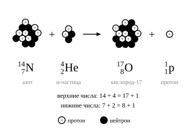

В уроке 4.1 мы видели опыт Резерфорда 1919 года: альфа-частицы, пролетая сквозь азот, иногда выбивали из него ядра водорода — протоны. Так открыли протон. Но в этом опыте случилось и кое-что поважнее: ядро азота перестало быть азотом. Впервые человек превратил один химический элемент в другой.

## Что увидели в камере Вильсона

В камере Вильсона пролетающая заряженная частица оставляет след из капелек тумана — трек. В 1925 году английский физик Патрик Блэкетт наполнил камеру азотом и снимал треки альфа-частиц. Он сделал больше двадцати тысяч фотографий, на них было больше четырёхсот тысяч треков. Почти все — прямые и почти одной длины. И только восемь треков заканчивались «вилкой».

После вилки трека альфа-частицы нет: она исчезла, её поглотило ядро азота. Вместо неё от вилки отходят два трека: длинный и тонкий — протон, короткий и толстый — тяжёлое ядро, получившее толчок. Это ядро кислорода-17.

## Что такое ядерная реакция

**Ядерная реакция** — превращение атомных ядер при их взаимодействии с элементарными частицами или друг с другом. Её записывают как уравнение химической реакции. Реакция Резерфорда:

$$
^{14}_{\ 7}\text{N} + {}^{4}_{2}\text{He} \to {}^{17}_{\ 8}\text{O} + {}^{1}_{1}\text{p}.
$$

Чем реакция отличается от радиоактивного распада (уроки 5.3 и 5.4)? Распад идёт сам собой, без всякого внешнего воздействия. Для реакции нужно столкновение: частица должна попасть в ядро.

## Что сохраняется

Посмотри на картинку с нуклонами: ни один нуклон не исчез и не появился, они только перегруппировались. И заряд никуда не делся. В любой ядерной реакции выполняются законы сохранения:

- **числа нуклонов**: сумма массовых чисел (верхних) слева равна сумме справа;
- **электрического заряда**: сумма зарядовых чисел (нижних) слева равна сумме справа;
- **энергии**;
- **импульса**.

**Пример.** Проверим реакцию Резерфорда. Верхние числа: ${14 + 4 = 18,}$ ${17 + 1 = 18.}$ Нижние: ${7 + 2 = 9,}$ ${8 + 1 = 9.}$ Оба закона выполняются.

Обрати внимание: сохраняется **число нуклонов**, а не масса. Масса продуктов немного отличается от массы исходных частиц — на величину, связанную с энергией реакции формулой ${\Delta E = \Delta m\, c^2}$ (урок 1.4 из СТО). Об этом урок 6.4.

<pp-task id="ks-nr-01"></pp-task>

## Импульс в ядерной реакции

Ядро азота в опыте покоилось, а альфа-частица летела. Значит, импульс системы до реакции направлен вперёд, по движению альфа-частицы. После реакции суммарный импульс протона и ядра кислорода тот же самый (урок 10.2 из механики). Поэтому оба продукта разлетаются вперёд, и ядро кислорода не может остаться на месте.

Удобно представить реакцию в два шага. Сначала альфа-частица и ядро азота сливаются в одно ядро, как тела при неупругом ударе (урок 10.4 из механики). Затем это ядро распадается на кислород и протон. Скорость промежуточного ядра находят из закона сохранения импульса — так же, как скорость слипшихся тележек.

<pp-task id="ks-nr-07"></pp-task>

Проверь себя: может ли в ядерной реакции суммарный заряд частиц после реакции оказаться больше, чем до неё?

Нет. Электрический заряд сохраняется в любой реакции: сумма зарядовых чисел после реакции равна сумме до неё. Если в записи реакции суммы нижних чисел не совпадают, в ней ошибка или пропущена частица.

## Частые ловушки

- **Путают реакцию и распад.** Распад идёт сам собой, реакция — при столкновении с частицей или ядром.
- **Проверяют только один закон.** Нужны оба: и сумма массовых чисел, и сумма зарядовых.
- **Думают, что сохраняется масса.** Сохраняется число нуклонов; масса меняется вместе с энергией.
- **Забывают налетающую частицу.** Она тоже стоит в левой части реакции.

## Коротко

- Ядерная реакция — превращение ядер при взаимодействии с частицами или друг с другом; первая — реакция Резерфорда ${^{14}_{\ 7}\text{N} + {}^{4}_{2}\text{He} \to {}^{17}_{\ 8}\text{O} + {}^{1}_{1}\text{p}}$ (1919).
- Сохраняются сумма массовых чисел, сумма зарядовых чисел, энергия и импульс.
