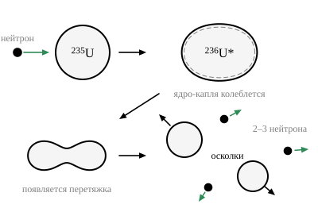
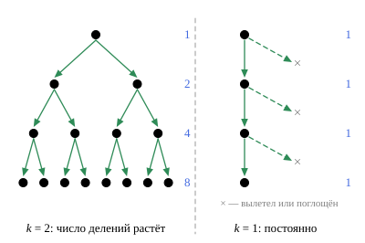

В конце 1938 года немецкие химики Отто Ган и Фриц Штрасман облучали уран нейтронами и нашли среди продуктов барий — элемент из середины таблицы Менделеева, почти вдвое легче урана. Объяснили это Лиза Мейтнер и Отто Фриш: ядро урана раскололось пополам. Они назвали это делением — как деление живой клетки.

## Ядро-капля

Ядро похоже на каплю жидкости: нуклоны притягиваются только к ближайшим соседям (урок 4.3). Ядерные силы держат каплю, как поверхностное натяжение. А протоны отталкиваются, и это отталкивание старается каплю разорвать.

Ядро урана-235 захватывает нейтрон и становится возбуждённым ядром урана-236. Оно начинает колебаться, вытягивается, посередине появляется перетяжка. Половинки уже почти не держатся друг за друга ядерными силами, а кулоновское отталкивание по-прежнему действует, и капля разрывается.

## Осколки и нейтроны

Ядро делится на два **осколка** средней массы — по-разному, вариантов много. Например,

$$
^{235}_{\ 92}\text{U} + {}^{1}_{0}\text{n} \to {}^{140}_{\ 54}\text{Xe} + {}^{94}_{38}\text{Sr} + 2\,{}^{1}_{0}\text{n}.
$$

Проверь законы сохранения: ${235 + 1 = 140 + 94 + 2,}$ ${92 = 54 + 38.}$

Почему вылетают нейтроны? В тяжёлом ядре нейтронов на один протон больше, чем в средних (урок 4.3). Осколкам столько нейтронов «не нужно», и 2–3 лишних вылетают сразу. Остальные лишние нейтроны осколки потом превращают в протоны бета-распадами (урок 5.4). Поэтому осколки радиоактивны — это и есть радиоактивные отходы реакторов.

При одном делении выделяется около ${200\ \text{МэВ}}$ (урок 4.7). Больше всего уносят разлетающиеся осколки, а в веществе их энергия превращается в тепло.

<pp-task id="ks-nr-05"></pp-task>

## Цепная реакция

Каждый нейтрон, вылетевший при делении, может разделить следующее ядро. Те дадут новые нейтроны, а они разделят новые ядра. Это **цепная реакция**.

Но не каждый нейтрон делит ядро. Одни вылетают из куска урана наружу, другие захватываются ядрами без деления. Поэтому важно, сколько нейтронов доживает до следующего деления. **Коэффициент размножения нейтронов** $k$ — отношение числа нейтронов в следующем поколении к числу нейтронов в предыдущем:

- ${k > 1}$ — число делений растёт с каждым поколением, реакция разгоняется;
- ${k = 1}$ — число делений постоянно, реакция идёт ровно;
- ${k < 1}$ — реакция затухает.

Одно поколение нейтронов сменяется за тысячные доли секунды и быстрее. Поэтому при ${k > 1}$ реакция разгоняется почти мгновенно.

<pp-task id="ks-nr-11"></pp-task>

## Критическая масса

Природный уран — это на ${99{,}3\,\%}$ уран-238 и лишь на ${0{,}7\,\%}$ уран-235. Уран-238 медленными нейтронами не делится, а захватывает их. Поэтому в природном уране цепная реакция сама не идёт. Нужен уран, обогащённый ураном-235.

Но и в чистом уране-235 цепная реакция идёт не всегда. Чем меньше кусок, тем ближе к любому ядру его поверхность и тем большая доля нейтронов вылетает наружу. В маленьком куске ${k < 1.}$ **Критическая масса** — наименьшая масса урана, в которой ${k = 1}$ и цепная реакция может идти. Для шара из чистого урана-235 это около ${50\ \text{кг}}$ — шар диаметром около ${17\ \text{см}.}$

На этом устроена атомная бомба: два куска урана, каждый меньше критической массы, резко соединяют. Масса становится больше критической, ${k > 1,}$ и за миллионные доли секунды делится огромное число ядер.

## Модель

В модели — шар из урана-235. Каждый нейтрон либо вылетает наружу, либо делит ядро и даёт ${2}$ или ${3}$ новых нейтрона. Чем больше шар, тем меньшая доля нейтронов вылетает. Посмотри, как растёт число нейтронов в каждом поколении, и сравни с пунктиром. Потом уменьши радиус до ${9\ \text{см}}$ — это критический размер модели: ${k = 1.}$ Число нейтронов в среднем не растёт и не падает, но их всего десяток, и случай может оборвать цепочку — запусти несколько новых опытов. А при ${6\ \text{см}}$ цепочка обрывается быстро всегда.

<pp-chain size="18" rods="0">Модель цепной реакции: круглый шар урана-235, ядра — точки, разделившиеся ядра — пустые кружки, нейтроны летят от делений к следующим ядрам или вылетают наружу. Внизу график числа нейтронов в каждом поколении: точки — опыт, пунктир — 10·k в степени номера поколения. Ползунки задают радиус шара и число регулирующих стержней.</pp-chain>

Проверь себя: в куске урана-235 массой 1 кг всегда есть случайные нейтроны. Почему он не взрывается?

Масса куска намного меньше критической. Большинство нейтронов вылетает наружу, не успев разделить ядро, поэтому ${k < 1}$ и любая начавшаяся цепочка делений быстро обрывается.

## Частые ловушки

- **Думают, что уран делится сам собой.** Деление вызывает нейтрон; без нейтронов уран-235 делится лишь изредка.
- **Путают ${k = 1}$ с остановкой.** При ${k = 1}$ реакция идёт с постоянной скоростью.
- **Думают, что чем больше кусок, тем больше нейтронов теряется.** Наоборот: в большом куске доля вылетающих нейтронов меньше.
- **Забывают налетающий нейтрон** при проверке законов сохранения.

## Коротко

- Нейтрон делит ядро урана-235 на два осколка; вылетают 2–3 нейтрона, выделяется около ${200\ \text{МэВ}.}$
- Цепная реакция: коэффициент размножения ${k > 1}$ — разгон, ${k = 1}$ — ровный ход, ${k < 1}$ — затухание.
- Критическая масса — наименьшая масса, при которой ${k = 1;}$ у чистого урана-235 около ${50\ \text{кг}.}$
