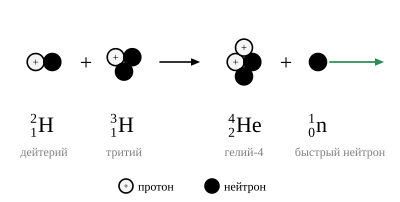

Солнце светит четыре с половиной миллиарда лет и каждую секунду теряет с излучением около четырёх миллионов тонн массы (урок 4.7). Никакое химическое топливо не горело бы так долго. Источник его энергии — слияние ядер водорода в ядра гелия.

## Синтез

**Термоядерный синтез** — реакция слияния лёгких ядер в более тяжёлые. На кривой удельной энергии связи (урок 4.6) лёгкие ядра лежат на крутом подъёме, поэтому продукты связаны гораздо прочнее и энергия выделяется. На один нуклон её выделяется больше, чем при делении урана (урок 4.7).

В недрах Солнца цепочкой реакций четыре протона превращаются в ядро гелия:

$$
4\,{}^{1}_{1}\text{p} \to {}^{4}_{2}\text{He} + 2\,{}^{\ 0}_{+1}e + 2\nu.
$$

Проверь законы сохранения: массовые числа ${4 = 4 + 0,}$ зарядовые ${4 = 2 + 2.}$ Два протона превратились в нейтроны, а их заряд унесли позитроны.

На Земле легче всего провести синтез дейтерия и трития:

$$
^{2}_{1}\text{H} + {}^{3}_{1}\text{H} \to {}^{4}_{2}\text{He} + {}^{1}_{0}\text{n}.
$$

## Кулоновский барьер

Почему же синтез так трудно устроить? Ядра заряжены положительно и отталкиваются. Ядерные силы начинают притягивать их, только когда ядра почти соприкоснутся. Энергия отталкивания двух зарядов $e$ на расстоянии $r$ равна ${ke^2/r}$ (урок 2.7 из электродинамики). Для ядер дейтерия и трития на расстоянии около ${4 \cdot 10^{-15}\ \text{м}\text{:}}$

$$
\begin{aligned}
\frac{ke^2}{r} &= \frac{9 \cdot 10^9 \cdot (1{,}6 \cdot 10^{-19})^2}{4 \cdot 10^{-15}} \approx 5{,}8 \cdot 10^{-14}\ \text{Дж},\\
\frac{ke^2}{r} &\approx 0{,}36\ \text{МэВ}.
\end{aligned}
$$

Это **кулоновский барьер**: чтобы слиться, ядра должны налететь друг на друга с такой энергией.

Средняя кинетическая энергия частиц газа ${\tfrac{3}{2}kT}$ (урок 2.4 из МКТ). Даже при температуре ${10^8\ \text{К}}$ она около ${2 \cdot 10^{-15}\ \text{Дж},}$ то есть ${0{,}013\ \text{МэВ}}$ — в десятки раз меньше барьера. И всё же синтез идёт. Во-первых, у части ядер скорость гораздо больше средней. Во-вторых, по законам квантовой физики ядро может с небольшой вероятностью «просочиться» сквозь барьер. Поэтому хватает десятков миллионов градусов: в центре Солнца около ${15}$ миллионов, а в установках на Земле нужно больше ${100}$ миллионов. Отсюда и название — **термоядерные** реакции: «термо» — тепло.

<pp-task id="ks-nr-14"></pp-task>

## Плазма и токамак

При таких температурах атомы теряют все электроны. Вещество становится **плазмой** — газом из ядер и электронов. Никакая стенка её не выдержит, да и плазма от стенки сразу остынет. Солнце удерживает свою плазму тяготением. На Земле её удерживают магнитным полем: заряженные частицы навиваются на линии поля по спиралям (урок 9.7 из электродинамики) и не долетают до стенок.

Самая удачная такая установка — **токамак**: «тороидальная камера с магнитными катушками». Её придумали в Советском Союзе: идея Игоря Тамма и Андрея Сахарова 1950–1951 годов, первые токамаки построили в Институте атомной энергии имени Курчатова. В 1968 году на токамаке Т-3 плазму нагрели примерно до ${10}$ миллионов градусов, и после этого токамаки стали строить по всему миру. Сейчас во Франции строят международный токамак ИТЭР, в проекте участвует и Россия.

Неуправляемый синтез уже давно осуществили — в водородной бомбе: её «запал» — атомная бомба, которая создаёт нужную температуру. Управляемый синтез пока не даёт электроэнергии, но его топливо почти неисчерпаемо: дейтерий есть в любой воде, примерно один атом на ${6500}$ атомов водорода. Трития в природе нет, его получают из лития, облучая его нейтронами.

<pp-task id="ks-nr-06"></pp-task>

Проверь себя: почему термоядерная реакция не идёт в стакане тяжёлой воды, хотя в ней много ядер дейтерия?

При комнатной температуре ядра движутся слишком медленно. Их кинетическая энергия в миллионы раз меньше кулоновского барьера, и ядра не могут сблизиться настолько, чтобы подействовали ядерные силы.

## Частые ловушки

- **Путают синтез и деление.** Синтез — слияние лёгких ядер, деление — раскол тяжёлых.
- **Думают, что «термо» значит «выделяет тепло».** Высокая температура нужна, чтобы ядра преодолели отталкивание.
- **Считают, что синтез даёт меньше энергии, чем деление.** На одну реакцию меньше, а на один нуклон — больше.
- **Думают, что плазму держат стенки.** Её удерживает магнитное поле или, в звёздах, тяготение.

## Коротко

- Синтез — слияние лёгких ядер; так светят Солнце и звёзды; на Земле проще всего ${^{2}_{1}\text{H} + {}^{3}_{1}\text{H} \to {}^{4}_{2}\text{He} + {}^{1}_{0}\text{n}.}$
- Ядра отталкиваются, поэтому нужны температуры в десятки и сотни миллионов градусов — реакции термоядерные.
- Плазму удерживают магнитным полем в токамаке — советском изобретении; строится международный токамак ИТЭР.

Это последний урок темы и всего раздела «Квантовая физика»: от фотона до термоядерного синтеза. Дальше — раздел о методах физики, тема «Измерения и погрешности»: как измерять величины и оценивать, насколько точен результат.
