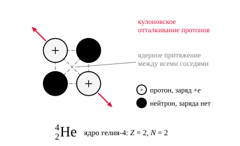

В ядре теснятся положительно заряженные протоны. Они должны бы разлететься от кулоновского отталкивания — но не разлетаются. Что их держит и откуда берётся энергия атомных станций? Тема нужна в задачах 16 и 17.

Строение ядра проходят в 11 классе. Пригодятся темы «Строение атома и линейчатые спектры» (ядро и электроны) и «Основы специальной теории относительности» (энергия покоя $E = mc^2$).

## Шаг 1. Из чего состоит ядро (11 класс)

Ядро состоит из **протонов** и **нейтронов**. Их вместе называют **нуклонами**.

- Протон: заряд $+e$, масса около $1{,}673 \cdot 10^{-27}\ \text{кг}$.
- Нейтрон: заряда нет, масса чуть больше массы протона.

Обозначение ядра: $^{A}_{Z}\text{X}$.

- $Z$ — **зарядовое число**, число протонов. Равно порядковому номеру элемента в таблице Менделеева и числу электронов в нейтральном атоме.
- $A$ — **массовое число**, общее число нуклонов.
- Число нейтронов: $N = A - Z$.

Пример: $^{238}_{92}\text{U}$ — 92 протона, $238 - 92 = 146$ нейтронов.

<pp-task id="ks-nuc-01"></pp-task>

## Шаг 2. Изотопы (11 класс)

**Изотопы** — ядра одного элемента (одинаковое $Z$) с разным числом нейтронов. Химически изотопы почти неотличимы. Водород, дейтерий и тритий: $^1_1\text{H}$, $^2_1\text{H}$, $^3_1\text{H}$.

<pp-task id="ks-nuc-02"></pp-task>

## Шаг 3. Ядерные силы (11 класс)

Нуклоны держатся вместе благодаря **ядерным силам**:

- очень сильные — во много раз сильнее электрического отталкивания протонов;
- **короткодействующие** — работают только на расстояниях порядка размера ядра ($10^{-15}\ \text{м}$);
- одинаково действуют между протонами и нейтронами.

## Шаг 4. Дефект массы (11 класс)

Взвесим ядро гелия и, отдельно, два протона и два нейтрона. Ядро окажется **легче**, чем его части по отдельности. Эта разница — **дефект массы**:

$$
\Delta m = Z m_p + (A - Z) m_n - M_{\text{я}}.
$$

<pp-task id="ks-nuc-03"></pp-task>

## Шаг 5. Энергия связи (11 класс)

Куда делась масса? Когда нуклоны соединились, выделилась энергия. По формуле Эйнштейна эта энергия и «унесла» массу. Чтобы разобрать ядро обратно, нужно вернуть ту же энергию — **энергию связи**:

$$
E_{\text{св}} = \Delta m\, c^2.
$$

Удобный перевод: масса $1\ \text{а.е.м.}$ соответствует энергии около $931{,}5\ \text{МэВ}$. Чтобы получить энергию связи в МэВ, умножь дефект массы в а.е.м. на $931{,}5$ — переводить в килограммы не нужно.

<pp-task id="ks-nuc-04"></pp-task>

## Шаг 6. Удельная энергия связи (11 класс)

**Удельная энергия связи** — энергия связи на один нуклон, $E_{\text{св}}/A$. Чем она больше, тем прочнее ядро.

<pp-task id="ks-nuc-05"></pp-task>

## Шаг 7. Откуда берётся ядерная энергия (11 класс)

Удельная энергия связи максимальна у ядер в районе железа (около $8{,}8\ \text{МэВ}$ на нуклон). Поэтому энергия выделяется и при делении тяжёлых ядер (урана), и при синтезе лёгких (водорода в гелий): продукты в обоих случаях связаны прочнее.

<pp-task id="ks-nuc-06"></pp-task>

## Частые ловушки

- **Путают $A$ и $Z$.** $Z$ — внизу, протоны; $A$ — вверху, все нуклоны.
- **Считают, что нейтронов $A$.** Нейтронов $A - Z$.
- **Думают, что ядро тяжелее суммы своих частей.** Оно легче — на дефект массы.
- **Путают энергию связи и удельную энергию связи.** Прочность ядра определяет удельная.

## Как это выглядит на ЕГЭ

*Сколько протонов и нейтронов в ядре $^{27}_{13}\text{Al}$?*

Нижнее число — протоны: $Z = 13$. Верхнее — все нуклоны: $A = 27$. Нейтронов $27 - 13 = 14$.

А сколько электронов в нейтральном атоме алюминия? Столько же, сколько протонов: $13$.

## Коротко

- Ядро $^{A}_{Z}\text{X}$: $Z$ протонов, $A - Z$ нейтронов.
- Изотопы — одинаковое $Z$, разное $A$.
- Ядерные силы сильные и короткодействующие.
- $\Delta m = Zm_p + (A-Z)m_n - M_{\text{я}}$; $E_{\text{св}} = \Delta m c^2$; $1\ \text{а.е.м.} \leftrightarrow 931{,}5\ \text{МэВ}$.
- Самые прочные ядра — около железа.
