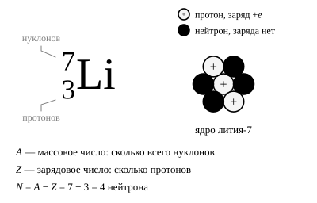

Опыт Резерфорда показал: в центре атома есть крошечное положительное ядро, и в нём почти вся масса атома (урок 3.1). Но из чего состоит само ядро? Его не разглядеть ни в какой микроскоп: оно в десятки тысяч раз меньше атома. И снова помог обстрел частицами.

## Протон

В 1919 году Резерфорд пропускал альфа-частицы через азот. Иногда на экране вспыхивали частицы, которые пролетали дальше самих альфа-частиц. По отклонению в магнитном поле их узнали: это ядра водорода. Альфа-частица, ударив ядро азота, выбивала из него ядро водорода. Значит, ядра водорода входят в состав других ядер.

Ядро самого лёгкого атома, водорода, назвали **протоном**:

- заряд протона ${+e = +1{,}6 \cdot 10^{-19}\ \text{Кл}}$ — равен заряду электрона по модулю, но положительный;
- масса протона ${m_p \approx 1{,}673 \cdot 10^{-27}\ \text{кг},}$ примерно в ${1836}$ раз больше массы электрона.

## Нейтрон

Если ядро состоит только из протонов, то масса ядра должна быть равна числу протонов, умноженному на массу протона. Но ядро гелия имеет заряд ${+2e,}$ то есть два протона, а весит почти как четыре протона. Где ещё две «протонные массы»?

Ответ нашёл Джеймс Чедвик в 1932 году. Бериллий, облучённый альфа-частицами, испускал очень проникающее излучение без заряда: его не отклоняли ни электрическое, ни магнитное поле. Попадая в парафин, оно выбивало из него протоны. Чедвик показал, что это частицы с массой почти как у протона, но без заряда. Их назвали **нейтронами**:

- заряда у нейтрона нет;
- масса нейтрона ${m_n \approx 1{,}675 \cdot 10^{-27}\ \text{кг}}$ — чуть больше массы протона.

Нейтрон так долго не могли найти именно потому, что он нейтрален: он не отклоняется полями, не вырывает электроны из атомов и поэтому не оставляет следов в приборах.

## Нуклоны и обозначение ядра

Протоны и нейтроны вместе называют **нуклонами** (от латинского nucleus — ядро). Ядро любого элемента обозначают так:

$$
^{A}_{Z}\text{X}.
$$

- $X$ — символ элемента из таблицы Менделеева.
- $Z$ — **зарядовое число**: число протонов. Заряд ядра ${+Ze.}$ Это и есть порядковый номер элемента (урок 3.2). В нейтральном атоме электронов столько же, сколько протонов.
- $A$ — **массовое число**: число всех нуклонов, протонов и нейтронов вместе.
- Число нейтронов:

$$
N = A - Z.
$$

Элемент определяет $Z.$ Любое ядро с шестью протонами — это углерод, с восемью — кислород. Нейтроны на заряд не влияют.

Так же записывают и сами нуклоны: протон ${^1_1\text{p}}$ (один нуклон, заряд $+1$), нейтрон ${^1_0\text{n}}$ (один нуклон, заряд $0$). Альфа-частица из опыта Резерфорда — это ядро гелия ${^4_2\text{He}\text{:}}$ два протона и два нейтрона.

**Пример.** Сколько протонов и нейтронов в ядре алюминия ${^{27}_{13}\text{Al}?}$ Нижнее число — протоны: ${Z = 13.}$ Верхнее — все нуклоны: ${A = 27.}$ Нейтронов ${27 - 13 = 14.}$ А электронов в нейтральном атоме алюминия столько же, сколько протонов: ${13.}$

Ещё пример: в ядре урана ${^{238}_{\ 92}\text{U}}$ ${92}$ протона и ${238 - 92 = 146}$ нейтронов.

<pp-task id="ks-nuc-01"></pp-task>

<pp-task id="ks-nuc-07"></pp-task>

## Модель

Собери ядро сам. Выбирай элемент — число протонов — и число нейтронов. Модель покажет обозначение ядра и скажет, есть ли такое ядро в природе. Таблицу масс и энергий под моделью мы разберём в уроках 4.4–4.6.

<pp-nucleus z="8" a="16">Модель ядра: выбор элемента и числа нейтронов. Ядро нарисовано из нуклонов: протоны — светлые кружки с плюсом, нейтроны — тёмные. Рядом обозначение ядра и подпись, стабильно ли оно. Таблица: числа протонов, нейтронов и нуклонов, массы, дефект массы и энергия связи. Внизу график удельной энергии связи.</pp-nucleus>

Попробуй: у водорода одно и то же $Z = 1,$ а нейтронов может быть ноль, один или два. Такие ядра — тема следующего урока.

## Какого размера ядро

Размер ядра — около ${10^{-15}\text{–}10^{-14}\ \text{м}}$ (урок 3.1). Чем больше нуклонов, тем больше ядро, но нуклоны в нём всегда упакованы плотно, вплотную друг к другу, как шарики в мешке. Поэтому плотность ядерного вещества огромна и почти одинакова у всех ядер: чайная ложка такого вещества весила бы около миллиарда тонн.

Проверь себя: чем отличаются ядра углерода-14 и азота-14, у которых одинаковое массовое число?

Числом протонов. У углерода ${Z = 6,}$ у азота ${Z = 7.}$ Нуклонов у обоих ${14,}$ поэтому у углерода-14 нейтронов ${14 - 6 = 8,}$ а у азота-14 ${14 - 7 = 7.}$ Это ядра разных элементов: элемент определяет число протонов, а не массовое число.

## Частые ловушки

- **Путают $A$ и ${Z.}$** $Z$ — внизу, протоны; $A$ — вверху, все нуклоны.
- **Считают, что нейтронов ${A.}$** Нейтронов ${A - Z.}$
- **Ищут электроны в ядре.** Электронов в ядре нет. Их число в нейтральном атоме равно $Z$ — это следствие нейтральности атома.
- **Думают, что элемент определяет массовое число.** Элемент определяет $Z$; ядра с одним $A$ могут быть ядрами разных элементов.

## Коротко

- Ядро — это протоны и нейтроны, вместе нуклоны.
- Протон: заряд $+e,$ масса ${\approx 1{,}673 \cdot 10^{-27}\ \text{кг}.}$ Нейтрон: заряда нет, масса чуть больше.
- ${^{A}_{Z}\text{X}\text{:}}$ $Z$ протонов, $A$ нуклонов, ${N = A - Z}$ нейтронов; в нейтральном атоме $Z$ электронов.
