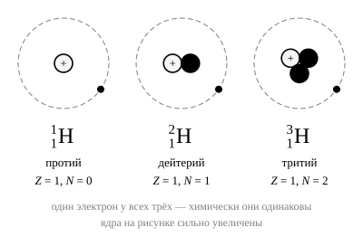

В 1931 году американский химик Гарольд Юри медленно выпаривал жидкий водород и заметил в спектре остатка слабые лишние линии. Это был водород, атомы которого вдвое тяжелее обычных. Вода из такого водорода — «тяжёлая вода» — на десятую часть плотнее обычной, и лёд из неё тонет в обычной воде. А по химическим свойствам это та же вода.

## Изотопы

**Изотопы** — ядра одного и того же элемента с разным числом нейтронов. Число протонов $Z$ у них одинаковое, а массовое число $A$ разное.

У водорода три изотопа:

- **протий** ${^1_1\text{H}}$ — один протон, нейтронов нет; это обычный водород, его больше всего;
- **дейтерий** ${^2_1\text{H}}$ — протон и нейтрон; именно его нашёл Юри;
- **тритий** ${^3_1\text{H}}$ — протон и два нейтрона; он радиоактивен и за ${12}$ с небольшим лет распадается наполовину.

Изотопы есть почти у всех элементов. У кислорода три стабильных изотопа: ${^{16}_{\ 8}\text{O},}$ ${^{17}_{\ 8}\text{O}}$ и ${^{18}_{\ 8}\text{O}.}$ У углерода — два стабильных, ${^{12}_{\ 6}\text{C}}$ и ${^{13}_{\ 6}\text{C},}$ и радиоактивный ${^{14}_{\ 6}\text{C},}$ по которому определяют возраст древних находок.

## Почему химия у изотопов одна

Химические свойства атома определяют его электроны: как атом отдаёт, принимает и делит их с соседями. Число электронов в нейтральном атоме равно числу протонов $Z$ (урок 3.2). У изотопов $Z$ одно, значит, и электронные оболочки одинаковые, и химия та же. Слово «изотоп» по-гречески значит «одно место»: все изотопы элемента стоят в одной клетке таблицы Менделеева.

Различаются изотопы массой. Поэтому их и разделяют по массе: например, в газовых центрифугах тяжёлые молекулы отбрасываются к стенкам чуть сильнее лёгких.

<pp-task id="ks-nuc-02"></pp-task>

<pp-task id="ks-nuc-09"></pp-task>

## Атомная единица массы

Массы атомов и ядер в килограммах неудобны: это числа вроде ${10^{-27}.}$ Поэтому вводят **атомную единицу массы** (а.е.м.) — двенадцатую часть массы атома углерода ${^{12}_{\ 6}\text{C}\text{:}}$

$$
1\ \text{а.е.м.} \approx 1{,}66 \cdot 10^{-27}\ \text{кг}.
$$

В этих единицах:

| Частица | Масса, а.е.м. |
|---|---|
| протон | $1{,}00728$ |
| нейтрон | $1{,}00866$ |
| электрон | $0{,}00055$ |

Протон и нейтрон весят почти по одной атомной единице, а электрон — в ${1836}$ раз меньше. Поэтому масса атома в а.е.м. близка к числу его нуклонов — отсюда и название «массовое число».

Относительная атомная масса из таблицы Менделеева (урок 1.5 из МКТ) — это и есть масса атома в а.е.м. А молярная масса в граммах на моль численно равна ей же: например, атом гелия-4 весит около ${4\ \text{а.е.м.},}$ а моль гелия — около ${4\ \text{г}.}$

## Почему атомные массы не целые

В таблице Менделеева масса хлора — ${35{,}45,}$ а не целое число. Причина в изотопах. Природный хлор — смесь: ${75{,}8\,\%}$ атомов хлора-35 и ${24{,}2\,\%}$ атомов хлора-37. В таблице стоит средняя масса атома:

$$
0{,}758 \cdot 35 + 0{,}242 \cdot 37 \approx 35{,}5.
$$

Точнее — ${35{,}45,}$ потому что и массы самих изотопов не точно целые: ${34{,}97}$ и ${36{,}97\ \text{а.е.м.}}$ Почему масса ядра не равна сумме масс его нуклонов — тема урока 4.4.

<pp-task id="ks-nuc-08"></pp-task>

Проверь себя: почему дейтерий и обычный водород дают одинаковые химические соединения, хотя их ядра разные?

У обоих в ядре один протон, значит, вокруг ядра один электрон. Химию определяют электроны, поэтому и соединения одинаковые: дейтерий тоже соединяется с кислородом в воду. Отличается только масса — тяжёлая вода плотнее обычной.

## Частые ловушки

- **Думают, что у изотопов разное число протонов.** Протонов поровну, это один элемент; разное число нейтронов.
- **Считают, что изотопы — разные химические элементы.** Элемент один, клетка в таблице одна.
- **Берут среднее арифметическое масс изотопов.** Среднюю массу считают с учётом долей: чего больше, то сильнее тянет среднее к себе.
- **Путают а.е.м. и килограммы.** ${1\ \text{а.е.м.} \approx 1{,}66 \cdot 10^{-27}\ \text{кг}.}$

## Коротко

- Изотопы: одно $Z,$ разное число нейтронов и разное $A.$
- Химически изотопы одинаковы, массой различаются.
- ${1\ \text{а.е.м.} \approx 1{,}66 \cdot 10^{-27}\ \text{кг}\text{:}}$ протон ${1{,}00728,}$ нейтрон ${1{,}00866\ \text{а.е.м.}}$
- Атомная масса элемента в таблице — среднее по его изотопам.
