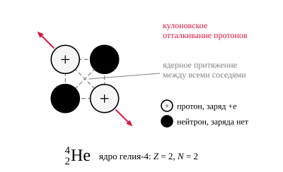

В ядре протоны сидят вплотную друг к другу, а одноимённые заряды отталкиваются. Насколько сильно? И почему ядро всё-таки не разлетается?

## Отталкивание протонов

Возьмём два протона на расстоянии ${2 \cdot 10^{-15}\ \text{м}}$ — примерно таком, как в ядре. По закону Кулона (урок 1.4 из электродинамики)

$$
F = k\frac{e^2}{r^2} = \frac{9 \cdot 10^9 \cdot (1{,}6 \cdot 10^{-19})^2}{(2 \cdot 10^{-15})^2} \approx 57{,}6\ \text{Н}.
$$

Почти шестьдесят ньютонов — вес шестикилограммовой гири — на одну частицу массой ${1{,}67 \cdot 10^{-27}\ \text{кг}.}$ Если бы ничто не держало протон, он получил бы ускорение

$$
a = \frac{F}{m_p} \approx \frac{57{,}6}{1{,}67 \cdot 10^{-27}} \approx 3{,}4 \cdot 10^{28}\ \text{м/с}^2.
$$

Может, протоны держит гравитация? Сила их притяжения на том же расстоянии ${Gm_p^2/r^2 \approx 4{,}6 \cdot 10^{-35}\ \text{Н}}$ — примерно в ${10^{36}}$ раз слабее кулоновской. Нет, не она.

## Ядерные силы

Значит, между нуклонами действуют особые силы притяжения, гораздо сильнее электрических. Их назвали **ядерными силами**, а само взаимодействие — **сильным**.

Свойства ядерных сил:

- **Очень сильные.** На расстояниях порядка размера нуклона ядерное притяжение двух протонов во много раз сильнее их кулоновского отталкивания.
- **Короткодействующие.** Они действуют только на расстояниях порядка ${10^{-15}\ \text{м}}$ и уже на ${(2\text{–}3) \cdot 10^{-15}\ \text{м}}$ почти исчезают. Кулоновская сила убывает гораздо медленнее, как ${1/r^2,}$ и достаёт далеко.
- **Не зависят от заряда.** Протон с протоном, протон с нейтроном, нейтрон с нейтроном притягиваются одинаково. Поэтому нейтроны — такой же «клей» ядра, как протоны, только без отталкивания.
- **Действуют только между соседями.** Нуклон притягивает лишь ближайших к нему нуклонов, а не всё ядро. Так же молекулы жидкости притягивают только соседей (урок 1.3 из МКТ); поэтому ядро и похоже на каплю жидкости.

Короткодействие объясняет, почему ядерные силы не замечали раньше: уже между соседними атомами, на расстоянии ${10^{-10}\ \text{м},}$ их нет совсем. Всё, что мы видим в обычной жизни, — тяготение и электромагнитные силы.

<pp-task id="ks-nuc-10"></pp-task>

<pp-task id="ks-nuc-11"></pp-task>

## Почему в тяжёлых ядрах больше нейтронов

Сравним два вида сил в большом ядре. Кулоновское отталкивание действует между **всеми** протонами ядра — даже между самыми далёкими. А ядерное притяжение — только между соседями. Чем больше протонов, тем сильнее общее отталкивание, а притяжение каждого нуклона почти не растёт.

Нейтроны добавляют притяжение, не добавляя отталкивания. Поэтому чем тяжелее ядро, тем больше в нём нейтронов по сравнению с протонами:

| Ядро | Протонов | Нейтронов |
|---|---|---|
| ${^4_2\text{He}}$ | $2$ | $2$ |
| ${^{16}_{\ 8}\text{O}}$ | $8$ | $8$ |
| ${^{56}_{26}\text{Fe}}$ | $26$ | $30$ |
| ${^{208}_{\ 82}\text{Pb}}$ | $82$ | $126$ |
| ${^{238}_{\ 92}\text{U}}$ | $92$ | $146$ |

Но и нейтроны не всесильны. Стабильных ядер с числом протонов больше ${83}$ нет вовсе: все они рано или поздно распадаются. Об этом — тема «Радиоактивность и закон распада».

Проверь себя: почему ядерные силы не стягивают в одно ядро соседние атомы в молекуле, раз они такие сильные?

Потому что они короткодействующие. Ядра соседних атомов разделены расстоянием порядка ${10^{-10}\ \text{м}}$ — в десятки тысяч раз больше радиуса действия ядерных сил. На таком расстоянии их нет, а кулоновское отталкивание ядер и электронные оболочки не дают ядрам сблизиться.

## Частые ловушки

- **Думают, что ядро держит гравитация.** Гравитация между нуклонами в ${10^{36}}$ раз слабее кулоновского отталкивания.
- **Считают, что нейтроны в ядре «лишние».** Нейтроны притягиваются ядерными силами, как протоны, и не отталкиваются — без них ядро бы не удержалось.
- **Считают, что ядерные силы действуют далеко.** Только на расстояниях порядка ${10^{-15}\ \text{м}.}$
- **Думают, что ядерные силы зависят от заряда.** Для протонов и нейтронов они одинаковы.

## Коротко

- Протоны в ядре отталкиваются с силой в десятки ньютонов; гравитация ничтожна.
- Ядерные силы: очень сильные, короткодействующие — порядка ${10^{-15}\ \text{м},}$ одинаковые для протонов и нейтронов, действуют только между соседями.
- Кулоновское отталкивание действует между всеми протонами, поэтому в тяжёлых ядрах нейтронов больше, чем протонов.
