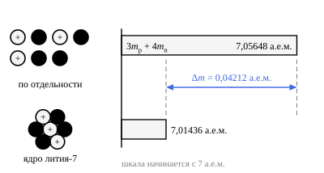

Если положить на весы кирпичи, а потом сложить из них стенку, масса не изменится: целое весит столько же, сколько его части. С ядрами не так. Ядро легче, чем протоны и нейтроны, из которых оно собрано.

## Ядро легче своих частей

Массы частиц и ядер измеряют очень точно, до миллионных долей атомной единицы. Возьмём ядро лития ${^7_3\text{Li}\text{:}}$ в нём ${3}$ протона и ${4}$ нейтрона. По отдельности они весят

$$
3m_p + 4m_n = 3 \cdot 1{,}00728 + 4 \cdot 1{,}00866 = 7{,}05648\ \text{а.е.м.}
$$

А масса ядра лития-7 — ${7{,}01436\ \text{а.е.м.}}$ Ядро легче на

$$
\Delta m = 7{,}05648 - 7{,}01436 = 0{,}04212\ \text{а.е.м.}
$$

Это больше половины процента — для точных весов огромная разница. В килограммах около ${7 \cdot 10^{-29}\ \text{кг}.}$

## Дефект массы

Разницу между суммой масс нуклонов по отдельности и массой ядра называют **дефектом массы**:

$$
\Delta m = Z m_p + N m_n - M_{\text{я}}.
$$

- $Z$ и ${N = A - Z}$ — числа протонов и нейтронов;
- ${m_p}$ и ${m_n}$ — массы протона и нейтрона;
- ${M_{\text{я}}}$ — масса ядра.

Дефект массы положителен у любого ядра, в котором больше одного нуклона: ядро всегда легче своих частей.

<pp-task id="ks-nuc-03"></pp-task>

## Масса ядра и масса атома

В справочниках обычно дают массы **атомов**, а не ядер: так их удобнее измерять. В массу атома входят и его $Z$ электронов. Чтобы получить массу ядра, массу электронов вычитают:

$$
M_{\text{я}} = M_{\text{ат}} - Z m_e,
$$

где масса электрона ${m_e \approx 0{,}00055\ \text{а.е.м.}}$

Масса атома лития-7 — ${7{,}016003\ \text{а.е.м.}}$ Три электрона весят ${3 \cdot 0{,}000549 \approx 0{,}00165\ \text{а.е.м.}}$ (здесь взято более точное значение ${m_e}$). Масса ядра ${7{,}016003 - 0{,}001647 \approx 7{,}01436\ \text{а.е.м.}}$ — то самое число, которое мы взяли выше.

Масса электронов кажется ничтожной, но сравни её с дефектом массы: ${0{,}00165}$ против ${0{,}042.}$ Это почти четыре процента дефекта. Если забыть про электроны, ответ заметно разойдётся с верным. Поэтому всегда смотри, что дано в задаче: масса ядра или масса атома.

<pp-task id="ks-nuc-12"></pp-task>

## Куда делась масса

Нуклоны не потерялись: их столько же. Пропала только часть массы. В уроке 1.4 из СТО мы видели: когда тело отдаёт энергию ${\Delta E,}$ его масса уменьшается на ${\Delta E/c^2.}$ Когда протоны и нейтроны соединяются в ядро, ядерные силы совершают работу и выделяется энергия — её уносят гамма-кванты. Вместе с энергией ушла и масса. Подробнее — в следующем уроке.

Проверь себя: что тяжелее — молекула водорода H₂ или два отдельных атома водорода?

Два отдельных атома. Когда атомы соединяются в молекулу, выделяется энергия — около ${4{,}5\ \text{эВ},}$ — и масса молекулы меньше на ${\Delta E/c^2.}$ Но это примерно ${5 \cdot 10^{-9}\ \text{а.е.м.}}$ — в миллионы раз меньше, чем дефект массы ядер, и химики его не замечают.

## Частые ловушки

- **Думают, что ядро тяжелее суммы своих частей или равно ей.** Оно легче — на дефект массы.
- **Вычитают в обратном порядке.** Из массы нуклонов вычитают массу ядра: ${\Delta m > 0.}$
- **Подставляют массу атома вместо массы ядра.** Сначала вычти массу $Z$ электронов.
- **Берут $A$ протонов.** Протонов $Z,$ нейтронов ${A - Z.}$

## Коротко

- Ядро легче суммы масс своих нуклонов.
- Дефект массы ${\Delta m = Z m_p + N m_n - M_{\text{я}} > 0.}$
- Масса ядра — масса атома минус $Z$ электронов: ${M_{\text{я}} = M_{\text{ат}} - Z m_e.}$
