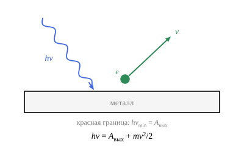

Двери в метро и магазине открываются сами, солнечная батарея питает калькулятор — в основе лежит фотоэффект. Его объяснение принесло Эйнштейну Нобелевскую премию. Тема встречается в задачах 16, 17 и 23.

Фотоэффект проходят в 11 классе. Пригодятся темы «Фотоны» (энергия фотона, электронвольты) и «Напряжённость и потенциал» (работа поля над зарядом).

## Шаг 1. Явление (11 класс)

Освети цинковую пластину ультрафиолетом — она теряет отрицательный заряд: свет выбивает из металла электроны. Это **фотоэффект** (внешний фотоэффект). Электроны, выбитые светом, — **фотоэлектроны**.

Опыты Столетова показали странные с точки зрения волновой теории закономерности.

## Шаг 2. Законы фотоэффекта (11 класс)

1. Сила **тока насыщения** (число электронов, вылетающих за секунду) пропорциональна интенсивности света.
2. Максимальная кинетическая энергия фотоэлектронов **растёт с частотой** света и **не зависит от интенсивности**.
3. Для каждого вещества есть **красная граница** — минимальная частота $\nu_{\min}$ (максимальная длина волны $\lambda_{\max}$), ниже которой фотоэффект не происходит, как бы ярко ни светили.

Волновая теория предсказывала обратное: яркий свет должен выбивать электроны с большей энергией. Ответ дал Эйнштейн.

<pp-task id="ks-pe-01"></pp-task>

## Шаг 3. Уравнение Эйнштейна (11 класс)

Свет состоит из фотонов. Один фотон отдаёт всю энергию одному электрону. Часть энергии уходит на то, чтобы вырваться из металла (**работа выхода** $A_{\text{вых}}$), остаток — кинетическая энергия электрона:

$$
h\nu = A_{\text{вых}} + E_{\text{к}\max}.
$$

- $h\nu$ — энергия фотона;
- $A_{\text{вых}}$ — работа выхода, зависит от вещества (обычно дана в эВ);
- $E_{\text{к}\max} = \dfrac{m v_{\max}^2}{2}$ — максимальная кинетическая энергия фотоэлектронов.

Теперь всё понятно: больше частота — больше энергия фотона — быстрее электроны; ярче свет — больше фотонов — больше электронов, но энергия каждого та же.

<pp-task id="ks-pe-02"></pp-task>

## Шаг 4. Красная граница (11 класс)

Если $h\nu < A_{\text{вых}}$, электрон не вырвется. Граница — когда энергии фотона хватает ровно на работу выхода:

$$
h\nu_{\min} = A_{\text{вых}}, \qquad \lambda_{\max} = \frac{hc}{A_{\text{вых}}}.
$$

Свет с длиной волны больше $\lambda_{\max}$ (краснее) фотоэффекта не вызывает.

<pp-task id="ks-pe-03"></pp-task>

## Шаг 5. Задерживающее напряжение (11 класс)

Чтобы остановить даже самые быстрые фотоэлектроны, между катодом и анодом прикладывают **задерживающее напряжение** $U_{\text{з}}$. Электрическое поле совершает работу против электрона:

$$
e U_{\text{з}} = E_{\text{к}\max}.
$$

Если $E_{\text{к}\max}$ в электронвольтах, то $U_{\text{з}}$ в вольтах — то же число.

<pp-task id="ks-pe-04"></pp-task>

## Шаг 6. Скорость фотоэлектронов (11 класс)

Если нужна скорость самых быстрых электронов, переведи энергию в джоули и используй $E_{\text{к}\max} = \dfrac{m v_{\max}^2}{2}$:

$$
v_{\max} = \sqrt{\frac{2 E_{\text{к}\max}}{m}},
$$

где $m = 9{,}1 \cdot 10^{-31}\ \text{кг}$ — масса электрона.

<pp-task id="ks-pe-05"></pp-task>

## Шаг 7. График $U_{\text{з}}(\nu)$ и постоянная Планка (11 класс)

Из $eU_{\text{з}} = h\nu - A_{\text{вых}}$ видно: задерживающее напряжение линейно зависит от частоты. График $U_{\text{з}}(\nu)$ — прямая с наклоном $h/e$, пересекающая ось частот в точке красной границы.

По двум опытам находят постоянную Планка:

$$
h = \frac{e\,(U_2 - U_1)}{\nu_2 - \nu_1}.
$$

<pp-task id="ks-pe-06"></pp-task>

## Частые ловушки

- **Думают, что яркий свет даёт более быстрые электроны.** Энергия зависит только от частоты.
- **Смешивают эВ и Дж.** Перед подстановкой переведи всё в одни единицы.
- **Считают, что ниже красной границы помогает яркость.** Фотоэффекта не будет при любой интенсивности.
- **Путают максимальную и среднюю энергию.** Уравнение — для максимальной.

## Как это выглядит на ЕГЭ

*Работа выхода электронов из металла $2\ \text{эВ}$. Металл освещают светом с энергией фотонов $3{,}5\ \text{эВ}$. Найди задерживающее напряжение.*

Максимальная кинетическая энергия фотоэлектронов:

$$
E_{\text{к}\max} = h\nu - A_{\text{вых}} = 3{,}5 - 2 = 1{,}5\ \text{эВ}.
$$

Энергия $1{,}5\ \text{эВ}$ — это заряд электрона, умноженный на $1{,}5\ \text{В}$. Значит, $U_{\text{з}} = 1{,}5\ \text{В}$. Электронвольты здесь экономят много арифметики.

## Коротко

- Ток насыщения пропорционален интенсивности света.
- $E_{\text{к}\max}$ зависит от частоты, не от интенсивности.
- $h\nu = A_{\text{вых}} + E_{\text{к}\max}$.
- Красная граница: $h\nu_{\min} = A_{\text{вых}}$.
- $eU_{\text{з}} = E_{\text{к}\max}$; наклон $U_{\text{з}}(\nu)$ равен $h/e$.
