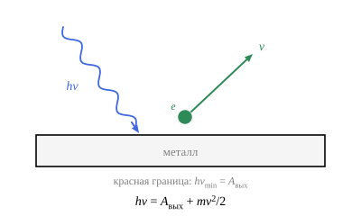
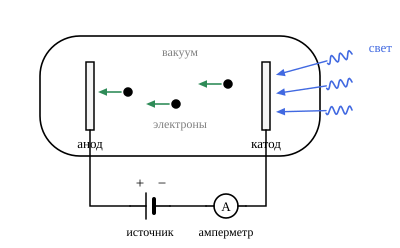

В 1887 году Генрих Герц ставил опыты с электромагнитными волнами и заметил странную вещь. Искра между двумя металлическими шариками проскакивала легче, если на шарики падал ультрафиолет от другой искры. Стоило поставить между ними стеклянную пластинку — эффект пропадал. Что свет делает с металлом?

## Свет выбивает электроны

Через год Вильгельм Гальвакс поставил опыт попроще. Он закрепил цинковую пластину на электрометре и зарядил её.

- Пластину зарядили **отрицательно** и осветили ультрафиолетом — стрелка электрометра быстро опустилась: пластина разрядилась.
- Пластину зарядили **положительно** — под тем же светом заряд не изменился.
- Между лампой и отрицательной пластиной поставили стекло — разряд прекратился: обычное стекло не пропускает ультрафиолет.

Значит, свет уносит из металла только отрицательный заряд. Позже выяснили, что это электроны — частицы с элементарным отрицательным зарядом (урок 1.2 из электродинамики), которые свободно движутся внутри металла. С положительной пластины вылетевшие электроны притягиваются обратно, поэтому её заряд не меняется.

**Фотоэффект** — вырывание электронов из вещества под действием света. Электроны, выбитые светом, называют **фотоэлектронами**.

В металле много свободных электронов, но сами они наружу не выходят: металл их удерживает. Свет передаёт электрону энергию, и её хватает, чтобы вырваться. Как именно передаёт — главный вопрос этой темы.

## Опыты Столетова

Подробно фотоэффект изучил Александр Столетов в Московском университете в 1888–1890 годах. Его установка — основа всех задач на фотоэффект.

- В стеклянной трубке два электрода. Тот, на который падает свет, — **катод**, второй — **анод**.
- Из трубки откачан воздух: в вакууме электроны летят, не сталкиваясь с молекулами.
- Между электродами — источник напряжения, в цепи — чувствительный амперметр.

Пока катод в темноте, тока нет: между электродами вакуум, зарядам не по чему течь. Стоит осветить катод — амперметр показывает ток. Электроны, выбитые светом, перелетают к аноду и замыкают цепь. Такой ток называют **фототоком**, а прибор — **фотоэлементом**.

Сила тока — это заряд, проходящий за секунду (урок 5.1 из электродинамики). Каждый электрон несёт заряд ${e = 1{,}6 \cdot 10^{-19}\ \text{Кл},}$ поэтому по фототоку можно сосчитать, сколько электронов в секунду долетает до анода. Это понадобится в следующем уроке.

## Где работает фотоэффект

- **Фотоэлементы и датчики света** включают уличные фонари в сумерках и считают пассажиров в турникетах: луч перекрыли — ток пропал.
- **Фотоэлектронные умножители** замечают даже отдельные фотоны: один выбитый электрон разгоняют и размножают в лавину. Они стоят в медицинских томографах и в детекторах частиц.
- В **солнечных батареях** и матрицах фотоаппаратов свет тоже освобождает электроны, но они остаются внутри полупроводника — это внутренний фотоэффект. На ЕГЭ речь идёт о внешнем, когда электроны вылетают наружу.

<pp-task id="ks-pe-07"></pp-task>

Проверь себя: почему отрицательно заряженная цинковая пластина под ультрафиолетом разряжается, а положительно заряженная — нет?

Свет выбивает из цинка электроны. Отрицательная пластина их отталкивает, они улетают и уносят отрицательный заряд — пластина разряжается. Положительная пластина притягивает вылетевшие электроны обратно, и её заряд не меняется.

## Частые ловушки

- **Думают, что свет выбивает положительные заряды.** Фотоэффект уносит только электроны, поэтому разряжается отрицательная пластина.
- **Путают фотоэффект с нагреванием.** Электроны вылетают не потому, что металл нагрелся: фотоэффект идёт и от холодного слабого света.
- **Думают, что обычное стекло пропускает ультрафиолет.** Оно его поглощает; окна в установках для ультрафиолета делают из кварца.
- **Думают, что в трубке ток идёт и в темноте.** Без света электроны из катода не вылетают, и в вакууме тока нет.

## Коротко

- Фотоэффект — вырывание электронов из вещества светом; вылетевшие электроны — фотоэлектроны.
- Под ультрафиолетом отрицательная цинковая пластина разряжается, положительная — нет.
- Установка Столетова: вакуумная трубка, освещённый катод, анод, источник и амперметр; ток идёт, только пока светят.
