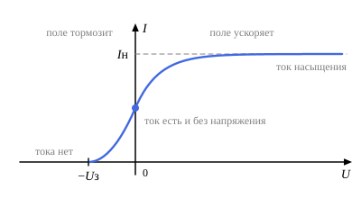

Электроны, которые выбивает свет, крошечные и быстрые — ни увидеть, ни поймать их по одному Столетов не мог. У него был только амперметр. И всё же по одному амперметру удалось узнать и сколько электронов вылетает, и с какой энергией. Как?

## Ток насыщения

Подключим анод к плюсу источника, катод — к минусу, и будем повышать напряжение $U$ между ними при том же освещении. Поле теперь ускоряет электроны к аноду.

- Сначала фототок растёт: поле подхватывает и те электроны, которые вылетели вбок или летели медленно.
- Потом рост прекращается. Ток перестаёт зависеть от напряжения — это **ток насыщения** ${I_{\text{н}}.}$

При насыщении до анода долетают **все** электроны, которые свет выбивает из катода за секунду. Больше поле дать не может — их больше просто нет. Сила тока — заряд за секунду (урок 5.1 из электродинамики), поэтому по току насыщения находят число выбитых электронов:

$$
I_{\text{н}} = \frac{Ne}{t}, \qquad \frac{N}{t} = \frac{I_{\text{н}}}{e}.
$$

**Пример.** Ток насыщения ${1{,}6\ \text{мкА}.}$ За секунду из катода вылетает

$$
\frac{N}{t} = \frac{1{,}6 \cdot 10^{-6}}{1{,}6 \cdot 10^{-19}} = 10^{13}\ \text{электронов}.
$$

Заметь: даже при нулевом напряжении ток есть. Электроны вылетают из катода с какой-то скоростью и часть из них сама долетает до анода.

## Тормозящее поле

Теперь поменяем полюса: анод к минусу, катод к плюсу. Электрон сам летит к большему потенциалу (урок 2.8 из электродинамики), а здесь анод ниже по потенциалу — поле **тормозит** электроны. Оно совершает над электроном работу ${-eU}$ (урок 2.5 из электродинамики) и отнимает у него кинетическую энергию ${eU.}$

До анода долетают только те электроны, у которых кинетическая энергия больше ${eU.}$ Повышаем тормозящее напряжение — ток падает. При некотором напряжении не долетают даже самые быстрые электроны, и ток пропадает совсем. Это **задерживающее напряжение** ${U_{\text{з}}.}$

На графике оно отмечено как ${-U_{\text{з}}\text{:}}$ знак минус лишь говорит, что анод теперь отрицательный. В задачах дают модуль.

## Энергия самых быстрых электронов

При задерживающем напряжении поле отнимает у самых быстрых фотоэлектронов всю кинетическую энергию (урок 12.2 из механики):

$$
eU_{\text{з}} = E_{\text{к}\max} = \frac{m v_{\max}^2}{2}.
$$

Так задерживающее напряжение становится «линейкой» для энергии электронов. Измерил ${U_{\text{з}}}$ — узнал ${E_{\text{к}\max},}$ а через неё и наибольшую скорость. Масса электрона ${m = 9{,}1 \cdot 10^{-31}\ \text{кг}.}$

В электронвольтах ещё проще: электрон, пройдя напряжение ${1\ \text{В},}$ меняет энергию на ${1\ \text{эВ}}$ (урок 2.8 из электродинамики). Поэтому ${E_{\text{к}\max}}$ в электронвольтах численно равна ${U_{\text{з}}}$ в вольтах.

**Пример.** Фототок пропадает при задерживающем напряжении ${0{,}6\ \text{В}.}$ Значит, самые быстрые электроны вылетают с энергией ${0{,}6\ \text{эВ},}$ или

$$
E_{\text{к}\max} = 0{,}6 \cdot 1{,}6 \cdot 10^{-19} = 9{,}6 \cdot 10^{-20}\ \text{Дж}.
$$

## Модель

Это фотоэлемент: свет падает на катод справа, электроны летят к аноду. Двигай напряжение $U$ и смотри на электроны и на график. Длину волны, яркость и металл катода разберём в уроках 2.3–2.5.

<pp-photoeffect>Модель фотоэлемента: ползунки длины волны света от 200 до 700 нанометров, яркости и напряжения между анодом и катодом от минус 5 до 5 вольт, выбор металла катода — цезий, калий, натрий, цинк. Фотоны падают на катод, электроны летят к аноду. График силы тока от напряжения с рабочей точкой. Таблица энергии фотона, работы выхода, наибольшей энергии электронов, задерживающего напряжения, красной границы и силы тока.</pp-photoeffect>

Посмотри, что выходит:

- при большом положительном напряжении ток почти равен току насыщения: поле подхватывает и электроны, летевшие вбок;
- при отрицательном напряжении часть электронов разворачивается, не долетев до анода;
- двигай напряжение к ${-U_{\text{з}}}$ из таблицы — ток обратится в ноль ровно там.

<pp-task id="ks-pe-08"></pp-task>

<pp-task id="ks-pe-09"></pp-task>

Проверь себя: почему при нулевом напряжении между анодом и катодом фототок не равен нулю?

Электроны вылетают из катода не с нулевой скоростью: свет даёт им кинетическую энергию. Часть из них долетает до анода сама, без помощи поля.

## Частые ловушки

- **Думают, что ток насыщения растёт с напряжением.** При насыщении долетают все выбитые электроны, больше напряжение ничего не добавит.
- **Путают полярность.** Задерживающее напряжение — это минус на аноде: поле тормозит электроны.
- **Считают, что ${eU_{\text{з}}}$ — энергия всех электронов.** Это энергия самых быстрых; остальные остановились раньше.
- **Путают вольты и электронвольты.** ${U_{\text{з}}}$ в вольтах — напряжение, ${E_{\text{к}\max}}$ в электронвольтах — энергия; числа совпадают, единицы — нет.

## Коротко

- Ток насыщения: долетают все выбитые электроны, ${N/t = I_{\text{н}}/e.}$
- Задерживающее напряжение останавливает самые быстрые электроны: ${eU_{\text{з}} = E_{\text{к}\max} = m v_{\max}^2/2.}$
- ${E_{\text{к}\max}}$ в электронвольтах численно равна ${U_{\text{з}}}$ в вольтах.
