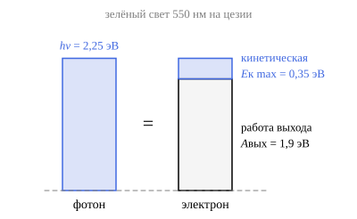

В 1905 году Эйнштейн взял идею Планка о порциях света (урок 1.1) и пошёл дальше: свет не только излучается, но и поглощается порциями. Одна порция — один фотон — достаётся одному электрону, целиком и сразу. Из этой мысли законы фотоэффекта получаются в одну строчку. Через шестнадцать лет за это объяснение Эйнштейн получил Нобелевскую премию.

## Один фотон — один электрон

Электроны в металле свободны, но наружу не выходят: на границе металл тянет их обратно. Чтобы электрон вылетел, надо совершить работу против этих сил. Наименьшую такую работу называют **работой выхода** ${A_{\text{вых}}.}$ Она зависит только от вещества, а от света — нет.

Фотон поглощается одним электроном и отдаёт ему всю энергию ${h\nu.}$ Часть её уходит на работу выхода, остаток — кинетическая энергия вылетевшего электрона:

$$
h\nu = A_{\text{вых}} + E_{\text{к}\max}.
$$

- $h\nu$ — энергия фотона (урок 1.2);
- ${A_{\text{вых}}}$ — работа выхода, задана для металла, обычно в электронвольтах;
- ${E_{\text{к}\max}}$ — наибольшая кинетическая энергия фотоэлектронов, та самая, что измеряют задерживающим напряжением (урок 2.2).

Почему наибольшая? Электроны, которые сидели глубже, по пути к поверхности теряют часть энергии на столкновения. Уравнение Эйнштейна описывает самые быстрые — вылетевшие с самой поверхности.

**Пример.** Цезий освещают зелёным светом с длиной волны ${550\ \text{нм}.}$ Энергию такого фотона мы уже нашли в уроке 1.2: ${2{,}25\ \text{эВ}.}$ Работа выхода цезия ${1{,}9\ \text{эВ},}$ поэтому

$$
E_{\text{к}\max} = h\nu - A_{\text{вых}} = 2{,}25 - 1{,}9 = 0{,}35\ \text{эВ}.
$$

Задерживающее напряжение — ${0{,}35\ \text{В}.}$

## Работа выхода разных металлов

| Металл | ${A_{\text{вых}},}$ эВ |
|---|---|
| цезий | ${1{,}9}$ |
| калий | ${2{,}2}$ |
| натрий | ${2{,}3}$ |
| цинк | ${4{,}2}$ |
| серебро | ${4{,}3}$ |
| платина | ${5{,}3}$ |

Щелочные металлы — цезий, калий, натрий — держат электроны слабо, поэтому их и наносят на катоды фотоэлементов. В задаче работу выхода обычно дают; таблицу учить не нужно.

## Законы — из одного уравнения

- **Яркость.** Яркость света — это число фотонов в секунду (урок 1.4). Больше фотонов — больше выбитых электронов, ток насыщения растёт. А энергия каждого фотона та же, и ${E_{\text{к}\max}}$ та же.
- **Частота.** ${E_{\text{к}\max} = h\nu - A_{\text{вых}}}$ растёт с частотой — линейно.
- **Красная граница.** Если ${h\nu < A_{\text{вых}},}$ одному фотону не хватает энергии вырвать электрон. Сложить энергию двух фотонов электрон не успевает — и фотоэффекта нет при любой яркости.
- **Без задержки.** Фотон отдаёт всю энергию сразу, копить ничего не нужно.

## Скорость самых быстрых электронов

Наибольшую скорость находят из кинетической энергии (урок 12.2 из механики):

$$
v_{\max} = \sqrt{\frac{2E_{\text{к}\max}}{m}}.
$$

Энергию сначала переводят в джоули. Для электронов из примера:

$$
\begin{aligned}
E_{\text{к}\max} &= 0{,}35 \cdot 1{,}6 \cdot 10^{-19} = 5{,}6 \cdot 10^{-20}\ \text{Дж}, \\
v_{\max} &= \sqrt{\frac{2 \cdot 5{,}6 \cdot 10^{-20}}{9{,}1 \cdot 10^{-31}}} \approx 3{,}5 \cdot 10^5\ \text{м/с}.
\end{aligned}
$$

Это около трёхсот пятидесяти километров в секунду.

## Модель

Модель из урока 2.2. Выбирай металл катода и меняй длину волны: в таблице энергия фотона, работа выхода и их разность ${E_{\text{к}\max}.}$

<pp-photoeffect>Модель фотоэлемента: ползунки длины волны света от 200 до 700 нанометров, яркости и напряжения между анодом и катодом от минус 5 до 5 вольт, выбор металла катода — цезий, калий, натрий, цинк. Фотоны падают на катод, электроны летят к аноду. График силы тока от напряжения с рабочей точкой. Таблица энергии фотона, работы выхода, наибольшей энергии электронов, задерживающего напряжения, красной границы и силы тока.</pp-photoeffect>

Посмотри, что выходит:

- при одной и той же длине волны у цинка электроны медленнее, чем у цезия, или не вылетают вовсе;
- яркость меняет ток насыщения, но не задерживающее напряжение;
- укорачивай волну — ${E_{\text{к}\max}}$ и задерживающее напряжение растут.

<pp-task id="ks-pe-02"></pp-task>

<pp-task id="ks-pe-04"></pp-task>

<pp-task id="ks-pe-05"></pp-task>

<pp-task id="ks-pe-12"></pp-task>

Проверь себя: может ли кинетическая энергия фотоэлектрона быть больше энергии поглощённого фотона?

Нет. Электрон получает энергию только от одного фотона, и часть её обязательно уходит на работу выхода. Поэтому кинетическая энергия всегда меньше ${h\nu.}$

## Частые ловушки

- **Складывают вместо вычитания.** ${E_{\text{к}\max} = h\nu - A_{\text{вых}}\text{:}}$ работа выхода отнимается.
- **Вычитают электронвольты из джоулей.** Сначала переведи всё в одни единицы.
- **Думают, что работа выхода зависит от света.** Это свойство металла.
- **Подставляют в скорость энергию в электронвольтах.** В формулу ${v = \sqrt{2E/m}}$ — только джоули.

## Коротко

- Уравнение Эйнштейна: ${h\nu = A_{\text{вых}} + E_{\text{к}\max}.}$
- Работа выхода — свойство металла; энергия фотона — свойство света.
- ${v_{\max} = \sqrt{2E_{\text{к}\max}/m},}$ энергия в джоулях.
