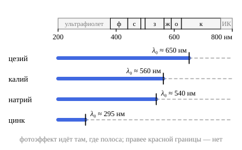

Гальвакс освещал цинк ультрафиолетом (урок 2.1) не случайно: обычный свет на цинк не действует, как его ни усиливай. А катоды фотоэлементов покрывают цезием — он отзывается даже на красный свет. Где проходит граница и от чего она зависит?

## Граница

Чем ниже частота света, тем меньше энергия фотона. На какой-то частоте её хватает ровно на работу выхода, и электрону ничего не остаётся на кинетическую энергию. Это **красная граница фотоэффекта**:

$$
h\nu_0 = A_{\text{вых}}.
$$

Отсюда наименьшая частота и наибольшая длина волны, при которых ещё идёт фотоэффект (${\lambda = c/\nu,}$ урок 1.2):

$$
\nu_0 = \frac{A_{\text{вых}}}{h}, \qquad \lambda_0 = \frac{hc}{A_{\text{вых}}}.
$$

Свет с частотой ниже ${\nu_0}$ — то есть с длиной волны больше ${\lambda_0}$ — фотоэффекта не вызывает. Границу называют красной, потому что она со стороны длинных волн — красного края спектра. Хотя у многих металлов она лежит в ультрафиолете.

**Пример.** Красная граница цезия. Работу выхода переводим в джоули:

$$
\begin{aligned}
A_{\text{вых}} &= 1{,}9 \cdot 1{,}6 \cdot 10^{-19} = 3{,}04 \cdot 10^{-19}\ \text{Дж}, \\
\lambda_0 &= \frac{hc}{A_{\text{вых}}} = \frac{6{,}6 \cdot 10^{-34} \cdot 3 \cdot 10^8}{3{,}04 \cdot 10^{-19}} \approx 6{,}5 \cdot 10^{-7}\ \text{м}.
\end{aligned}
$$

Это около ${650\ \text{нм}}$ — красный свет. Электроны из цезия выбивает весь видимый свет, кроме самого тёмно-красного. Частота границы ${\nu_0 = A_{\text{вых}}/h \approx 4{,}6 \cdot 10^{14}\ \text{Гц}.}$

Чем больше работа выхода, тем левее граница. У цинка она около ${295\ \text{нм}}$ — в ультрафиолете. Вот почему в опыте Гальвакса цинк разряжался только под ультрафиолетом, а стекло, поглощавшее его, останавливало разряд.

## Энергия электронов через красную границу

Работу выхода можно записать через границу: ${A_{\text{вых}} = h\nu_0 = hc/\lambda_0.}$ Тогда уравнение Эйнштейна принимает вид

$$
E_{\text{к}\max} = h(\nu - \nu_0) = \frac{hc}{\lambda} - \frac{hc}{\lambda_0}.
$$

Это удобно, когда в задаче дана не работа выхода, а красная граница. Проверь знак: если ${\lambda > \lambda_0,}$ выходит отрицательная энергия — значит, фотоэффекта нет.

В модели из урока 2.2 выбери цинк и пройди длиной волны от фиолетового края к ультрафиолету: ток появляется, только когда волна короче красной границы.

<pp-task id="ks-pe-03"></pp-task>

<pp-task id="ks-pe-13"></pp-task>

Проверь себя: красная граница натрия около 540 нм. Вызовет ли фотоэффект на натрии свет красной лазерной указки?

Нет. Длина волны красного света больше 600 нм — больше красной границы натрия. Энергии одного фотона не хватит на работу выхода, и яркость тут не поможет.

## Частые ловушки

- **Путают, где фотоэффект есть.** Он идёт при длине волны **меньше** ${\lambda_0}$ и частоте **больше** ${\nu_0.}$
- **Думают, что красная граница всегда в красном свете.** Это просто граница со стороны длинных волн; у цинка она в ультрафиолете.
- **Дают ответ в метрах, когда просят нанометры.** ${1\ \text{м} = 10^9\ \text{нм}.}$
- **Подставляют работу выхода в электронвольтах в ${hc/A.}$** Сначала переведи её в джоули.

## Коротко

- Красная граница: ${h\nu_0 = A_{\text{вых}},}$ ${\nu_0 = A_{\text{вых}}/h,}$ ${\lambda_0 = hc/A_{\text{вых}}.}$
- Фотоэффект идёт при ${\nu > \nu_0,}$ то есть ${\lambda < \lambda_0.}$
- ${E_{\text{к}\max} = h(\nu - \nu_0).}$
