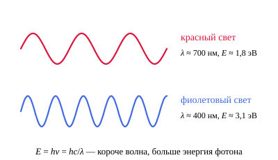

Свет — это волна: он интерферирует и дифрагирует. Но в начале XX века выяснилось, что свет ещё и поглощается и излучается порциями — частицами. Эта двойственность лежит в основе квантовой физики. Тема нужна в задачах 16, 17 и 18.

Кванты и фотоны проходят в 11 классе. Пригодятся темы «Волновая оптика» (свет — волна, $\lambda = c/\nu$), «Импульс» и «Основы СТО» (частица без массы, $E = pc$).

## Шаг 1. Гипотеза Планка (11 класс)

Нагретое тело излучает свет. Классическая физика не могла объяснить, как энергия распределена по частотам. Планк предположил: свет излучается не непрерывно, а **порциями — квантами**. Энергия одной порции пропорциональна частоте:

$$
E = h\nu.
$$

- $\nu$ — частота света, Гц;
- $h = 6{,}6 \cdot 10^{-34}\ \text{Дж} \cdot \text{с}$ — постоянная Планка;
- $E$ — энергия кванта, Дж.

<pp-task id="ks-phot-01"></pp-task>

## Шаг 2. Энергия через длину волны (11 класс)

Эйнштейн пошёл дальше: свет не только излучается, но и распространяется и поглощается порциями. Частицу света назвали **фотоном**. Так как $\nu = c/\lambda$,

$$
E = h\nu = \frac{hc}{\lambda}.
$$

Чем короче длина волны, тем больше энергия фотона. Энергия фотона фиолетового света примерно вдвое больше, чем красного. Фотоны ультрафиолета способны разрушать молекулы — поэтому ультрафиолет вызывает загар и ожоги, а инфракрасное излучение — нет, хоть и греет.

<pp-task id="ks-phot-02"></pp-task>

## Шаг 3. Энергия в электронвольтах (11 класс)

Джоули для фотонов — неудобно мелкие числа. Энергию фотонов удобно выражать в электронвольтах: $1\ \text{эВ} = 1{,}6 \cdot 10^{-19}\ \text{Дж}$. Чтобы перевести джоули в эВ, дели на $1{,}6 \cdot 10^{-19}$.

Фотоны видимого света имеют энергию примерно от $1{,}6$ до $3{,}3\ \text{эВ}$.

<pp-task id="ks-phot-03"></pp-task>

## Шаг 4. Импульс фотона (11 класс)

Свойства фотона:

- движется со скоростью света $c$ и не может покоиться;
- масса покоя равна нулю;
- энергия $E = h\nu = \dfrac{hc}{\lambda}$;
- импульс (из $E = pc$, тема «Основы СТО»):

$$
p = \frac{E}{c} = \frac{h}{\lambda}.
$$

<pp-task id="ks-phot-04"></pp-task>

## Шаг 5. Яркость — это число фотонов (11 класс)

Энергия одного фотона зависит только от частоты. А **яркость** (мощность) света — это сколько фотонов приходит за секунду. Лазер мощностью $P$ излучает за секунду

$$
N = \frac{P}{h\nu} = \frac{P\lambda}{hc}
$$

фотонов. Ярче свет того же цвета — больше фотонов, но энергия каждого та же.

<pp-task id="ks-phot-05"></pp-task>

## Шаг 6. Давление света (11 класс)

Раз у фотона есть импульс, свет давит на поверхность, на которую падает. Давление на зеркальную поверхность вдвое больше, чем на чёрную: при отражении импульс фотона меняет направление, и изменение импульса вдвое больше — как у мяча, отскочившего от стены (тема «Импульс»). Давление света очень мало, но заметно, например, для хвостов комет.

## Шаг 7. Волны де Бройля (11 класс)

Если волна (свет) ведёт себя как частица, может быть, и частицы ведут себя как волны? Де Бройль предположил: любой частице с импульсом $p$ соответствует волна длиной

$$
\lambda = \frac{h}{p} = \frac{h}{m v}.
$$

Гипотеза подтвердилась: пучок электронов, проходя через кристалл, даёт дифракционную картину — как рентгеновские лучи. На этом работает электронный микроскоп.

Для обычных тел (мяч, человек) длина волны де Бройля ничтожно мала, и волновые свойства не проявляются.

<pp-task id="ks-phot-06"></pp-task>

## Шаг 8. Корпускулярно-волновой дуализм (11 класс)

Свет и частицы вещества обладают и волновыми, и корпускулярными свойствами. Какие проявляются — зависит от опыта: в интерференции и дифракции видна волна, в фотоэффекте и при испускании атомами — частица.

## Частые ловушки

- **Путают частоту и длину волны в формуле энергии.** $E = h\nu = hc/\lambda$; длина волны — в знаменателе.
- **Забывают перевести нанометры.** $1\ \text{нм} = 10^{-9}\ \text{м}$.
- **Думают, что фотон может покоиться.** Не может.
- **Считают, что яркость света меняет энергию одного фотона.** Яркость — это число фотонов; энергия одного фотона зависит только от частоты.

## Как это выглядит на ЕГЭ

*Найди энергию фотона с длиной волны $500\ \text{нм}$ в электронвольтах. $h = 6{,}6 \cdot 10^{-34}\ \text{Дж} \cdot \text{с}$, $c = 3 \cdot 10^8\ \text{м/с}$.*

$$
E = \frac{hc}{\lambda} = \frac{6{,}6 \cdot 10^{-34} \cdot 3 \cdot 10^8}{5 \cdot 10^{-7}} \approx 3{,}96 \cdot 10^{-19}\ \text{Дж}.
$$

В электронвольтах: $3{,}96 \cdot 10^{-19}/1{,}6 \cdot 10^{-19} \approx 2{,}5\ \text{эВ}$ — зелёный свет.

## Коротко

- $E = h\nu = hc/\lambda$, $p = h/\lambda$.
- Фотон: скорость $c$, масса покоя ноль.
- Яркость — число фотонов $N = P/(h\nu)$, цвет — энергия фотона.
- Свет давит на поверхности; на зеркальную — вдвое сильнее.
- Длина волны де Бройля $\lambda = h/(mv)$.
