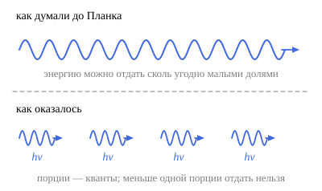

Включи электроплитку и смотри. Сначала конфорка греет, но не светится: она излучает невидимое инфракрасное. Потом она тускло краснеет, а если разогреть железо ещё сильнее, оно станет жёлтым и почти белым. Чем горячее тело, тем выше частота света, которого в его излучении больше всего. Но почему тело при комнатной температуре совсем не излучает ультрафиолет, хотя в нём есть колебания любой частоты?

## Загадка нагретого тела

В конце XIX века физики считали свет электромагнитной волной (урок 13.3 из электродинамики), а энергию волны — непрерывной: её можно отдать какими угодно малыми долями. Из этого выходило, что нагретое тело должно излучать больше всего энергии на самых высоких частотах — в ультрафиолете и дальше. Любая печка светила бы ультрафиолетом, а энергия излучения вообще получалась бесконечной. Опыт показывал совсем другое: излучение на высоких частотах быстро спадает до нуля. Эту неудачу классической теории назвали «ультрафиолетовой катастрофой».

## Гипотеза Планка

В 1900 году Макс Планк нашёл выход. Он предположил: свет излучается не непрерывно, а **порциями — квантами**. Энергия одного кванта пропорциональна частоте света:

$$
E = h\nu.
$$

- $\nu$ — частота света, Гц;
- ${h = 6{,}6 \cdot 10^{-34}\ \text{Дж} \cdot \text{с}}$ — **постоянная Планка**;
- $E$ — энергия кванта, Дж.

Почему это спасает? Чтобы излучить свет высокой частоты, телу нужно отдать сразу целую порцию $h\nu,$ а она большая. Тепловой энергии частиц холодного тела на такую порцию не хватает, поэтому ультрафиолета оно не излучает. Раскалённое тело может отдать порции побольше — и светится видимым светом.

## Фотон

Планк считал, что порциями свет только излучается. В 1905 году Эйнштейн пошёл дальше: свет и **летит, и поглощается** порциями. Порцию света позже назвали **фотоном**. Луч света — это поток фотонов. Каждый из них несёт энергию ${h\nu,}$ и поглотить половину фотона нельзя: он либо поглощается целиком, либо не поглощается вовсе.

Почему же мы не замечаем, что свет «зернистый»? Потому что порции очень малы.

**Пример.** Частота жёлтого света ${5{,}1 \cdot 10^{14}\ \text{Гц}.}$ Энергия одного фотона

$$
E = h\nu = 6{,}6 \cdot 10^{-34} \cdot 5{,}1 \cdot 10^{14} \approx 3{,}4 \cdot 10^{-19}\ \text{Дж}.
$$

Это ничтожная энергия: лампа каждую секунду испускает огромное число таких фотонов, и глаз видит ровный свет.

Энергия кванта растёт вместе с частотой. Фотон Wi-Fi с частотой ${2{,}4\ \text{ГГц}}$ несёт всего около ${1{,}6 \cdot 10^{-24}\ \text{Дж}}$ — примерно в двести тысяч раз меньше, чем фотон жёлтого света. Поэтому радиоволны, даже мощные, только греют, а фотоны ультрафиолета способны разрушать молекулы в коже.

<pp-task id="ks-phot-01"></pp-task>

<pp-task id="ks-phot-07"></pp-task>

Проверь себя: частоту света увеличили вдвое. Как изменилась энергия одного фотона?

Увеличилась вдвое: ${E = h\nu}$ прямо пропорциональна частоте.

## Частые ловушки

- **Делят постоянную Планка на частоту.** ${E = h\nu}$ — произведение, а не частное.
- **Путают $h$ с другими константами.** ${h = 6{,}6 \cdot 10^{-34}\ \text{Дж} \cdot \text{с};}$ единица — джоуль, умноженный на секунду, поэтому ${h\nu}$ даёт джоули.
- **Думают, что фотон можно поглотить частично.** Фотон поглощается целиком или не поглощается.

## Коротко

- Свет излучается, летит и поглощается порциями — фотонами.
- Энергия одного фотона ${E = h\nu,}$ ${h = 6{,}6 \cdot 10^{-34}\ \text{Дж} \cdot \text{с}.}$
- Чем выше частота, тем больше энергия фотона.
