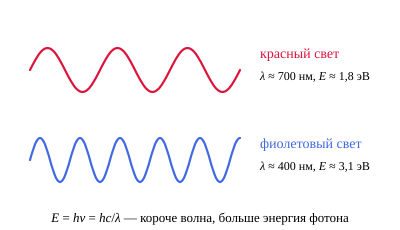

От ультрафиолета кожа загорает и обгорает, а от инфракрасного обогревателя — нет, сколько под ним ни сиди. Обогреватель при этом даёт куда больше тепла. Почему вред наносит слабый ультрафиолет, а не мощное инфракрасное излучение?

## Энергия через длину волны

В задачах про свет чаще дают не частоту, а длину волны. Частота и длина волны света в вакууме связаны так (урок 13.3 из электродинамики):

$$
\nu = \frac{c}{\lambda}.
$$

Подставим в формулу Планка:

$$
E = h\nu = \frac{hc}{\lambda}.
$$

Длина волны стоит **в знаменателе**: чем короче волна, тем больше энергия фотона. Волна красного света примерно вдвое длиннее фиолетовой, поэтому фотон фиолетового света почти вдвое энергичнее.

Теперь понятно, что с загаром. Фотоны ультрафиолета несут столько энергии, что один фотон может разорвать связь в молекуле кожи. Фотоны инфракрасного излучения слабые: их много, они греют, но ни один не способен в одиночку разрушить молекулу. Важна не общая энергия, а энергия одной порции.

Длины волн света дают в нанометрах. Перед расчётом их переводят в метры: ${1\ \text{нм} = 10^{-9}\ \text{м}.}$

**Пример.** Энергия фотона зелёного света с длиной волны ${550\ \text{нм}\text{:}}$

$$
E = \frac{hc}{\lambda} = \frac{6{,}6 \cdot 10^{-34} \cdot 3 \cdot 10^8}{5{,}5 \cdot 10^{-7}} = 3{,}6 \cdot 10^{-19}\ \text{Дж}.
$$

## Электронвольт

Энергии фотонов в джоулях — неудобно маленькие числа. Поэтому их выражают в **электронвольтах**, как энергии частиц (урок 2.8 из электродинамики):

$$
1\ \text{эВ} = 1{,}6 \cdot 10^{-19}\ \text{Дж}.
$$

Чтобы перевести джоули в электронвольты, энергию **делят** на ${1{,}6 \cdot 10^{-19}.}$ Для фотона зелёного света из примера:

$$
E = \frac{3{,}6 \cdot 10^{-19}}{1{,}6 \cdot 10^{-19}} = 2{,}25\ \text{эВ}.
$$

Обратно, из электронвольт в джоули, — умножают на ${1{,}6 \cdot 10^{-19}.}$

## Энергия по всему спектру

У краёв видимого света, ${760\ \text{нм}}$ и ${380\ \text{нм}}$ (урок 13.4 из электродинамики), фотоны несут примерно от ${1{,}63}$ до ${3{,}26\ \text{эВ}.}$ Ультрафиолет с длиной волны ${200\ \text{нм}}$ — уже около ${6{,}2\ \text{эВ},}$ а фотоны рентгеновского и гамма-излучения — тысячи и миллионы электронвольт. Фотоны инфракрасного излучения слабее одного-полутора электронвольт, радиоволн — ещё в миллионы раз слабее.

Энергия обратно пропорциональна длине волны: укороти волну вдвое — энергия фотона вырастет вдвое.

## Модель

Двигай длину волны и смотри, как меняются энергия фотона в джоулях и электронвольтах, частота и диапазон. Точки внизу — фотоны лазерного луча; площадь точки — энергия одного фотона. Мощность понадобится в уроке 1.4.

<pp-photons>Модель фотонов: ползунок длины волны от 100 до 1000 нанометров и ползунок мощности лазера от 1 до 10 милливатт. Шкала диапазонов с меткой, волна в масштабе и луч как поток фотонов-точек. Таблица частоты, энергии фотона в джоулях и электронвольтах, импульса, диапазона и числа фотонов в секунду.</pp-photons>

Посмотри, что выходит:

- у ультрафиолета точки крупные — фотоны энергичнее, у инфракрасного мелкие;
- при переходе от фиолетового края к красному энергия фотона падает примерно вдвое.

<pp-task id="ks-phot-02"></pp-task>

<pp-task id="ks-phot-03"></pp-task>

<pp-task id="ks-phot-08"></pp-task>

Проверь себя: у какого фотона больше энергия — инфракрасного из пульта от телевизора или красного из лазерной указки?

У красного. Длина волны инфракрасного излучения больше, а энергия фотона обратно пропорциональна длине волны.

## Частые ловушки

- **Умножают на длину волны вместо деления.** ${E = hc/\lambda;}$ длина волны в знаменателе.
- **Забывают перевести нанометры в метры.** ${1\ \text{нм} = 10^{-9}\ \text{м},}$ например ${500\ \text{нм} = 5 \cdot 10^{-7}\ \text{м}.}$
- **При переводе в электронвольты умножают на ${1{,}6 \cdot 10^{-19}.}$** Джоули в электронвольты — делят, электронвольты в джоули — умножают.
- **Думают, что мощное излучение состоит из энергичных фотонов.** Энергия одного фотона зависит только от длины волны.

## Коротко

- ${E = h\nu = hc/\lambda\text{:}}$ короче волна — больше энергия фотона.
- ${1\ \text{эВ} = 1{,}6 \cdot 10^{-19}\ \text{Дж};}$ видимый свет — примерно от ${1{,}63}$ до ${3{,}26\ \text{эВ}.}$
- ${1\ \text{нм} = 10^{-9}\ \text{м}.}$
