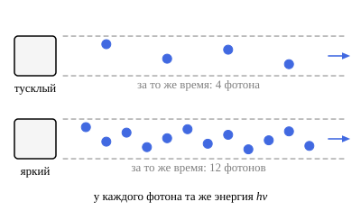

Убавь яркость настольной лампы — свет станет тусклее, но цвет останется тем же. Что изменилось в потоке фотонов: каждый фотон стал слабее или их стало меньше?

## Цвет и яркость

Энергия одного фотона ${E = h\nu}$ зависит только от частоты — то есть от цвета. Значит, при убавленной яркости фотоны остались прежними. Стало меньше **фотонов за секунду**.

Яркость света — это то, сколько энергии он несёт за секунду, то есть его **мощность** $P.$ Если за секунду вылетает $N$ фотонов, каждый с энергией ${E = h\nu,}$ то

$$
P = N h\nu.
$$

## Сколько фотонов в секунду

Отсюда число фотонов, которые источник излучает за секунду:

$$
N = \frac{P}{h\nu} = \frac{P\lambda}{hc}.
$$

Если нужно число фотонов за время $t,$ берут энергию за это время, ${Pt,}$ и делят на энергию одного фотона: ${N = Pt/(h\nu).}$

**Пример.** Зелёная лазерная указка мощностью ${5\ \text{мВт}}$ светит на длине волны ${532\ \text{нм}.}$ Энергия одного фотона

$$
E = \frac{hc}{\lambda} = \frac{6{,}6 \cdot 10^{-34} \cdot 3 \cdot 10^8}{5{,}32 \cdot 10^{-7}} \approx 3{,}72 \cdot 10^{-19}\ \text{Дж}.
$$

За секунду указка излучает энергию ${5 \cdot 10^{-3}\ \text{Дж},}$ поэтому фотонов

$$
N = \frac{5 \cdot 10^{-3}}{3{,}72 \cdot 10^{-19}} \approx 1{,}34 \cdot 10^{16}.
$$

Больше десяти миллионов миллиардов фотонов в секунду — вот почему «зернистость» света не видна глазу.

## Одинаковая мощность, разный цвет

Пусть мощность одинакова, а цвет разный. Из ${N = P\lambda/(hc)}$ видно: число фотонов пропорционально длине волны. Красный лазер той же мощности, что и синий, излучает больше фотонов, потому что каждый красный фотон слабее. Мощность — это число фотонов, умноженное на энергию одного: меньше энергия фотона — больше фотонов.

## Модель

Модель та же, что в уроке 1.2. Теперь двигай и мощность. Число точек в луче пропорционально числу фотонов в секунду, а площадь точки — энергии одного фотона.

<pp-photons>Модель фотонов: ползунок длины волны от 100 до 1000 нанометров и ползунок мощности лазера от 1 до 10 милливатт. Шкала диапазонов с меткой, волна в масштабе и луч как поток фотонов-точек. Таблица частоты, энергии фотона в джоулях и электронвольтах, импульса, диапазона и числа фотонов в секунду.</pp-photons>

Посмотри, что выходит:

- мощность больше — точек больше, но они того же размера;
- при той же мощности сдвинь длину волны в ультрафиолет: точек меньше, зато они крупнее; в инфракрасном — наоборот.

<pp-task id="ks-phot-05"></pp-task>

<pp-task id="ks-phot-10"></pp-task>

<pp-task id="ks-phot-11"></pp-task>

Проверь себя: два лазера одного цвета, мощность первого больше. У какого больше энергия одного фотона?

Одинаковая: цвет один, значит, и частота одна. У мощного лазера больше фотонов в секунду.

## Частые ловушки

- **Думают, что яркость меняет энергию одного фотона.** Яркость — это число фотонов; энергия одного фотона зависит только от частоты.
- **Забывают приставки мощности.** ${1\ \text{мВт} = 10^{-3}\ \text{Вт}.}$
- **Считают, что при равной мощности фотонов поровну.** Фотонов больше у света с большей длиной волны.
- **Делят энергию фотона на мощность.** ${N = P/E,}$ а не наоборот.

## Коротко

- Цвет задаёт энергию одного фотона, яркость — число фотонов.
- ${P = Nh\nu,}$ ${N = P/(h\nu) = P\lambda/(hc)}$ фотонов в секунду.
- При той же мощности длинноволнового света фотонов больше.
