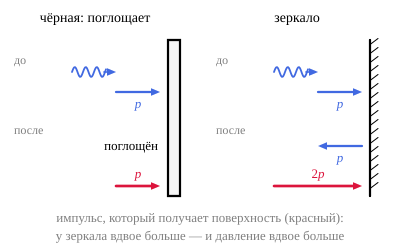

В 1899 году Пётр Лебедев подвесил на тонкой нити лёгкие крылышки — одно зачернённое, другое блестящее — в сосуде, из которого откачал воздух. Когда на крылышки падал свет, нить чуть-чуть закручивалась. Свет толкал крылышки. Причём блестящее он толкал сильнее, чем чёрное. Почему?

## Свет передаёт импульс

У каждого фотона есть импульс ${p = h/\lambda}$ (урок 1.3). Когда фотон попадает на поверхность, его импульс меняется — значит, поверхность получает импульс от фотона. Импульс, полученный за секунду, — это сила (урок 10.5 из механики). Сила, приложенная к площади, — давление. Так свет давит на всё, на что падает.

## Чёрная поверхность и зеркало

**Чёрная поверхность** поглощает фотон. Его импульс был $p,$ стал ноль. Поверхность получает импульс $p.$

**Зеркало** отражает фотон назад. Его импульс был $p,$ а стал $p$ в обратную сторону. Изменение импульса — ${2p,}$ как у мяча, отскочившего от стены (урок 10.5 из механики). Зеркало получает вдвое больший импульс.

Поэтому **на зеркало свет давит вдвое сильнее**, чем на чёрную поверхность. Это и увидел Лебедев: блестящее крылышко отклонялось сильнее.

## Сила давления луча

Пусть луч мощностью $P$ падает перпендикулярно на чёрную поверхность. За секунду приходит ${N = P/E}$ фотонов (урок 1.4), каждый с импульсом ${E/c.}$ Поверхность за секунду получает импульс

$$
N \cdot \frac{E}{c} = \frac{P}{E} \cdot \frac{E}{c} = \frac{P}{c}.
$$

Энергия фотона сократилась: от цвета сила не зависит. Импульс за секунду — это сила, поэтому

$$
\begin{aligned}
&\text{чёрная поверхность:} &F &= \frac{P}{c},\\
&\text{зеркало:} &F &= \frac{2P}{c}.
\end{aligned}
$$

**Пример.** Луч лазера мощностью ${2{,}1\ \text{Вт}}$ полностью поглощается чёрной пластинкой. Сила давления

$$
F = \frac{P}{c} = \frac{2{,}1}{3 \cdot 10^8} = 7 \cdot 10^{-9}\ \text{Н}.
$$

Это вес пылинки массой меньше микрограмма. Поэтому давление света так трудно заметить на Земле.

## Давление солнечного света

На каждый квадратный метр у Земли солнечный свет приносит около ${1{,}4\ \text{кВт}.}$ Давление на чёрную поверхность — это сила на квадратный метр:

$$
p_\text{д} = \frac{1{,}4 \cdot 10^3}{3 \cdot 10^8} \approx 4{,}7 \cdot 10^{-6}\ \text{Па}.
$$

На зеркальную — вдвое больше, около ${9{,}3 \cdot 10^{-6}\ \text{Па}.}$ Атмосферное давление больше в десять миллиардов раз. Но в космосе нет ни воздуха, ни трения. Солнечный свет отталкивает пылинки, и хвост кометы всегда направлен от Солнца. А зеркальный парус японского аппарата IKAROS площадью около ${200\ \text{м}^2}$ получал силу около двух миллиньютонов — и за месяцы разгонялся без топлива.

<pp-task id="ks-phot-12"></pp-task>

<pp-task id="ks-phot-13"></pp-task>

Проверь себя: солнечный парус сделали не зеркальным, а чёрным. Как изменилась сила давления света на него?

Уменьшилась вдвое. Чёрный парус поглощает фотоны и получает от каждого импульс $p,$ а зеркальный — ${2p.}$

## Частые ловушки

- **Думают, что на чёрную поверхность свет давит сильнее, раз она «сильнее поглощает».** Наоборот: зеркало отбрасывает фотоны назад и получает вдвое больший импульс.
- **Вычитают модули импульсов при отражении и получают ноль.** Импульс — вектор: ${p - (-p) = 2p.}$
- **Умножают мощность на $c.$** ${F = P/c}$ — делят.
- **Путают давление и силу.** Давление — сила на единицу площади, в паскалях.

## Коротко

- Свет давит, потому что фотоны несут импульс.
- Чёрная поверхность получает $p$ от фотона, зеркало — ${2p.}$
- Сила давления луча: ${F = P/c}$ на чёрную поверхность, ${F = 2P/c}$ на зеркало.
