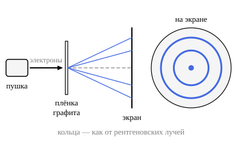

Свет интерферирует и дифрагирует — значит, это волна (уроки 16.2–16.4 из электродинамики). Но он излучается и поглощается порциями — значит, это поток частиц. Если волна может вести себя как частица, то, может быть, и частица — электрон, атом — может вести себя как волна?

## Гипотеза де Бройля

В 1924 году Луи де Бройль предположил: **любой частице** с импульсом $p$ соответствует волна. Её длину он взял из той же формулы, что и у фотона, ${p = h/\lambda}$ (урок 1.3), только наоборот:

$$
\lambda = \frac{h}{p} = \frac{h}{mv}.
$$

Здесь ${p = mv}$ — импульс частицы с массой (урок 10.1 из механики). Чем больше импульс, тем короче волна.

## Почему мяч не дифрагирует

**Пример.** Теннисный мяч массой ${0{,}06\ \text{кг}}$ летит со скоростью ${30\ \text{м/с}.}$ Его длина волны

$$
\lambda = \frac{h}{mv} = \frac{6{,}6 \cdot 10^{-34}}{0{,}06 \cdot 30} \approx 3{,}7 \cdot 10^{-34}\ \text{м}.
$$

Это в триллионы триллионов раз меньше атома. Дифракция заметна, только когда препятствие или щель сравнимы с длиной волны (урок 16.4 из электродинамики). Щелей такого размера не бывает, поэтому волновые свойства мяча, человека, автомобиля увидеть невозможно. У тел вокруг нас огромные импульсы — и ничтожные длины волн.

## Электрон — волна

Другое дело электрон: масса у него крошечная. Разгоним покоившийся электрон напряжением $U.$ Он получит кинетическую энергию ${E_\text{к} = eU}$ (урок 2.8 из электродинамики). Импульс найдём из ${E_\text{к} = mv^2/2 = p^2/(2m)}$ (урок 12.2 из механики):

$$
p = \sqrt{2mE_\text{к}} = \sqrt{2meU}.
$$

**Пример.** Электрон прошёл напряжение ${100\ \text{В}.}$ Его кинетическая энергия ${E_\text{к} = 1{,}6 \cdot 10^{-19} \cdot 100 = 1{,}6 \cdot 10^{-17}\ \text{Дж},}$ импульс

$$
p = \sqrt{2 \cdot 9{,}1 \cdot 10^{-31} \cdot 1{,}6 \cdot 10^{-17}} \approx 5{,}4 \cdot 10^{-24}\ \text{кг} \cdot \text{м/с},
$$

длина волны

$$
\lambda = \frac{h}{p} = \frac{6{,}6 \cdot 10^{-34}}{5{,}4 \cdot 10^{-24}} \approx 1{,}2 \cdot 10^{-10}\ \text{м} = 0{,}12\ \text{нм}.
$$

Расстояния между атомами в кристалле — тоже десятые доли нанометра. Значит, кристалл для электронов — как дифракционная решётка для света (урок 16.5 из электродинамики).

## Опыт: дифракция электронов

В 1927 году Дэвиссон и Джермер направили пучок электронов на кристалл никеля, а Томсон пропустил электроны сквозь тонкую металлическую плёнку. Электроны отражались и рассеивались не как попало, а в определённых направлениях. За плёнкой на экране получались **кольца** — точно такие, как от рентгеновских лучей, а их размеры совпали с длиной волны ${h/p.}$ Гипотеза де Бройля подтвердилась.

На волновых свойствах электронов работает **электронный микроскоп**. Микроскоп не различает детали меньше длины волны (урок 16.4 из электродинамики). У видимого света это сотни нанометров, а у быстрых электронов — сотые и тысячные доли нанометра, поэтому в электронный микроскоп видны вирусы и даже отдельные атомы.

## Корпускулярно-волновой дуализм

Итак, и свет, и частицы вещества обладают **и волновыми, и корпускулярными** (от латинского «корпускула» — частица) свойствами. Это называют корпускулярно-волновым дуализмом. Какие свойства проявятся, зависит от опыта:

- в интерференции и дифракции видна **волна** — и у света, и у электронов;
- при излучении и поглощении света, например в фотоэффекте, видна **частица**: свет отдаёт энергию целыми фотонами.

Это не значит, что фотон или электрон — «то волна, то шарик». Это объект нового рода, у которого нет наглядного образа из нашего мира. Описывать его приходится обоими языками.

<pp-task id="ks-phot-06"></pp-task>

<pp-task id="ks-phot-14"></pp-task>

<pp-task id="ks-phot-15"></pp-task>

Проверь себя: протон и электрон летят с одинаковой скоростью. У кого длина волны де Бройля больше?

У электрона. При одинаковой скорости его импульс меньше — масса почти в две тысячи раз меньше, а длина волны ${h/(mv)}$ обратно пропорциональна импульсу.

## Частые ловушки

- **Думают, что чем больше импульс, тем длиннее волна.** Наоборот: ${\lambda = h/p.}$
- **Забывают двойку в импульсе разогнанного электрона.** ${p = \sqrt{2meU},}$ потому что ${E_\text{к} = p^2/(2m).}$
- **Дают ответ в метрах, когда просят нанометры.** ${1\ \text{м} = 10^9\ \text{нм}.}$
- **Считают, что волновые свойства есть только у света.** Они есть у любой частицы, но заметны лишь у очень лёгких.

## Коротко

- Длина волны де Бройля ${\lambda = h/p = h/(mv).}$
- Электрон после напряжения $U$: ${p = \sqrt{2meU}.}$
- Дифракция электронов на кристалле подтвердила волны де Бройля.
- Свет и частицы — и волны, и частицы; что проявится, зависит от опыта.

Это последний урок темы. Дальше — тема «Фотоэффект»: как фотоны выбивают электроны из металла и почему энергия этих электронов зависит от цвета света, а не от его яркости.
