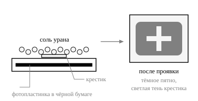

В конце прошлой темы мы выяснили, что стабильных ядер с числом протонов больше ${83}$ нет (урок 4.3). Что же происходит с остальными ядрами? Они сами собой превращаются в другие. Первым это заметил — совершенно случайно — французский физик Анри Беккерель.

## Опыт Беккереля

В 1896 году Беккерель изучал соли урана, которые светятся после того, как их осветит солнце. Он думал, что такое свечение может сопровождаться и невидимыми лучами, способными проходить сквозь бумагу. Поэтому он заворачивал фотопластинку в плотную чёрную бумагу, клал на неё соль урана и выставлял на солнце. После проявки на пластинке темнело пятно.

Однажды стояли пасмурные дни, и Беккерель убрал подготовленную пластинку с солью урана в тёмный ящик. Проявив её на всякий случай, он увидел такое же тёмное пятно, как после солнца. Солнце было ни при чём: **соль урана сама, непрерывно испускала невидимое излучение**. Оно проходило сквозь чёрную бумагу, но задерживалось металлом — там, где лежал металлический предмет, оставалась светлая тень.

Скоро выяснилось:

- излучают все соединения урана и сам металлический уран;
- излучение не ослабевает месяцами, хотя его ничем не «заряжают»;
- оно делает воздух проводником: заряженный электроскоп рядом с ураном разряжается.

## Супруги Кюри: полоний и радий

Мария Склодовская-Кюри измерила излучение многих веществ по тому, как они разряжают электроскоп. Оказалось, что излучение соединения урана зависит только от того, **сколько в нём урана**, а не от того, в какое соединение он входит. Излучал и торий.

Но урановая руда излучала сильнее, чем можно было ожидать по урану в ней. Значит, в руде есть неизвестные, гораздо более активные элементы. В 1898 году Мария и Пьер Кюри выделили из тонн руды два новых элемента: **полоний** (в честь Польши, родины Марии) и **радий** («лучистый»). Радий излучает в миллионы раз сильнее урана той же массы. Явление Мария Кюри назвала **радиоактивностью**. В 1903 году Беккерель и супруги Кюри получили Нобелевскую премию.

## Радиоактивность — свойство ядра

Раз излучение зависит только от количества урана, а не от его соединения, источник излучения — не химические связи, а сами атомы урана. Химические реакции перестраивают электронные оболочки атомов, а излучение от этого не меняется. Значит, излучает **ядро**.

**Радиоактивность** — самопроизвольное превращение неустойчивых ядер в другие ядра с испусканием излучения. Сам процесс называют **радиоактивным распадом**.

Ядро очень мало и прочно: энергии связи нуклонов — миллионы электронвольт (урок 4.5), а тепловое движение и химические реакции оперируют энергиями порядка электронвольта. Поэтому на распад не влияют:

- нагрев и охлаждение;
- давление;
- химические соединения, растворение, агрегатное состояние.

Радиоактивны все ядра тяжелее висмута, а среди лёгких — отдельные изотопы с «неудачным» числом нейтронов: например, углерод-14 и тритий (урок 4.2).

<pp-task id="ks-rad-07"></pp-task>

Проверь себя: можно ли обезвредить радиоактивные отходы, сжигая их в печи?

Нет. Сжигание — химическая реакция: она меняет соединения, в которые входят радиоактивные атомы, но не их ядра. Ядра будут распадаться с той же скоростью, только уже в золе и дыме — а дым разнесёт их по округе.

## Частые ловушки

- **Думают, что радиоактивность открыл Резерфорд или Кюри.** Открыл Беккерель в 1896 году; супруги Кюри открыли полоний и радий и дали явлению имя.
- **Считают, что излучение вызывает свет.** Соль урана излучает и в полной темноте.
- **Думают, что нагрев или химия ускоряют распад.** Распад идёт в ядре, а эти воздействия меняют только электронные оболочки.

## Коротко

- 1896 год: Беккерель — соли урана сами испускают невидимое излучение.
- 1898 год: Мария и Пьер Кюри — полоний и радий, слово «радиоактивность».
- Радиоактивность — самопроизвольное превращение неустойчивых ядер с испусканием излучения; внешние условия на неё не влияют.
