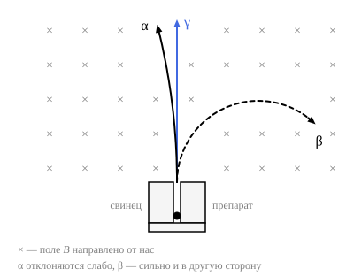
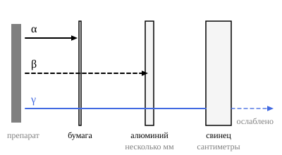

Излучение радия засвечивает фотопластинку и разряжает электроскоп. Но одно ли это излучение? Чтобы узнать, его пропустили через магнитное поле — так, как раньше разделяли по заряду и массе другие частицы.

## Опыт с магнитным полем

Крупинку радия кладут на дно узкого канала в свинцовом блоке. Свинец поглощает всё, что летит в стороны, и из канала выходит узкий пучок. Пучок направляют в магнитное поле, перпендикулярное его скорости, а выше ставят фотопластинку.

На пластинке получаются три пятна: пучок разделился на три части. Их назвали первыми буквами греческого алфавита.

- **Гамма-лучи** идут прямо: у них нет заряда.
- **Альфа-лучи** отклоняются слабо — в ту сторону, куда отклонились бы положительные частицы.
- **Бета-лучи** отклоняются сильно и в противоположную сторону: они заряжены отрицательно.

Сторону отклонения находят по правилу левой руки (урок 9.1 из электродинамики): для положительной частицы четыре пальца — по скорости, линии поля входят в ладонь, отогнутый большой палец показывает силу Лоренца. Для отрицательной — наоборот.

Почему альфа-лучи отклоняются слабо? Радиус окружности в магнитном поле ${R = \dfrac{mv}{|q|B}}$ (урок 9.4 из электродинамики). Чем больше масса на единицу заряда, тем больше радиус и тем меньше изогнут след. Альфа-частица в тысячи раз тяжелее электрона, а заряд у неё лишь вдвое больше.

<pp-task id="ks-rad-08"></pp-task>

## Что такое каждый вид излучения

**Альфа-лучи** — поток ядер гелия ${^4_2\text{He}\text{:}}$ два протона и два нейтрона, заряд ${+2e}$ (урок 4.1). Это те самые альфа-частицы, которыми Резерфорд обстреливал фольгу (урок 3.1): они вылетают из ядер со скоростями около ${15\,000\text{–}20\,000\ \text{км/с}.}$ Что это ядра гелия, Резерфорд доказал в 1908 году: собрал альфа-частицы в стеклянной трубке и увидел в её спектре линии гелия.

**Бета-лучи** — поток электронов, заряд ${-e.}$ Их отклонение в электрическом и магнитном полях такое же, как у электронов катодных лучей. Бета-электроны летят быстрее альфа-частиц, некоторые — почти со скоростью света.

**Гамма-лучи** — электромагнитное излучение, как свет, только с очень короткой длиной волны, около ${10^{-12}\ \text{м}}$ и меньше. Это поток фотонов (уроки 1.1 и 1.2) с энергиями порядка мегаэлектронвольта — в сотни тысяч раз больше, чем у фотона видимого света (около ${2\text{–}3\ \text{эВ}}$).

| Излучение | Что это | Заряд | В магнитном поле |
|---|---|---|---|
| альфа | ядра гелия ${^4_2\text{He}}$ | ${+2e}$ | отклоняется слабо |
| бета | электроны | ${-e}$ | отклоняется сильно, в другую сторону |
| гамма | фотоны | нет | не отклоняется |

## Проникающая способность

Излучения по-разному проходят сквозь вещество. Пролетая, частица выбивает электроны из атомов — **ионизует** вещество — и на каждый выбитый электрон тратит часть энергии. Тяжёлая альфа-частица с зарядом ${+2e}$ ионизует очень сильно и быстро теряет энергию. Электрон ионизует слабее и проходит дальше. Фотон без заряда взаимодействует редко и проходит дальше всех.

- Альфа-частицы задерживает **лист бумаги** или несколько сантиметров воздуха. Снаружи тела они не опасны: их останавливает даже верхний слой кожи. Опасны они внутри тела — если радиоактивное вещество вдохнуть или проглотить.
- Бета-частицы задерживает **несколько миллиметров алюминия**.
- Гамма-лучи полностью не задерживает ничто: слой **свинца** в сантиметр лишь ослабляет их примерно вдвое. От них защищают толстые слои свинца или бетона.

<pp-task id="ks-rad-09"></pp-task>

Проверь себя: на пути пучка от радиоактивного препарата поставили лист бумаги, и счётчик за ним стал показывать заметно меньше. Какое излучение задержал лист?

Альфа-излучение: лист бумаги задерживает только его. Бета- и гамма-лучи проходят сквозь бумагу почти без потерь, и счётчик продолжает их считать.

## Частые ловушки

- **Путают, какое излучение — ядра гелия, а какое — электроны.** Альфа — ядра гелия, бета — электроны, гамма — фотоны.
- **Думают, что сильнее отклоняются тяжёлые альфа-частицы.** Наоборот: радиус ${R = mv/(|q|B)}$ у них больше, след изогнут слабо.
- **Считают гамма-лучи потоком частиц с зарядом.** У гамма-квантов заряда нет, поле их не отклоняет.
- **Путают проникающую способность.** Меньше всех проникают альфа-частицы, больше всех — гамма-кванты.

## Коротко

- Альфа: ядра ${^4_2\text{He},}$ заряд ${+2e;}$ бета: электроны, заряд ${-e;}$ гамма: фотоны без заряда.
- В магнитном поле альфа и бета отклоняются в разные стороны, бета — гораздо сильнее; гамма не отклоняется.
- Альфа задерживает бумага, бета — миллиметры алюминия, гамма ослабляют сантиметры свинца.
