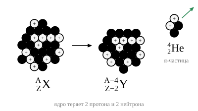

Альфа-частица вылетает из ядра. Значит, ядро теряет два протона и два нейтрона — и становится другим ядром. Каким? Это легко найти, если помнить, что нуклоны и заряд никуда не исчезают.

## Что происходит с ядром

Альфа-частица — ядро гелия ${^4_2\text{He}\text{:}}$ четыре нуклона, из них два протона. Ядро, испустившее её, теряет ${4}$ нуклона и ${2}$ протона:

$$
^{A}_{Z}\text{X} \to {}^{A-4}_{Z-2}\text{Y} + {}^4_2\text{He}.
$$

Здесь работают два закона сохранения:

- **число нуклонов** сохраняется — сумма верхних чисел слева и справа одинакова: ${A = (A - 4) + 4;}$
- **электрический заряд** сохраняется — сумма нижних чисел одинакова: ${Z = (Z - 2) + 2.}$

Зарядовое число — это номер элемента (урок 4.1). Оно уменьшилось на ${2,}$ значит, получился **другой элемент**, на две клетки ближе к началу таблицы Менделеева. Это **правило смещения** для альфа-распада, его нашли Содди и Фаянс в 1913 году.

**Пример.** Уран-238 испытывает альфа-распад:

$$
^{238}_{\ 92}\text{U} \to {}^{234}_{\ 90}\text{Th} + {}^4_2\text{He}.
$$

Нуклонов стало ${238 - 4 = 234,}$ протонов ${92 - 2 = 90}$ — это торий. Нейтронов было ${238 - 92 = 146,}$ стало ${234 - 90 = 144\text{:}}$ тоже на два меньше.

<pp-task id="ks-rad-01"></pp-task>

<pp-task id="ks-rad-10"></pp-task>

## Почему вылетает целый гелий

Почему тяжёлое ядро не выбрасывает по одному протону или нейтрону, а сразу четвёрку? Вспомни кривую удельной энергии связи (урок 4.6): у гелия-4 она заметно выше, чем у соседних лёгких ядер. Два протона и два нейтрона образуют особенно прочную группу. Ядру выгоднее отдать её целиком: на это хватает энергии, а на отрыв одного нуклона — нет.

## Откуда энергия

Тяжёлые ядра лежат на правом, опускающемся участке кривой: их нуклоны связаны слабее, чем в ядрах полегче. После альфа-распада нуклоны в ядре-продукте и в гелии связаны прочнее — энергия выделяется (урок 4.7). На языке масс: ядро урана-238 тяжелее, чем ядро тория-234 и альфа-частица вместе. Расчёт по таблицам масс даёт разницу около ${0{,}0046\ \text{а.е.м.},}$ то есть

$$
E \approx 0{,}0046 \cdot 931{,}5 \approx 4{,}3\ \text{МэВ}.
$$

Почти всю эту энергию уносит лёгкая альфа-частица, а тяжёлое ядро-продукт получает небольшую отдачу, как ружьё при выстреле. Поэтому альфа-частицы одного изотопа вылетают с почти одинаковой энергией — несколько мегаэлектронвольт.

Проверь себя: какое ядро получится при альфа-распаде радона-222? Зарядовое число радона 86.

Массовое число уменьшится на 4: ${222 - 4 = 218.}$ Зарядовое — на 2: ${86 - 2 = 84,}$ это полоний. Получится ядро полония-218: ${^{218}_{\ 84}\text{Po}.}$ Радон — газ, а полоний — металл: при распаде меняется не только ядро, но и химический элемент.

## Частые ловушки

- **Вычитают 4 из зарядового числа.** Из массового числа уходит 4, из зарядового — 2.
- **Забывают, что меняется элемент.** Новое $Z$ — новый элемент; символ ищи в таблице Менделеева по номеру.
- **Считают, что нейтронов становится на 4 меньше.** Альфа-частица уносит 2 нейтрона, а не 4.
- **Путают направление.** Если известно ядро-продукт, исходное ядро ищут, прибавляя: ${A + 4}$ и ${Z + 2.}$

## Коротко

- Альфа-распад: ${^{A}_{Z}\text{X} \to {}^{A-4}_{Z-2}\text{Y} + {}^4_2\text{He}.}$
- Сохраняются число нуклонов (верхние числа) и заряд (нижние числа).
- Элемент сдвигается на две клетки к началу таблицы.
- Гелий-4 вылетает целиком, потому что связан особенно прочно; энергия — несколько мегаэлектронвольт.
