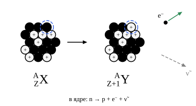

Бета-лучи — это электроны. Но электронов в ядре нет: ядро состоит только из протонов и нейтронов (урок 4.1). Откуда же электрон берётся? Он рождается в момент распада.

## Нейтрон превращается в протон

Свободный нейтрон, вылетевший из ядра, живёт недолго: за ${10}$ минут распадается примерно половина нейтронов. Каждый превращается в протон, электрон и ещё одну частицу — **антинейтрино** ${\tilde{\nu}\text{:}}$

$$
^1_0\text{n} \to {}^1_1\text{p} + {}^{\ \,0}_{-1}e + \tilde{\nu}.
$$

То же самое может случиться с нейтроном внутри ядра, в котором нейтронов «слишком много». Протон остаётся в ядре, а электрон и антинейтрино вылетают. Это **бета-минус-распад**:

$$
^{A}_{Z}\text{X} \to {}^{A}_{Z+1}\text{Y} + {}^{\ \,0}_{-1}e + \tilde{\nu}.
$$

Электрон записывают как ${^{\ \,0}_{-1}e\text{:}}$ нуклонов в нём нет (верхнее число ${0}$), а заряд ${-e}$ (нижнее число ${-1}$). Тогда законы сохранения выполняются, как и при альфа-распаде:

- число нуклонов: ${A = A + 0}$ — массовое число **не меняется**;
- заряд: ${Z = (Z + 1) + (-1)}$ — зарядовое число **растёт на ${1.}$**

Правило смещения для бета-минус-распада: элемент сдвигается на **одну клетку к концу** таблицы Менделеева.

**Пример.** Кобальт-60, который используют в медицине, испытывает бета-минус-распад:

$$
^{60}_{27}\text{Co} \to {}^{60}_{28}\text{Ni} + {}^{\ \,0}_{-1}e + \tilde{\nu}.
$$

Нуклонов по-прежнему ${60,}$ протонов стало ${28}$ — это никель. Нейтронов было ${60 - 27 = 33,}$ стало ${60 - 28 = 32\text{:}}$ один нейтрон стал протоном.

Ещё пример — тритий (урок 4.2): ${^3_1\text{H} \to {}^3_2\text{He} + {}^{\ \,0}_{-1}e + \tilde{\nu}.}$ Водород превращается в гелий-3.

<pp-task id="ks-rad-02"></pp-task>

## Зачем антинейтрино

Сначала физики видели только электрон, и это была загадка. В альфа-распаде все альфа-частицы одного изотопа вылетают с одной энергией, а бета-электроны — с самыми разными, от почти нуля до наибольшего значения. Куда девается остальная энергия? В 1930 году Вольфганг Паули предположил, что её уносит незаметная нейтральная частица. Энрико Ферми назвал её нейтрино, «нейтрончик». У неё нет заряда и почти нет массы, и она почти не взаимодействует с веществом: свободно пролетает сквозь Землю. Поймать её удалось только в 1956 году.

Бывает и **бета-плюс-распад**: протон в ядре превращается в нейтрон, а ядро испускает позитрон — частицу с массой электрона и зарядом ${+e.}$ Тогда $Z$ уменьшается на ${1.}$ В задачах ЕГЭ под бета-распадом обычно имеют в виду бета-минус-распад.

## Гамма-излучение

После альфа- или бета-распада новое ядро часто оказывается **возбуждённым**, с лишней энергией. У ядра, как у атома (урок 3.4), есть определённые уровни энергии. Переходя с более высокого уровня на более низкий, ядро испускает фотон — **гамма-квант** — с энергией, равной разности уровней:

$$
h\nu = E_n - E_m.
$$

Только расстояния между уровнями ядра — сотни тысяч и миллионы электронвольт, а не единицы, как у атома. Поэтому гамма-кванты такие энергичные.

Кобальт-60 после бета-распада даёт возбуждённое ядро никеля-60. Оно спускается в основное состояние за две ступеньки и испускает два гамма-кванта. Эти кванты и используют врачи, когда облучают опухоли.

Гамма-квант не несёт ни нуклонов, ни заряда, поэтому при гамма-излучении **$A$ и $Z$ не меняются**: это то же ядро, только с меньшей энергией.

<pp-task id="ks-rad-11"></pp-task>

Проверь себя: ядро испытало бета-минус-распад, а потом испустило гамма-квант. Как изменились его массовое и зарядовое числа в итоге?

Массовое число не изменилось: ни бета-распад, ни гамма-излучение не меняют число нуклонов. Зарядовое число выросло на 1 — только из-за бета-распада: гамма-квант заряда не уносит.

## Частые ловушки

- **При бета-минус-распаде уменьшают $Z.$** Электрон уносит заряд ${-e,}$ поэтому заряд ядра растёт: ${Z + 1.}$
- **Думают, что электрон был в ядре.** Он рождается, когда нейтрон превращается в протон.
- **Уменьшают массовое число на 1.** Нуклонов не становится меньше: нейтрон просто стал протоном.
- **Считают, что гамма-излучение меняет элемент.** $A$ и $Z$ при нём не меняются.

## Коротко

- Бета-минус-распад: ${^{A}_{Z}\text{X} \to {}^{A}_{Z+1}\text{Y} + {}^{\ \,0}_{-1}e + \tilde{\nu};}$ в ядре нейтрон превращается в протон.
- $A$ не меняется, $Z$ растёт на 1: элемент сдвигается на клетку к концу таблицы.
- Гамма-квант испускает возбуждённое ядро при переходе на более низкий уровень; $A$ и $Z$ не меняются.
