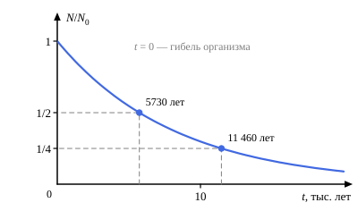

До сих пор время в задачах укладывалось в целое число периодов. А если прошло полтора периода? И что вообще значит «половина ядер распадается» — какие именно? Ответ на второй вопрос объясняет первый.

## Нецелое число периодов

Закон ${N = N_0 \cdot 2^{-t/T}}$ работает при любом ${t,}$ не только кратном периоду. Показатель ${t/T}$ может быть дробным.

**Пример.** Сколько ядер останется через полтора периода полураспада?

$$
\frac{N}{N_0} = 2^{-1{,}5} = \frac{1}{2 \cdot \sqrt{2}} \approx 0{,}35.
$$

Останется около ${35\,\%,}$ распадётся около ${65\,\%.}$

Обрати внимание: «на глаз», разделив пополам промежуток между ${50\,\%}$ (через $T$) и ${25\,\%}$ (через ${2T}$), получилось бы ${37{,}5\,\%.}$ Это неверно. Кривая распада — не ломаная из отрезков: она круче в начале каждого периода и положе в конце. Пока ядер больше, за одно и то же время их распадается больше. Поэтому для нецелого числа периодов считай только по формуле, с калькулятором.

## Закон случая

Посмотри на одно ядро радона-222. Когда оно распадётся? Этого не знает никто: может быть, через секунду, а может, через месяц. Можно сказать только, с какой **вероятностью** оно распадётся за данное время:

- вероятность дожить до ${T}$ — ${1/2;}$
- вероятность дожить до ${2T}$ — ${1/4,}$ и так далее.

И ещё одно удивительное свойство: ядро **не стареет**. Ядро, которое уже прожило миллион лет, распадётся в ближайший период с той же вероятностью ${1/2,}$ что и только что родившееся. В нём нет «часов», которые отсчитывают срок.

Почему же тогда закон распада такой точный? Потому что ядер очень много. Монетка падает орлом или решкой случайно, но из миллиона бросков орлов будет почти точно половина. В крупинке вещества ядер — миллиарды миллиардов, и доля распавшихся совпадает с законом с огромной точностью. А для десятка ядер закон выполняется лишь примерно.

## Модель

Здесь всего двадцать ядер. Запусти несколько новых опытов: ступеньки каждый раз другие и заметно отходят от пунктира. Потом поставь ${1000}$ ядер — ступеньки почти легли на кривую.

<pp-decay n0="20" half="5">Модель радиоактивного распада с небольшим числом ядер: сетка ядер, нераспавшиеся закрашены, распавшиеся — пустые кружки. Внизу график числа нераспавшихся ядер: ступеньки — опыт, пунктир — закон N₀·2^(−t/T). Ползунки задают период полураспада, начальное число ядер и момент времени; кнопка «Новый опыт» запускает распад других ядер.</pp-decay>

<pp-task id="ks-rad-06"></pp-task>

## Радиоуглеродный метод

Как узнать возраст деревянной ладьи, кости или ткани из древнего захоронения? Помогает радиоактивный углерод-14, ${T = 5730}$ лет.

В верхних слоях атмосферы космические лучи всё время превращают азот-14 в углерод-14 — это ядерная реакция, о них следующая тема. Углерод-14 распадается, но и рождается заново, поэтому его доля в воздухе почти постоянна: примерно один атом на триллион атомов обычного углерода. С углекислым газом он попадает в растения, а через них — в животных и людей. Пока организм жив, он обменивается углеродом со средой, и доля углерода-14 в нём такая же, как в воздухе.

Когда организм погибает, обмен прекращается. Новый углерод-14 больше не поступает, а старый распадается по закону ${N = N_0 \cdot 2^{-t/T}.}$ Измерив, во сколько раз углерода-14 на грамм углерода меньше, чем в живом, находят, сколько прошло времени.

**Пример.** В кости углерода-14 в ${2}$ раза меньше, чем в живой: прошёл один период, около ${5730}$ лет. Если в ${4}$ раза меньше, то ${4 = 2^2}$ — два периода, ${11\,460}$ лет.

Метод придумал американский химик Уиллард Либби в 1949 году и получил за него Нобелевскую премию. Он работает примерно до ${50\,000}$ лет: дальше углерода-14 остаётся так мало, что его не измерить. Возраст горных пород и Земли определяют так же, но по долгоживущим изотопам — урану-238 и калию-40.

<pp-task id="ks-rad-14"></pp-task>

Проверь себя: в образце было 4 ядра радона-222. Через 3,8 суток в нём обязательно останется 2 ядра?

Нет. Каждое ядро распадается случайно, с вероятностью ${1/2}$ за период. Может остаться и 2 ядра, и 3, и ни одного — 2 лишь вероятнее всего. Закон распада говорит о среднем, и точно он выполняется только для огромного числа ядер.

## Частые ловушки

- **Делят время пропорционально.** Закон не линейный: для нецелого числа периодов считай по формуле ${2^{-t/T}.}$
- **Думают, что старое ядро распадётся скорее.** Ядро не стареет: вероятность распада за период всегда ${1/2.}$
- **Применяют закон к нескольким ядрам как точный.** Для малого числа ядер он даёт лишь среднее.
- **Считают, что в живом организме углерод-14 убывает.** Пока организм жив, его доля постоянна; отсчёт идёт с момента гибели.

## Коротко

- ${N = N_0 \cdot 2^{-t/T}}$ работает при любом $t;$ в начале периода распадается больше, чем в конце.
- Закон статистический: для одного ядра — только вероятность, для огромного числа ядер — точный закон.
- Радиоуглеродный метод: по доле углерода-14, у которого ${T = 5730}$ лет, находят время, прошедшее с гибели организма, — примерно до ${50\,000}$ лет.

Это последний урок темы. Дальше — тема «Ядерные реакции»: как ядра превращаются не сами по себе, а при столкновениях с частицами и друг с другом, как делится уран и почему светит Солнце.
